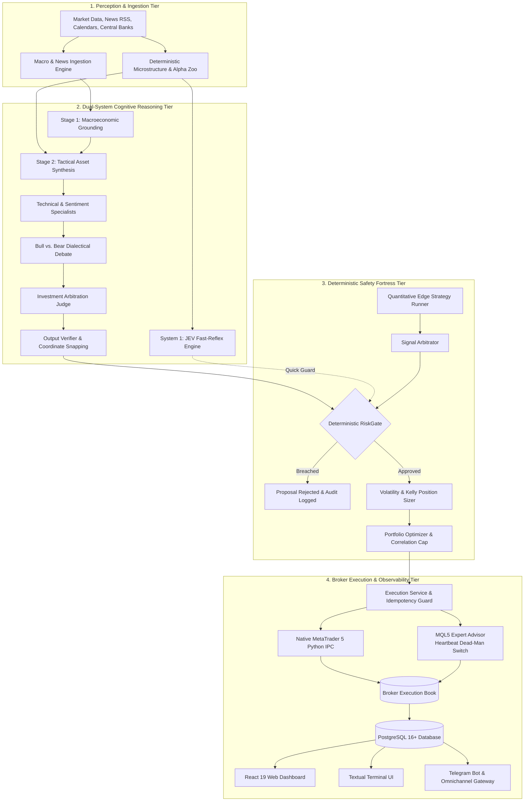

# Project Requirements Document (PRD): Monika

**Document Version:** 1.0.0
**Project Status:** Active Quantitative Research & Production Development
**Primary System Role:** Domain-Specific Trading Agent Harness & Multi-Agent Execution Framework for MetaTrader 5 (MT5)
**Execution Runtime:** MetaTrader 5 (Windows Native IPC & Linux Wine/Docker RPC Bridge)
**Database Backend:** PostgreSQL 16+ (Asyncpg + SQLAlchemy 2.0 + Alembic Migrations)
**Cognitive Architecture:** Dual-System Cognitive Engine (System 1 JEV Fast-Reflex + System 2 LangGraph StateGraph Synthesis)
**Author & Maintainer:** Saiful Akbar & Contributors

---

## 1. Executive Summary & Vision

### 1.1 What is Monika?
**Monika** is an institutional-grade, domain-specific **Trading Agent Harness** and multi-agent execution framework designed for quantitative financial research, algorithmic market analysis, and automated trade execution on **MetaTrader 5 (MT5)**.

Rather than relying on naive single-prompt LLM execution or rigid, static indicator-based Expert Advisors, Monika implements a decoupled, multi-stage architecture:
1. **Perception & Macro Ingestion:** Automated scraping and structured parsing of macroeconomic calendars, central bank communications (Federal Reserve, ECB, BOJ, BOE, Bank Indonesia), breaking news feeds, and sentiment matrices.
2. **Deterministic Microstructure & Alpha Zoo:** Exact mathematical computation of Classical Indicators, Smart Money Concepts (SMC), Liquidity Sweeps, Order Blocks, Fair Value Gaps (FVG), Extreme Value Theory (EVT) tail risk, and over 463 quantitative factor formulas (WorldQuant 101, Qlib 158, Academic & Microstructure alphas), supplemented by optional Google TimesFM 3.0 deep forecasting.
3. **Dual-System Reasoning Architecture:**
   - **System 1 (JEV Fast-Reflex):** Sub-second rule-based reflex filters, session timing gates, realtime news escalations, and position safety guards.
   - **System 2 (Cognitive Synthesis):** Multi-agent dialectical adversarial debates (Bull vs. Bear specialists) adjudicated by an impartial Investment Judge on a stateful LangGraph StateGraph.
4. **Mechanical Capital Fortress (`RiskGate`):** An unbypassable mathematical validation layer enforcing 10 non-negotiable risk checks, position sizing (Kelly / Volatility Parity), slippage budgets, and emergency circuit breakers.
5. **Resilient Execution & Dead-Man's Switch:** Dual-layer broker bridge pairing native Python IPC with a compiled MQL5 Expert Advisor (`AIAgent_EA.mq5`) monitoring independent heartbeat pulses to guarantee emergency position protection in the event of Python runtime failure.
6. **Continuous Learning & Model Benchmarking:** Closed-loop crystallization of winning strategies into executable playbooks, accompanied by the **Alpha Arena** tournament engine and multi-layer benchmark harness.

### 1.2 The Core Concept: Why an "Agent Harness"?
In advanced artificial intelligence engineering, an **Agent Harness** is the specialized runtime substrate that equips, constrains, isolates, and monitors an autonomous agent.

Large Language Models (LLMs) are probabilistic, non-deterministic, and prone to hallucinations. In financial markets, granting an unconstrained LLM direct access to broker order sockets is unacceptable. Monika provides the harness:
- **Perception Harness:** Pre-fetches, cleans, deduplicates, and structures live market quotes, economic calendars, and news feeds before the LLM ever inspects them.
- **Cognitive Harness:** Orchestrates multi-agent discourse through deterministic state machines, enforcing distinct personas (Macro Analyst, Technical Specialist, Bull Debater, Bear Debater, Investment Judge).
- **Safety Fortress Harness:** Enforces immutable mathematical boundaries (hard daily drawdown ceilings, volatility-adjusted position sizing, news event blackout windows, and circuit breakers). The AI can only *propose* a trade hypothesis; only the mechanical backend can *dispose* and execute it.
- **Security & Sandbox Harness:** Sandboxes tool executions with SSRF protection, prevents prompt injection, secures host credentials, and snapshots environment variables.
- **Evaluation Harness:** Provides zero-lookahead backtesting, Walk-Forward Optimization (WFO), Deflated Sharpe Ratio (DSR) analysis, and multi-model benchmark evaluation (Alpha Arena).

---

## 2. Core Architectural Principles

Monika is engineered around five immutable pillars:

```
┌─────────────────────────────────────────────────────────────────────────────┐
│                          MONIKA CORE PHILOSOPHY                             │
├─────────────────────────────────────────────────────────────────────────────┤
│  1. "AI Proposes, Mechanical Fortress Disposes" (Fail-Closed Architecture)  │
│  2. Strict Separation of Concerns (Cognitive Reasoning vs. Exact Math)      │
│  3. Capital Preservation as the Primary Directive (Survival > Profit)       │
│  4. Comprehensive Auditability & Persistent Memory (Every Token & Ticket)   │
│  5. Dual-System Cognition (System 1 Reflexes + System 2 Dialectical Debate) │
└─────────────────────────────────────────────────────────────────────────────┘
```

1. **"AI Proposes, Mechanical Fortress Disposes"**: AI agents produce structured proposals (`SubmitAssetAnalysisSchema`), never direct broker orders. Every proposal must pass mathematical validation through `RiskGate` before reaching the broker execution bridge.
2. **Separation of Concerns**: Indicators (ATR, RSI, Moving Averages), structural zones (Fair Value Gaps, Swing Pivots), and position lot sizes are computed strictly by deterministic Python modules. The LLM is never permitted to calculate lot sizes or pip measurements mentally.
3. **Capital Preservation Above All**: Protecting trading capital takes precedence over generating alpha. If market conditions are ambiguous, volatile, or anomalous, the correct and praised action is `WAIT` or `NO TRADE`.
4. **Comprehensive Auditability**: Every prompt payload, tool execution, token expenditure, debate argument, judicial verdict, and broker order ticket is permanently logged into PostgreSQL.
5. **Dual-System Cognition**: High-frequency reflexive responses (fast news reaction, hard session cutoffs) are handled by System 1 (JEV), freeing System 2 (LangGraph) for deliberate, multi-turn macroeconomic and technical synthesis.

---

## 3. End-to-End System Architecture



---

## 4. Functional Requirements (FR)

### FR-1: Macroeconomic Grounding, News Ingestion & Central Bank Intelligence
- **FR-1.1 (Macro Calendar Monitoring):** Programmatic ingestion of global economic releases (CPI, PPI, NFP, Unemployment, GDP, Retail Sales, Rate Decisions).
- **FR-1.2 (Active Event Poller):** Increases polling frequency around tier-1 events to capture actual reported metrics within seconds of public release.
- **FR-1.3 (Post-Release Settlement Filter):** Enforces a configurable settlement blackout window ($\pm 15$ minutes) around high-impact announcements to avoid erratic broker spreads and slippage. Evaluates *economic surprise* (`actual` vs `forecast`) upon settlement.
- **FR-1.4 (Central Bank Intelligence):** Dedicated scrapers and parsers for monetary policy statements, speeches, and minutes from the Federal Reserve, ECB, BOJ, BOE, and Bank Indonesia (`bank_indonesia.py`, `central_bank_doc_scraper.py`).
- **FR-1.5 (Thematic News Clustering & Sentiment):** Deduplicates and clusters headlines from Kitco, Bloomberg, Reuters, FXStreet, and TradingView, computing entity-level sentiment and macro threat indexes.

### FR-2: Microstructure, Quantitative Indicators & Alpha Zoo
- **FR-2.1 (Classical Quantitative Indicators):** Deterministic computation of EMAs, SMAs, RSI (14), Wilder's ATR (14), Bollinger Bands, and Average Daily Range (ADR).
- **FR-2.2 (Smart Money Concepts / SMC):**
  - Swing Highs and Swing Lows (Fractal pivots).
  - Break of Structure (BOS) and Change of Character (CHoCH).
  - Fair Value Gaps (FVG) tracked by mitigation state (unfilled, partially filled, mitigated).
  - Liquidity Pools (buy-side and sell-side liquidity clusters and sweeps).
- **FR-2.3 (Alpha Zoo & Formula Factor Engine):**
  - **WorldQuant 101:** Full implementation of WorldQuant's 101 quantitative alpha formulas (`wq_alpha_001.py` through `wq_alpha_101.py`).
  - **Qlib 158:** High-capacity feature library comprising 158 normalized financial factors.
  - **Microstructure & Academic Factors:** Cointegration testing, Copula tail risk estimation, and Extreme Value Theory (EVT) calculations.
- **FR-2.4 (Deep Volatility Forecasting):** Optional integration with **Google TimesFM 3.0** generating forward-looking quantile volatility bounds ($q_{0.1}$ to $q_{0.9}$) for intraday boundary guidance.

### FR-3: Multi-Agent Adversarial Debate & Cognitive Synthesis
- **FR-3.1 (Stateful Graph Workflow):** Governed by LangGraph StateGraph connecting prefetch, macro grounding, tactical screening, specialist debate, risk gating, and execution nodes.
- **FR-3.2 (Adversarial Bull & Bear Specialists):** Candidate setups passing initial filters are debated across structured rounds by adversarial personas identifying structural flaws, liquidity traps, and counter-trend risks.
- **FR-3.3 (Judicial Arbitration & Confidence Scoring):** An impartial `InvestmentJudge` evaluates debate transcripts against empirical price structure, emitting a calibrated confidence score ($0.0$ to $1.0$). Projections below configured thresholds (e.g., $0.70$) are discarded.
- **FR-3.4 (Deterministic Coordinate Snapping):** The `OutputVerifier` automatically snaps LLM-proposed price coordinates to exact, verified swing pivots, order blocks, or FVG boundaries, rejecting proposals violating geometric invariants (e.g., stop loss on wrong side of entry).
- **FR-3.5 (Signal Arbitration Governance):** The `SignalArbitrator` may only let a quantitative signal override an LLM stance (WAIT, AVOID, or the opposite direction) with TimesFM directional confirmation ($|skew| \geq 0.20$ in the trade direction). Without confirmation, the LLM stance is preserved or the conflict is avoided. Strategy promotion is decided exclusively by the strategy evidence store; incubation is granted only after real paper-trade results.

### FR-4: Deterministic Capital Protection (RiskGate) & Portfolio Optimization
- **FR-4.1 (Mandatory 10-Point Risk Clearance):**
  1. System operational status (active / pause).
  2. Positive lot sizing and broker minimum volume verification.
  3. Daily realized and unrealized drawdown ceilings (default maximum 4.0%; weekly 15.0%).
  4. Maximum concurrent open positions ceiling (default maximum 5).
  5. Duplicate asset and direction exposure block.
  6. High-impact news event proximity filter ($\pm 15$ minutes blackout).
  7. Cross-asset portfolio correlation cap (prevents concentrated directional exposure).
  8. Maximum spread threshold filter (blocks execution during broker spread expansion).
  9. Minimum Risk-to-Reward ratio verification (default minimum $1:1.5$ or $1:2.0$). Quantitative (non-LLM) proposals must additionally carry an explicit, valid `quant_scorecard`; the evidence gate fails closed when the strategy evidence store or the originating analysis is unavailable.
  10. Weekend gap risk quarantine (halts new trades late Friday UTC).
- **FR-4.2 (Position Sizing & Portfolio Optimization):** Volatility parity, fractional Kelly criterion sizing, and risk parity portfolio allocation (`portfolio_optimizer.py`).
- **FR-4.3 (Circuit Breakers & Flash Crash Protection):** Automatic trading freeze and defensive stop trailing upon detecting abnormal price dislocation ($>5\times$ ATR within 30 seconds) or drawdown breach.
- **FR-4.4 (Pending Action & Crypto Audit Ledger):** Persistent ledger tracking pending broker requests (`pending_action.py`) and cryptographic audit records (`crypto_audit_ledger.py`).

### FR-5: MetaTrader 5 Broker Connectivity & Execution
- **FR-5.1 (Native IPC & Containerized Wine Bridge):** High-speed Python IPC on Windows hosts; Docker/Wine RPC bridge for Linux VPS deployments.
- **FR-5.2 (MQL5 EA Dead-Man's Switch):** Independent Expert Advisor (`AIAgent_EA.mq5`) monitoring `heartbeat.txt`. Automatically protects open capital if the Python daemon hangs or disconnects for $>120$ seconds.
- **FR-5.3 (Paper Trading Graduation Protocol):** Default strict paper trading (`paper_trading.enabled: true`). Switching to live money requires at least 50 validated paper trades with win rate $\ge 55\%$.
- **FR-5.4 (Order Idempotency & Reconciliation):** Cryptographic idempotency keys prevent duplicate order dispatches; periodic reconciliation audits local state against live broker records.

### FR-6: Agent Harness, Plugin Engine & Security Fence
- **FR-6.1 (Universal Plugin Contract):** Standardized interfaces (`TradingPlugin`, `PluginContext`, `PluginMetadata`) across analysis, brokers, indicators, and risk models.
- **FR-6.2 (Topological Dependency Lifecycle):** Kahn's topological sort initializes and tears down plugins in deterministic sequence.
- **FR-6.3 (Security Fence):**
  - **SSRF Guard:** Restricts tool and scraper access to private or local network ranges (`127.0.0.1`, `10.0.0.0/8`, `192.168.0.0/16`).
  - **Terminal Guard & Prompt Injection Scanner:** Inspects inputs and shell commands to prevent prompt injection and unauthorized command execution.
  - **Credential Vault:** Encrypts and redacts secrets from logs, transcripts, and model prompts.

### FR-7: Omnichannel Gateway & Remote Supervision
- **FR-7.1 (Supervision Bot & Voice Safety Gate):** Telegram bot supporting operator commands (`/status`, `/positions`, `/brief`, `/risk`, `/pause`, `/resume`, `/kill`) with voice note processing (Whisper speech-to-text) protected by `VoiceSafetyGate`.
- **FR-7.2 (Multi-Platform Adapters):** Extensible adapters for Discord (`discord_notifier.py`), Slack, and Webhooks with rate limiting and turn-lease concurrency management.

### FR-8: Memory, Continuous Learning & Crystallized Skills
- **FR-8.1 (Layered Memory Architecture):**
  - *Layer 0 (Soul):* Immutable core risk identity and operational bounds.
  - *Layer 1 (Macro Reality):* Validated central bank and macroeconomic baseline.
  - *Layer 2 (Chronicle):* Ongoing log of weekly market regimes and narratives.
  - *Layer 3 (Episodic Reflection):* Post-trade reflections evaluating thesis vs. reality.
- **FR-8.2 (Skill Crystallization Engine):** Autonomously transforms repeatedly successful trading strategies into permanent markdown skills (`continuous_learning.py`, `skills/crystallized/`).

### FR-9: System 1 (JEV) Fast-Reflex Architecture
- **FR-9.1 (Sub-Second Reflex Trigger):** Fast-path evaluation pipeline executing rule-based triggers without invoking multi-turn LLM debates.
- **FR-9.2 (Session Timing & Confluence Gates):** Validates killzones (London Open, New York Open, Asian session) and confluence filters.
- **FR-9.3 (Real-Time Position Guard):** Monitors active floating positions against sudden liquidity grabs, triggering emergency trailing stops or partial exits.

### FR-10: Research, Alpha Arena & Multi-Layer Benchmark Harness
- **FR-10.1 (Point-in-Time Backtest Engine):** Zero-lookahead historical bar stepping with execution friction modeling and Walk-Forward Optimization (WFO).
- **FR-10.2 (Alpha Arena Head-to-Head Tournament):** Automated Elo rating tournament (`alpha_arena.py`) evaluating competing LLM models across standardized financial cases.
- **FR-10.3 (Golden Scenario Fixture Matrix):** Curated library of 65 historical market events (macro surprises, news escalations, liquidity traps, debt crises) for deterministic model evaluation.
- **FR-10.4 (Token Drift & Cost Tracking):** Measures reasoning degradation, schema compliance, prompt cache hit rates (calculated as normalized `cache_read_tokens / total_input_tokens` without denominator double-counting), and input/output cost deltas per model.

### FR-11: Observability, User Interfaces & Executive Reporting
- **FR-11.1 (React 19 Web Dashboard):** Real-time telemetry, portfolio equity curves, open positions, factor heatmaps, and LangGraph DAG execution trees.
- **FR-11.2 (Textual Terminal UI - TUI):** Lightweight console dashboard for remote server and SSH operation.
- **FR-11.3 (Automated Report Generators):** Generates executive multi-format reporting: DOCX audit reports (`docx_report_generator.py`), PowerPoint presentation decks (`pptx_deck_generator.py`), and formatted PDF summaries (`pdf_report_generator.py`).

---

## 5. Non-Functional Requirements (NFR)

### NFR-1: Reliability & Fault Tolerance
- **Fail-Closed Default:** Unhandled exceptions or data dropouts immediately abort evaluation to a `NO TRADE` state.
- **Process Supervision:** Daemon wrapped in auto-restart loops with exponential backoff and single-instance PID locking (`trading_agent.pid`).

### NFR-2: Security & Credential Hygiene
- **Zero Exposure of Secrets:** `.env` and credential files must never be read, parsed, or printed by LLMs or committed to source control.
- **Bootstrap Environment Snapshot:** Host-level variables (`PATH`, `PYTHONPATH`) snapshotted at startup to prevent environment hijacking.

### NFR-3: Concurrency & Transactional Integrity
- **PostgreSQL Advisory Locks:** Critical order modifications and balance audits use transactional advisory locks.
- **Partial Unique Indexes:** Database schema strictly prevents duplicate active trades for identical signals.

### NFR-4: Token Economics & Caching
- **Prompt Caching Optimization:** Static system instructions engineered for provider KV caching ($>70\%$ target hit rate).
- **Dynamic Model Routing:** Lighter models handle high-volume filtering, reserving high-reasoning models for debate arbitration.
- **Multi-Horizon AI Budget Governor & Circuit Breaker ($3.00/Day, $18.00/Week, $60.00/Month):**
  - **Multi-Horizon Spend Ceilings:** Strict budget caps configured via `cost_tracking.daily_budget_usd` ($3.00/day default), `cost_tracking.weekly_budget_usd` ($18.00/week default), and `cost_tracking.monthly_budget_usd` ($60.00/month default).
  - **90% Soft Guard ($2.70/day, $16.20/week):** When daily or weekly spend reaches 90% of its respective ceiling, `NewsWatcher` throttles targeted Stage 2 re-analysis for idle assets (symbols with NO active open positions), preserving remaining quota for scheduled cycle updates and active trade management.
  - **100% Hard Circuit Breakers:** When daily, weekly, or monthly spend reaches 100% (or 95% for monthly MTD), `CostTracker` trips `budget_pause = "true"` via `SystemConfig`, suppressing all news-triggered re-analyses and new cycle entries until acknowledged or reset.
  - **Fail-Safe Zero-Compromise on Capital Protection (§1):** Mechanical capital protection paths — including deterministic `RiskGate`, `PositionGuardian` emergency stop-loss tightening / trailing stops, emergency kill-switch (`POST /api/v1/kill`), and MT5 EA watchdog (`AIAgent_EA.mq5`) — are deterministic, non-LLM paths and are NEVER paused, throttled, or compromised by AI budget state.

### NFR-5: Portability & Cross-Platform Operation
- **Primary Windows Execution:** Native MT5 execution on Windows 10/11 or Windows Server.
- **Linux Headless Support:** Supported via Docker/Wine RPC bridge (`deploy/Dockerfile.mt5-wine`).

---

## 6. Data Schema & Persistence Model

Managed via **PostgreSQL 16+** using async SQLAlchemy 2.0 and tracked through 9 Alembic migrations (`0001` through `0008` and schema sync `c83c5e451412` across 74 mapped tables).

### Database Entity Architecture
```
┌─────────────────────────────────────────────────────────────────────────────┐
│                           CORE POSTGRESQL TABLES                            │
├───────────────────────┬─────────────────────────────────────────────────────┤
│ positions             │ Active and historical broker execution tickets.     │
│ trade_signals         │ Evaluated trading signals and arbitration outcomes. │
│ paper_trade_records   │ Simulated trade executions and graduation metrics.  │
│ risk_state            │ Daily drawdown meters, circuit breaker status.      │
│ fundamental_briefs    │ Stored Stage 1 macroeconomic regime evaluations.    │
│ debate_transcripts    │ Multi-round Bull/Bear debate arguments and verdicts.│
│ news_articles         │ Scraped news articles, source URLs, and timestamps. │
│ economic_events       │ Calendar releases, forecasts, and reported values.  │
│ decision_reflections  │ Post-trade reflections and empirical lessons.       │
│ token_usage_logs      │ Granular token and cache cost tracking per model.   │
│ activity_logs         │ Structured operational logs and diagnostic events.  │
│ user_preferences      │ Dynamic user configurations and trading parameters. │
│ trading_journal       │ Operator notes, subjective annotations, and reviews.│
│ llm_benchmark_run     │ Benchmark execution sessions, models, and metadata. │
│ llm_benchmark_result  │ Case-by-case benchmark scores, latency, and costs.  │
└───────────────────────┴─────────────────────────────────────────────────────┘
```
