# Monika — Multi-Agent Trading Research Framework for MetaTrader 5

<p align="center">
  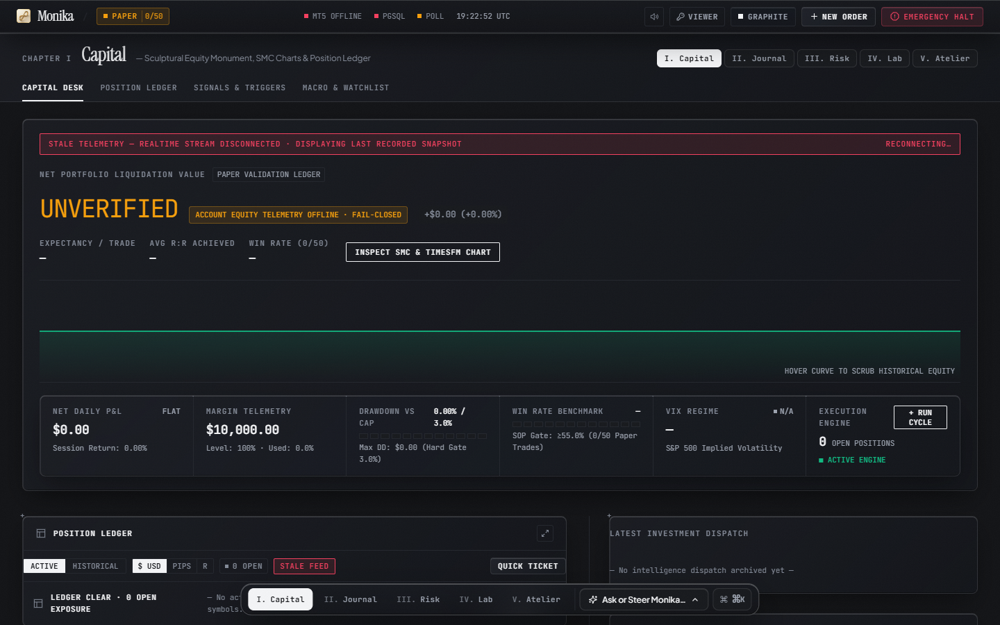
</p>

<p align="center">
  <strong>An open-source research framework exploring LLM-assisted market analysis with deterministic, code-enforced risk management in MetaTrader 5.</strong><br />
  <em>Integrates macroeconomic news ingestion, market structure indicators, bull/bear debate prompts, and hard mathematical risk gates.</em>
</p>

<p align="center">
  <a href="https://github.com/alakbarr/Monika/actions/workflows/ci.yml"></a>
  <a href="https://www.python.org/"></a>
  <a href="https://langchain-ai.github.io/langgraph/"></a>
  <a href="https://fastapi.tiangolo.com"></a>
  <a href="https://react.dev/"></a>
  <a href="https://www.postgresql.org"></a>
  <a href="https://www.metatrader5.com"></a>
  <a href="LICENSE"></a>
  <a href="https://github.com/astral-sh/ruff"></a>
</p>

---

## Project Status and Reality Check

> [!WARNING]
> **This is an experimental personal research project, not a turnkey commercial trading system, and not an automated profit generator.**
>
> - **Trading risks:** Financial trading involves substantial risk of loss. Adding language models to an algorithmic pipeline does not eliminate market risk.
> - **Model limitations:** Large language models are probabilistic. They make calculation errors, hallucinate price levels, and suffer from confirmation bias. They must never have direct, unconstrained access to broker order execution.
> - **Active development:** This codebase is an ongoing engineering exploration. Expect breaking changes, architectural refactoring, and edge-case bugs.
> - **Demo accounts only:** Always run this framework on paper-trading or demo accounts. Never deploy live capital without thoroughly auditing the code and risk models.

The goal of this project is to explore a strict separation of concerns: **the language model acts solely as a qualitative research assistant to draft hypotheses, while deterministic Python code performs all mathematics, indicator computations, lot sizing, and risk validation.**

---

## Table of Contents

- [1. Overview](#1-overview)
  - [Comparison of Approaches](#comparison-of-approaches)
  - [The Core Architecture: AI Proposes, Code Disposes](#the-core-architecture-ai-proposes-code-disposes)
  - [Design Principles](#design-principles)
- [2. Intended Audience](#2-intended-audience)
- [3. Core System Components](#3-core-system-components)
  - [Macroeconomic and News Ingestion](#macroeconomic-and-news-ingestion)
  - [Market Structure and Technical Indicators](#market-structure-and-technical-indicators)
  - [Bull vs. Bear Adversarial Debate](#bull-vs-bear-adversarial-debate)
  - [Pre-Trade Risk Controls (RiskGate)](#pre-trade-risk-controls-riskgate)
  - [Rule-Based Strategies and Signal Arbitration](#rule-based-strategies-and-signal-arbitration)
  - [MetaTrader 5 Interface and Watchdog EA](#metatrader-5-interface-and-watchdog-ea)
  - [Persistence and Post-Trade Review](#persistence-and-post-trade-review)
- [4. User Interfaces & Observability](#4-user-interfaces--observability)
  - [Web Dashboard (React 19 + Vite)](#web-dashboard-react-19--vite)
  - [Terminal User Interface (TUI)](#terminal-user-interface-tui)
- [5. System Architecture & Workflows](#5-system-architecture--workflows)
  - [End-to-End Pipeline](#end-to-end-pipeline)
  - [Background Task Schedulers](#background-task-schedulers)
- [6. Supported Assets & Model Configuration](#6-supported-assets--model-configuration)
  - [Supported Instruments](#supported-instruments)
  - [Model Routing Configuration](#model-routing-configuration)
- [7. Installation & Quickstart](#7-installation--quickstart)
  - [Prerequisites](#prerequisites)
  - [Step-by-Step Setup](#step-by-step-setup)
  - [Database Initialization](#database-initialization)
  - [Environment Variables (.env)](#environment-variables-env)
  - [Pre-Flight Diagnostic Check](#pre-flight-diagnostic-check)
  - [Starting the Application](#starting-the-application)
- [8. CLI & Telegram Reference](#8-cli--telegram-reference)
  - [Command-Line Interface](#command-line-interface)
  - [Telegram Bot Commands](#telegram-bot-commands)
- [9. Testing & Backtesting](#9-testing--backtesting)
  - [Running the Test Suite](#running-the-test-suite)
  - [Offline Backtesting](#offline-backtesting)
  - [Model Benchmarks](#model-benchmarks)
- [10. Frequently Asked Questions](#10-frequently-asked-questions)
- [11. Repository Structure](#11-repository-structure)
- [12. Contributing](#12-contributing)
- [13. Disclaimer](#13-disclaimer)

---

## 1. Overview

Monika is an experimental harness built to test whether generative language models can assist with market intelligence and pattern analysis without risking unconstrained execution errors.

### Comparison of Approaches

| Dimension | Traditional Expert Advisors | Direct LLM Trading Bots | Monika Approach |
| :--- | :--- | :--- | :--- |
| **Macro & News Context** | Blind to calendar events and policy speeches | Able to read text, but lacks reliable market grounding | Synthesizes macro feeds and calendars into structured briefs |
| **Math & Sizing** | Exact floating-point calculations | Frequent hallucinations and arithmetic errors | Plain Python computes all ATR sizing, lot bounds, and pips |
| **Analytical Bias** | Rigid static thresholds during market shifts | High confirmation bias; agrees with prompts | Adversarial Bull/Bear debate challenges trade ideas |
| **Execution Authority** | Direct order placement | Direct API calls with no safety boundaries | Strict deterministic code filters (RiskGate) must pass |
| **Safety Mechanisms** | Basic stop loss only | None built-in | Drawdown ceilings, spread limits, news blackout windows |

### The Core Architecture: AI Proposes, Code Disposes

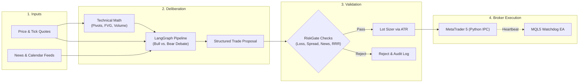

### Design Principles

1. **Fail-Closed Execution:** Any unhandled exception, missing data source, API timeout, or ambiguous signal defaults to `WAIT` or `NO TRADE`. Capital preservation strictly overrides trade frequency.
2. **Clear Division of Responsibilities:** LLMs handle qualitative synthesis and adversarial critique; deterministic Python modules handle floating-point arithmetic, indicator values, and risk gates.
3. **Patience as a Priority:** The system favors waiting in cash when spreads widen, high-impact news approaches, or setups lack clear structure.
4. **Complete Traceability:** Every prompt payload, debate argument, judicial confidence score, and broker ticket is recorded in PostgreSQL.
5. **Independent Watchdog:** A companion MQL5 script (`AIAgent_EA.mq5`) monitors a heartbeat file written by Python. If the Python process terminates unexpectedly, the EA can safeguard open positions.

---

## 2. Intended Audience

| Target Audience | Description | Suitability |
| :--- | :--- | :--- |
| **Developers & Quantitative Hobbyists** | Exploring how to build and orchestrate multi-agent workflows using LangGraph and Python. | Recommended |
| **Systematic Traders** | Testing ways to integrate qualitative news summaries with deterministic indicators and risk gates. | Recommended |
| **AI & NLP Researchers** | Experimenting with structured output schemas, multi-agent adversarial debate, and prompt caching. | Recommended |
| **Users Seeking Guaranteed Income** | Looking for turnkey profitability, automated signal services, or passive income bots. | Unsuitable |
| **High-Frequency Scalpers** | Requiring sub-second execution speeds (LLM inference cycles take multiple seconds). | Unsuitable |
| **Complete Beginners** | Unfamiliar with Python 3.14, PostgreSQL configuration, or MetaTrader 5 demo accounts. | Unsuitable |

---

## 3. Core System Components

### Macroeconomic and News Ingestion
- **Economic Calendar:** Continuously monitors scheduled releases (CPI, Non-Farm Payrolls, FOMC, GDP) and enforces blackout windows around high-impact events.
- **Yield Curves & Macro Data:** Ingests US Treasury yield data and macroeconomic indices via the FRED API.
- **News Clustering:** Aggregates headlines from financial feeds and filters them into currency-specific summaries.

### Market Structure, Quantitative Indicators & High-Performance Compute
- **Native Rust C-ABI Accelerator (`monika_core_rs`):**
  - High-performance compiled shared library (`monika_core_rs.dll` / `.so` / `.dylib`) with automated SHA-256 shadow-copy loading on Windows to prevent runtime file locks.
  - Native C-ABI kernels: SMC fractal pivot detection (`find_swings_f64`, `find_swing_pivots_f64`), Microstructure VPIN informed trading toxicity (`vpin_fractional_f64`), Kyle's Lambda rolling OLS price impact (`kyle_lambda_ols_f64`), Lee-Ready Tick-Rule CVD (`tick_rule_cvd_f64`), Monte Carlo equity simulation (`eval_equity_paths_f64`, `monte_carlo_simulate_f64`), CSCV probability of backtest overfitting (`cscv_pbo_from_chunks_f64`), and 14 vectorized classic indicators (EMA, SMA, RSI, ATR, Bollinger, Donchian, Supertrend, etc.).
  - Guaranteed 100% mathematical parity with vectorized NumPy fallback if the native library is disabled (`MONIKA_DISABLE_RUST_ACCEL=1`).
- **Polars Columnar Pipeline (`core/dataframe/polars_bridge.py`):**
  - Apache Arrow columnar memory for zero-copy transforms and rapid multi-asset matrix alignment.
  - Zero-lookahead historical bar stepping with strict point-in-time cursors.
- **Smart Money Concepts (SMC) & Microstructure:**
  - Break of Structure (BOS) and Change of Character (CHoCH).
  - Fair Value Gaps (FVG) and Order Blocks categorized by mitigation state (unfilled, partially filled, mitigated) with candle delta-checking to avoid redundant calculations.
  - Buy-side and sell-side liquidity pools and sweep verification.
  - Over 463 quantitative factor formulas across WorldQuant 101, Qlib 158, Academic, and Microstructure factor libraries.
  - Optional Google TimesFM 3.0 deep forecasting for forward-looking quantile volatility bands.

### Bull vs. Bear Adversarial Debate
Rather than querying a single prompt, Monika coordinates a multi-agent debate within a LangGraph state machine:

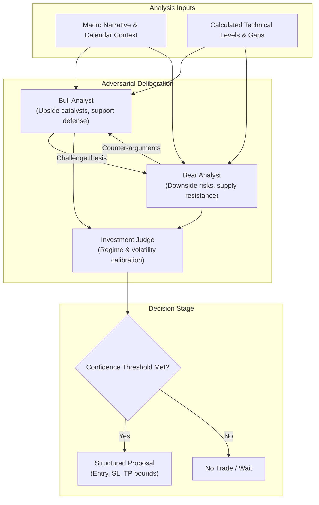

- **Bull Analyst:** Identifies long catalysts, demand zones, and order absorption.
- **Bear Analyst:** Highlights supply barriers, unmitigated gaps, and macro headwinds.
- **Investment Judge:** Weighs arguments against current market regime metrics and assigns a confidence score.
- **Coordinate Snapping:** Automatically snaps proposed price levels to validated swing levels or gap boundaries.

### Pre-Trade Risk Controls (`RiskGate`)
Every trade proposal must clear an immutable battery of **over 30 deterministic risk checks** across four modular dimensions before reaching MetaTrader 5:

1. **System & Safety State:**
   - *Emergency Disk Kill Switch:* Immediate fail-closed rejection if `data/kill_switch.flag` is present.
   - *Live Capital Protection:* Fails closed if live account equity is zero, negative, or unavailable.
   - *Operational Status:* Verifies the system is not globally paused (`trading_not_paused`).
   - *Quantitative Edge Status:* Verifies the rule runner is not in pause status (`edge_status_not_paused`).
   - *Daily Trade Count Ceiling:* Caps max executions per calendar day (`max_daily_trades`).
2. **Execution & Lot Math Bounds:**
   - *Sizing Validity:* Rejects proposals violating price geometry (e.g. SL on wrong side of entry, zero/negative stop distance).
   - *Broker Lot Constraints:* Enforces symbol min, max, and volume step bounds, always rounding volume **down**.
   - *Minimum Risk-to-Reward Ratio (RRR):* Enforces minimum planned payoff ratio (default $\ge 1:1.5$).
   - *Maximum Spread Threshold:* Blocks orders during abnormal broker spread spikes or illiquid rollovers.
   - *Asymmetric Exit Pass-Through:* Stop loss triggers, trailing stops, and manual liquidations reduce risk and are never blocked by entry constraints.
3. **Portfolio & Capital Preservation:**
   - *Daily Drawdown Ceiling:* Halts new entries when realized + unrealized daily loss reaches threshold (default 4.0%).
   - *Weekly Drawdown Ceiling:* Enforces weekly cumulative loss ceiling (default 15.0%).
   - *Concurrent Open Positions:* Absolute ceiling on simultaneous open exposures (default maximum 5).
   - *Single-Symbol Duplicate Exposure:* Prevents duplicate directional exposure on identical assets.
   - *Total Portfolio Heat Ceiling:* Restricts total aggregate open risk across all positions (default 4.0%).
   - *Bounded Mandate Compliance:* Enforces portfolio asset allocation caps.
   - *Correlation Exposure Matrix:* Monitors rolling cross-asset return correlation to prevent concentrated currency exposure.
   - *Consecutive Loss Streak Breaker:* Suspends trading on symbols experiencing consecutive loss streaks.
4. **Market Microstructure & Intelligence Quality:**
   - *Macro Volatility Ceiling (VIX):* Blocks entries during broad market volatility spikes.
   - *Flash Crash Cooldown:* Enforces trading freeze after abnormal rapid price dislocation ($>5\times$ ATR in 30s).
   - *Tier-1 News Blackout Window:* Enforces $\pm 15$ minutes blackout around tier-1 economic events (NFP, CPI, FOMC, GDP).
   - *Weekend Gap Quarantine:* Halts new positions late Friday UTC ahead of market close.
   - *Daily Rollover Liquidity Freeze:* Halts entries during illiquid market rollover / swap periods.
   - *Post-Stop-Loss Cooldown:* Enforces cooling-off periods after stop-loss hits to avoid whipsaws.
   - *Data Freshness Guard:* Rejects orders with stale quotes or delayed bar timestamps.
   - *TimesFM Expectancy:* Validates deep learning volatility envelope and directional skew alignment.
   - *Schmitt Trigger Regime Hysteresis:* Prevents whipsaw regime switching during transitional market states.
   - *Macro Policy Alignment:* Ensures trade direction harmonizes with active central bank monetary policies.
   - *VPIN Toxicity Filter:* Rejects setups exhibiting elevated informed trading order flow toxicity.
   - *ADV Liquidity Floor:* Verifies sufficient underlying market turnover volume.
   - *Clayton Copula Tail Risk:* Computes joint multi-asset crash probability.
   - *Evidence Gate:* Requires validated strategy evidence and valid quant scorecard.
   - *Judicial Confidence Floor:* Rejects LLM proposals with arbitration confidence below threshold (e.g. $<0.70$).
   - *Factor Crowding Cap:* Restricts excessive exposure to identical factor families (e.g. all momentum).
   - *Modular Risk Registry Plugins:* Executes dynamically registered user and domain risk plugins.

### Rule-Based Strategies and Signal Arbitration
- **Rule-Based Runners (`EdgeStrategyRunner`):** Runs standalone algorithms (e.g. Donchian breakout, gap fade, trend models) alongside the LLM workflow.
- **Signal Arbitrator:** Reconciles signals between quantitative rules and the LLM debate. If both agree, the setup is prioritized; if they conflict, the system defaults to avoidance (`WAIT`).
- **Strategy Evidence Store:** Tracks sample size, win rate, and profit factor per strategy; incubation is granted only after validated paper-trade records.

### MetaTrader 5 Interface and Watchdog EA
- **Native Python IPC:** Direct local communication with the MetaTrader 5 desktop terminal on Windows.
- **Linux Wine / Docker RPC Bridge:** Transparent execution via containerized Wine RPC server (`deploy/Dockerfile.mt5-wine`).
- **MQL5 Watchdog (`AIAgent_EA.mq5`):** A lightweight Expert Advisor running inside MT5 that checks a local `heartbeat.txt` updated periodically by Python. If Python stops responding for $>240$ seconds, the EA can take defensive action.
- **Enforced Paper Trading:** Defaults to `paper_trading.enabled: true` to prevent accidental real-money execution.

### Persistence and Post-Trade Review
- **Dual-Tier Database Backend:** Supports embedded canonical SQLite (WAL mode) for Trial evaluation and PostgreSQL 16+ for production, across 75 mapped tables with Alembic migrations up to head `0018`.
- **Post-Trade Reflection:** A background task reviews closed trades to note whether market movement aligned with the original thesis and crystallizes winning playbooks.

---

## 4. User Interfaces & Observability

> [!NOTE]
> All metrics, account balances, and win rates displayed in the screenshots below represent **paper-trading simulations** during diagnostic test sessions. They do not represent real financial returns.

### Web Dashboard (React 19 + Vite)

The web dashboard is a local interface for inspecting system state, open demo positions, and execution logs.

#### Trading Desk Overview
Monitors open demo positions, simulated equity curves, and system log events.

<p align="center">
  
</p>

---

#### Market Intelligence & Pipeline DAG
Visualizes the execution path and latency of each step in the LangGraph analysis pipeline.

<p align="center">
  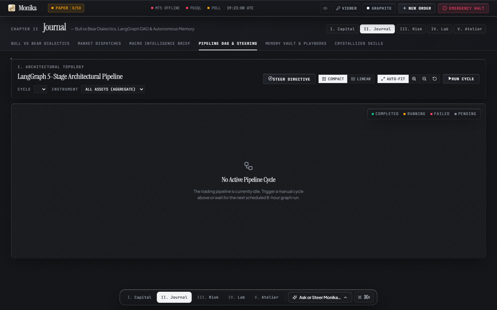
</p>

---

#### Signals Matrix & Market Data
Tracks pending conditional triggers and live market quotes.

<p align="center">
  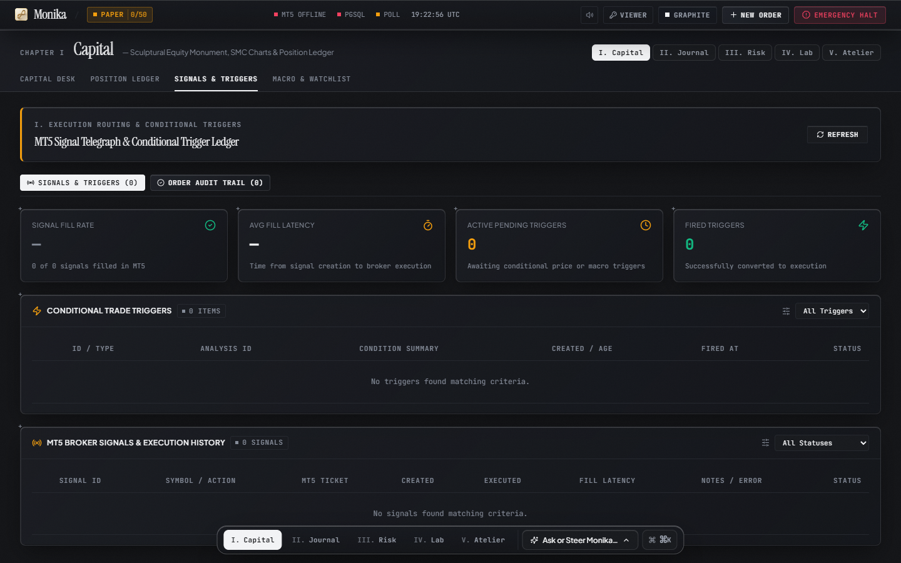
  
</p>

---

#### Risk Limits & Token Usage
- **Left:** Real-time gauges for daily drawdown budgets and circuit breaker status.
- **Right:** Tracking of token consumption, model provider calls, and prompt cache hit rates.

<p align="center">
  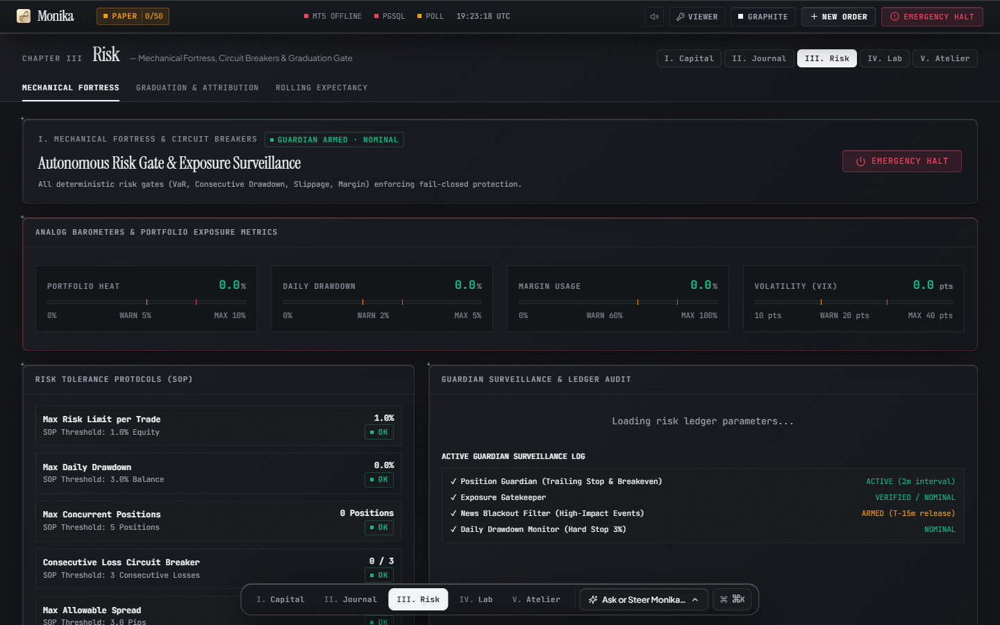
  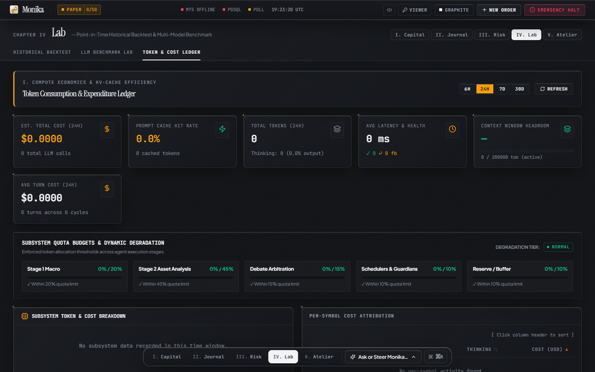
</p>

---

#### Console Chat & Settings
- **Left:** Interactive console to query current agent state and market theses.
- **Right:** Configuration management editor.

<p align="center">
  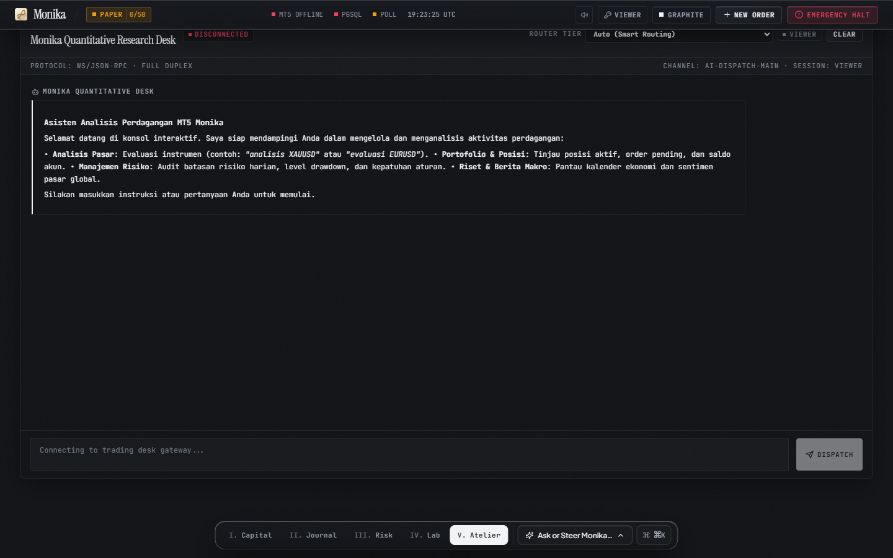
  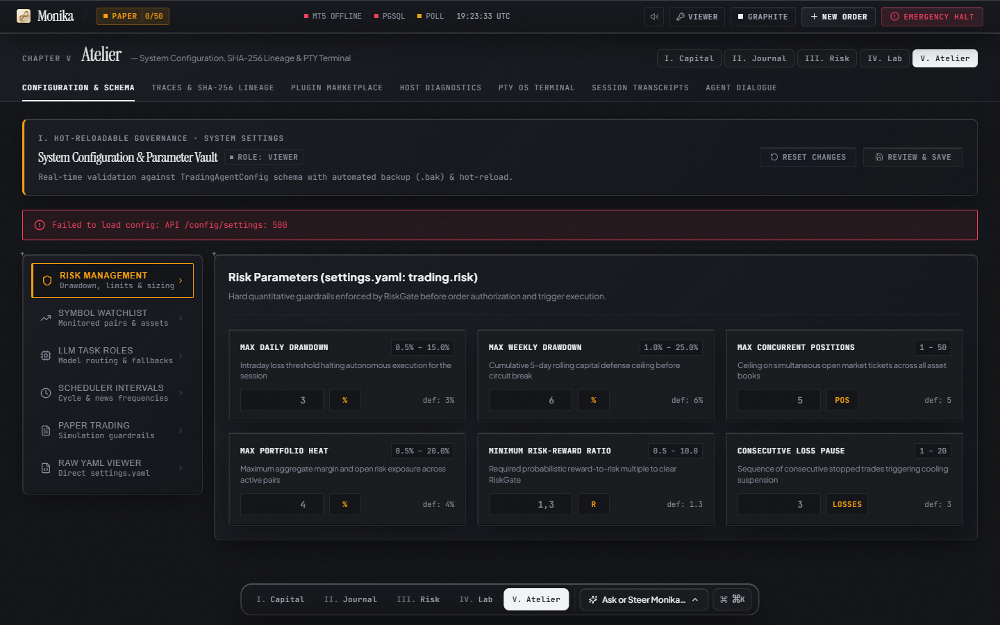
</p>

---

### Terminal User Interface (TUI)

For headless servers, remote SSH sessions, or lightweight resource environments:

<p align="center">
  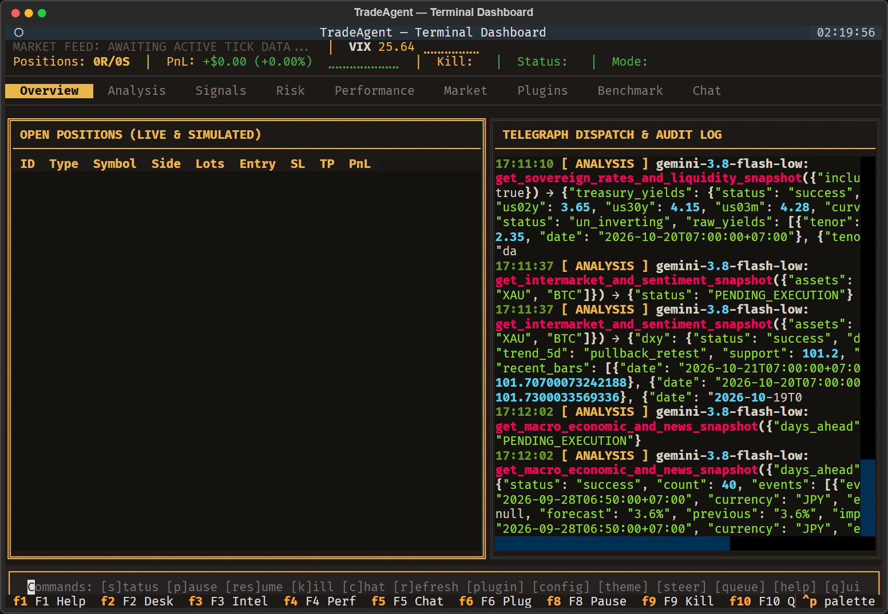
</p>

- Built with **Textual** and **Rich** for lightweight terminal rendering.
- Displays live simulated equity curves, open demo orders, and system logs.

---

## 5. System Architecture & Workflows

### End-to-End Pipeline

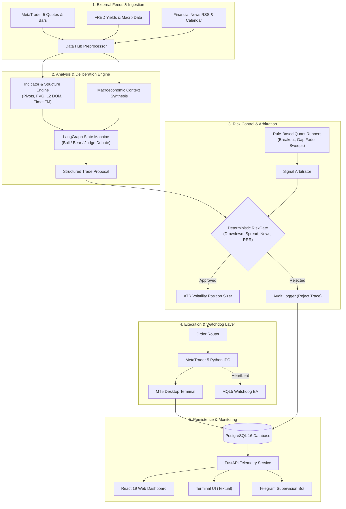

### Background Tasks & Supervisory Tree

Monika coordinates over **35 concurrent background tasks** supervised by `TaskRegistry` with automatic restart, exponential backoff, error categorization (`PERMANENT_ERRORS` vs `LONG_RETRY_ERRORS`), and clean shutdown tracking:

| Subsystem | Task Component | Interval / Mode | Operational Responsibility |
| :--- | :--- | :--- | :--- |
| **Market Data** | `MarketDataScheduler` | Dynamic / Tick | Ingests live quotes, maintains in-memory `RingBufferHub` cache, and updates OHLCV bars. |
| | `MacroDataScheduler` | Scheduled / Daily | Ingests US Treasury yields, DXY, and macro statistics via FRED API. |
| | `ActiveCalendarPoller` | Real-time | Accelerates polling frequency around scheduled tier-1 economic events. |
| | `TickStream` | Real-time | Continuous tick ingestion and event emission over `EventBus`. |
| **Analysis & Deliberation** | `GraphCycleScheduler` | Every 6–8 hrs | Orchestrates the full LangGraph Stage 1 Macro & Stage 2 Asset Deliberation cycle. |
| | `DailyReportScheduler` | Daily / Scheduled | Emits daily executive trading and macroeconomic performance summaries. |
| | `NewsWatcher` | Every 5 min | Scrapes RSS financial feeds, deduplicates headlines, and triggers targeted evaluations. |
| | `DigestSliceScheduler` | Periodic | Compiles periodic thematic news digests and sentiment vectors. |
| | `PostReleaseAnalyzer` | Post-Release | Measures reported macroeconomic surprise metrics against forecast consensus. |
| | `TriggerChecker` | Every 2 min | Evaluates pending conditional price triggers (e.g. FVG mitigation / order block tests). |
| **Strategy & Playbooks** | `EdgeStrategyRunner` | Continuous | Executes standalone rule-based quant models alongside the LLM workflow. |
| | `AlphaDiscoveryScheduler`| Periodic | Automated alpha mining and formula screening across 463 factor formulas. |
| | `StrategySynthesisScheduler` | Periodic | Synthesizes multi-indicator confluences and generates candidate strategies. |
| | `PlaybookCurator` | Scheduled | Evaluates empirical performance of trading playbooks and manages lifecycle tiers. |
| | `MicroPlaybookCompiler`| Periodic | Compiles validated micro-structures into crystallized strategy assets. |
| | `SkillCurator` | Periodic | Curates autonomous skill repositories and validates markdown playbooks. |
| **Financial Guardians** | `PositionGuardian` | Every 5 min | Checks open positions against news blackouts and enforces protective trailing stops. |
| | `TrailingStopManager` | Every 30 sec | Evaluates trailing stop triggers and breakeven adjustments. |
| | `PositionSupervisor` | Every 10–60 sec | Coordinates position evaluation, margin utilization, and risk checks across workers. |
| | `OrderReconciler` | Every 5 min | Verifies and reconciles local database records with active MT5 broker tickets. |
| | `FlashCrashDetector` | Every 30 sec | Detects abnormal rapid price travel (>5x ATR) and moves stops defensively. |
| | `FridayCloseGuardian` | Friday PM UTC | Manages weekend gap exposure by evaluating profitable position closure. |
| | `FloatingDrawdownMonitor`| Every 15 sec | Tracks real-time floating equity drawdown against maximum daily risk limits. |
| | `MarginGuardian` | Every 30 sec | Monitors margin utilization and triggers defensive scaling if margin exceeds bounds. |
| | `PaperTradeMonitor` | Periodic | Tracks simulated trade graduation criteria (win rate, count, profit factor). |
| | `PositionExitReviewer` | Event-driven | Triggers post-exit reflections to log observations from closed trades. |
| **System & Monitoring** | `HeartbeatManager` | Every 20 sec | Emits periodic heartbeat timestamps to `heartbeat.txt` for the MT5 Watchdog EA. |
| | `EAWatchdog` | Every 30 sec | Monitors broker connectivity and dead-man switch health. |
| | `Dashboard API` | Continuous | FastAPI backend serving REST endpoints and WebSockets to the web dashboard. |
| | `MT5HealthMonitor` | Every 30 sec | Monitors MT5 terminal IPC connection health with flake-tolerant grace windows. |
| | `DBHealthCheck` | Every 60 sec | Verifies database connection pool health and executes safe auto-reconnects. |
| | `CacheReaper` | Hourly | Prunes expired in-memory caches, ring buffers, and old alert history. |
| | `MemorySupervisor` | Continuous | Monitors memory growth and executes adaptive compaction to prevent OOM. |
| | `ScraperLoop` | Periodic | Executes scheduled data scrapers and updates central bank documents. |
| | `WhatIfResolver` | Periodic | Solves counterfactual what-if audits on missed or avoided trading opportunities. |
| | `RiskParameterReloader` | Every 15 sec | Hot-reloads risk parameters dynamically from `settings.yaml` without restarts. |
| | `ConfigManagerWatcher` | Event-driven | Pub/sub configuration event propagation across active components. |
| | `TelegramBot` | Continuous | Long-polling daemon for remote notifications and manual operator commands. |
| | `PluginEngine` | Continuous | Universal plugin manager supporting topological lifecycle management. |
| | `UniversalCron` | Continuous | High-precision cron engine managing scheduled jobs and triggers. |
| | `GuardianSupervisor` | Continuous | Independent multi-process watchdog on port 8001 providing unblockable `/kill`. |

---

## 6. Supported Assets & Model Configuration

### Supported Instruments
Configured via `config/settings.yaml`:
- **Commodities:** `XAUUSD` (Spot Gold), `XTIUSD` (WTI Crude Oil), `XBRUSD` (Brent Crude Oil)
- **Major Forex:** `EURUSD`, `GBPUSD`, `USDJPY`, `AUDUSD`
- **Cryptocurrency:** `BTCUSD` (Bitcoin)

### Model Routing Configuration
Model selection is decoupled from application code. Tasks request an abstract role (e.g. `stage1_fundamental`, `debate_bull`, `debate_judge`), which is mapped to a provider and model in `config/settings.yaml`.

Supported providers:
- **Google Gemini:** Direct Google GenAI SDK integration with key rotation.
- **Groq:** Fast inference for lightweight prescreening.
- **OpenRouter:** Access to multiple open-source and proprietary models.
- **Anthropic / OpenAI / DeepSeek:** Standard compatible endpoints.
- **Local Ollama:** For local, self-hosted environments.

Example configuration in `config/settings.yaml`:
```yaml
llm:
  task_roles:
    stage1_fundamental:
      primary: your-chosen-macro-model
      fallback_1: your-backup-model
      max_tokens: 16384
      temperature: 0.0

    debate_judge:
      primary: your-chosen-reasoning-model
      fallback_1: your-backup-model
      max_tokens: 6144
      temperature: 0.0

    stage2_prescreen:
      primary: your-fast-filter-model
      max_tokens: 1024
      temperature: 0.0
```

---

## 7. Installation & Quickstart

Monika is designed for **zero-friction onboarding**: you can be up and running in ~2 minutes with zero database server setup, without installing Node.js/npm, and using free Google Gemini API keys.

👉 **Complete Bilingual Installation Guide:** See [docs/SETUP_GUIDE.md](docs/SETUP_GUIDE.md) for full Indonesian & English walkthroughs.

---

### 📦 Package Tiers: Choose Your Experience

Monika offers two setup packages out of the box:

| Package | Database | MetaTrader 5 | Execution | AI Provider | Telegram Bot | Setup Time |
| :--- | :--- | :--- | :--- | :--- | :--- | :--- |
| **🚀 Trial Package** *(Recommended)* | **SQLite (Zero-Config WAL)** | **Required (Demo Account OK)** | **Paper Trading Sandbox** | **Gemini Free (Min 1 key)** | **Required (Mobile Oversight)** | **~2 minutes** |
| **🔥 Full Package** | **PostgreSQL 16+** | **Required (Live/Demo)** | **Paper & MT5 Live Bridge** | **Multi-Provider + 9Router** | **Required (Mobile Oversight)** | **~10-15 minutes** |

> 💡 **Upgrade Anytime:** Start with the **Trial Package**. Whenever you are ready to unlock PostgreSQL, the React 19 Web Dashboard, and live MT5 bridges, run:
> ```bash
> python -m monika.interfaces.cli.main upgrade
> ```

---

### ⚡ Quickstart (One-Click Launch)

#### Prerequisite (Both Windows & Linux)
1. **Download & Install MetaTrader 5**: [metatrader5.com/en/download](https://www.metatrader5.com/en/download)
2. **Open a Free Demo Account**: Inside MT5, go to `File` → `Open an Account` → select `MetaQuotes-Demo`.
3. **Enable Algo Trading**: Click the **Algo Trading** button in the MT5 top toolbar so it turns green.

#### Windows
Clone or download this repository, then simply **double-click**:
```cmd
start_monika.bat
```
*The launcher automatically verifies Python (accepting Python >= 3.14, with automated winget fallback), prepares `venv`, and launches the interactive setup wizard.*

#### Linux / macOS / VPS (Ubuntu 22.04+)
```bash
git clone https://github.com/alakbarr/Monika.git
cd Monika
chmod +x start_monika.sh
./start_monika.sh
```

#### Containerized Docker (VPS)
```bash
cp .env.example .env
docker compose -f deploy/docker-compose.vps.yml up -d --build
```

---

### 🔑 API Key & Credential Reference Guide

| Service | Status | Official Registration | Notes |
| :--- | :--- | :--- | :--- |
| **MetaTrader 5 Account** | **Required** | In-app (`File` → `Open an Account`) | Free Demo account is 100% fine for testing. |
| **Telegram Bot** | **Required** | [@BotFather on Telegram](https://t.me/BotFather) | Mobile oversight, trade approval cards, and remote emergency kill. |
| **Google Gemini** | **Required (Pick 1)** | [aistudio.google.com/apikey](https://aistudio.google.com/apikey) | Generous free tier. Requires standard Google account login. |
| **9Router Gateway** | *Recommended* | [github.com/9router/9router](https://github.com/9router) | Smart local AI proxy (port 20128) for rotation and failover. |
| **OpenRouter** | Alternative | [openrouter.ai/keys](https://openrouter.ai/keys) | Single key for open-source and commercial models. |
| **Groq** | Alternative | [console.groq.com/keys](https://console.groq.com/keys) | Ultra-fast Llama-3 inference (free tier available). |
| **Anthropic Claude** | Alternative | [console.anthropic.com](https://console.anthropic.com/) | Claude 3.5 Sonnet / Haiku reasoning. |
| **FRED Data** | Optional | [fred.stlouisfed.org](https://fred.stlouisfed.org/docs/api/api_key.html) | US Treasury yields and macro data (free). |
| **Finnhub** | Optional | [finnhub.io/register](https://finnhub.io/register) | Real-time financial calendar and news sentiment. |

---

### System Diagnostics (System Doctor)

Run the offline diagnostic probe to verify environment and component health:
```bash
python -m monika.interfaces.cli.main doctor --offline
```

---

## 8. CLI & Telegram Reference

### Command-Line Interface

| Command | Primary Function |
| :--- | :--- |
| `python -m monika.interfaces.cli.main setup` | Interactive terminal wizard to configure `.env` and broker parameters. |
| `python -m monika.interfaces.cli.main upgrade` | Interactively upgrades Monika from Trial to Full package. |
| `python -m monika.interfaces.cli.main doctor` | Runs diagnostic health checks for database, MT5, and LLM API keys (`--offline` supported). |
| `python -m monika.interfaces.cli.main run` | Starts the background trading agent daemon. |
| `python -m monika.interfaces.cli.main stop` | Gracefully requests the running trading daemon to shut down. |
| `python -m monika.interfaces.cli.main status` | Displays system health, active background tasks, and account equity. |
| `python -m monika.interfaces.cli.main positions` | Lists open demo positions, active stops, and unrealized profit/loss. |
| `python -m monika.interfaces.cli.main analyze [SYMBOL]` | Executes an on-demand analysis cycle for a specified instrument (e.g. `XAUUSD`). |
| `python -m monika.interfaces.cli.main chat` | Starts an interactive chat REPL with the agent assistant. |
| `python -m monika.interfaces.cli.main ask "QUERY"` | Executes a one-off query and prints the response. |
| `python -m monika.interfaces.cli.main pause` | Pauses automated trade proposal execution. |
| `python -m monika.interfaces.cli.main resume` | Resumes automated trade proposal execution. |
| `python -m monika.interfaces.cli.main kill` | Emergency stop: closes open positions and halts daemon execution. |
| `python -m monika.interfaces.cli.main tui` | Launches the full-screen terminal user interface (Textual). |
| `python -m monika.interfaces.cli.main backtest` | Runs strategy evaluations against historical price data. |
| `python -m monika.interfaces.cli.main benchmark` | Evaluates and compares reasoning responses across configured models. |
| `python -m monika.interfaces.cli.main config [get\|set\|show\|edit]` | Inspects, modifies, and validates system configuration keys. |
| `python -m monika.interfaces.cli.main profile [list\|switch]` | Manages configuration profiles for different trading environments. |
| `python -m monika.interfaces.cli.main backup` | Generates a timestamped backup of the operational database. |
| `python -m monika.interfaces.cli.main logs` | Displays recent activity and system logs from the terminal. |
| `python -m monika.interfaces.cli.main sessions` | Inspects stored multi-agent chat and deliberation sessions. |
| `python -m monika.interfaces.cli.main onboarding` | Launches the interactive onboarding experience for new operators. |
| `python -m monika.interfaces.cli.main unsuspend [SYMBOL]` | Manually unsuspends a symbol placed in cooldown after consecutive losses. |
| `python -m monika.interfaces.cli.main stress_test` | Executes Monte Carlo equity path simulation and portfolio stress tests. |
| `python -m monika.interfaces.cli.main auth` | Manages Google Antigravity Desktop OAuth PKCE tokens and credentials. |
| `python -m monika.interfaces.cli.main plugins` | Lists discovered plugins and inspects lifecycle states. |
| `python -m monika.interfaces.cli.main mcp` | Starts the Model Context Protocol (MCP) server for external agent integration. |

---

### Telegram Bot Commands

| Command | Permission | Description |
| :--- | :--- | :--- |
| `/status` | Public | View system health, open positions, and account metrics. |
| `/positions` | Public | List open tickets, entry prices, stop losses, and take profits. |
| `/brief` | Public | Display the latest macroeconomic narrative summary. |
| `/risk` | Public | Inspect current daily drawdown and risk limit utilization. |
| `/vix` | Public | View current volatility readings and active regime classification. |
| `/tokens` | Public | Review token consumption and estimated API expenditures. |
| `/run` | Admin | Manually trigger an analysis cycle. |
| `/pause` | Admin | Pause automated trade execution. |
| `/resume` | Admin | Resume automated trade execution. |
| `/close <ticket>` | Admin | Request manual closure of a specific open ticket. |
| `/kill` | Admin | Emergency stop: close all open positions and halt execution. |
| `/help` | Public | Display available commands and usage instructions. |

---

## 9. Testing & Backtesting

### Running the Test Suite
Run automated unit and integration tests across risk calculation, indicators, and broker bridges:

```bash
# Run full test suite (Windows PowerShell):
pytest tests -v

# Run full test suite (Linux/macOS):
pytest tests -v

# Run RiskGate validation tests:
pytest tests/risk/test_risk_gate.py -v

# Run market structure indicator tests:
pytest tests/indicators/test_structure.py -v
```

### Offline Backtesting
Evaluate strategy logic against historical data:
```bash
python -m monika.interfaces.cli.main backtest --symbol XAUUSD --days 30
```

### Model Benchmarks
Evaluate reasoning consistency across different models using recorded test fixtures:
```bash
python -m monika.interfaces.cli.main benchmark --models model_a,model_b
```

---

## 10. Frequently Asked Questions

### What is Monika?
Monika is an experimental Python framework that explores whether language models can assist in market analysis while keeping all actual risk management and order validation in deterministic code. The AI can propose ideas, but plain code enforces the rules.

### Does this framework guarantee trading profits?
**No.** Financial markets are non-linear, unpredictable, and subject to regime changes. Most automated trading strategies lose money in live conditions. This project is built for research and software engineering experimentation.

### Why not let language models place orders directly?
Language models make arithmetic mistakes, misjudge lot sizes, hallucinate price levels, and suffer from confirmation bias. Leaving position sizing, stop placement, and risk rules to deterministic Python code prevents the model from making catastrophic execution errors.

### Which database engine should I use: SQLite or PostgreSQL?
Monika features a **dual-tier database architecture**:
- **Trial Tier (Default)**: Embedded canonical SQLite (`data/monika.db`) in Write-Ahead Logging (WAL) mode. Zero configuration required, up and running in ~2 minutes! Suitable for single-instance paper trading, backtesting, and evaluation.
- **Full Tier (Production)**: PostgreSQL 16+ with connection pooling and transactional advisory locks. Recommended for high-concurrency production deployments with live MetaTrader 5 bridges, continuous websocket streaming, and multi-process architecture.
You can easily upgrade anytime from Trial to Full using `python -m monika.interfaces.cli.main upgrade` without losing any historical data or paper trades.

### Why is paper trading enforced by default?
Accidental execution errors are common during automated trading development. Keeping `paper_trading.enabled: true` as the default ensures users can test and debug safely without risking capital.

### What are the estimated LLM API operating costs?
By employing prompt caching and routing lightweight prescreening tasks to fast models, operating costs typically range between **$0.50 and $2.00 per day** of continuous operation. Costs can be reduced to zero by using local models via Ollama or free provider tiers.

### Can this run on Linux?
Yes. Although MetaTrader 5 is a native Windows application, Linux support is provided using Wine and Docker container configurations available in the `deploy/` directory.

---

## 11. Repository Structure

```
Monika/
├── PRD.md                     # Project requirements & design notes
├── README.md                  # System documentation & quickstart guide
├── DESIGN.md                  # Web dashboard UI specifications
├── CONTRIBUTING.md            # Guidelines for open-source contributions
├── CODE_OF_CONDUCT.md         # Community code of conduct
├── SECURITY.md                # Security policy & vulnerability reporting
├── INDEX.md                   # Codebase index and references
├── STRUCTURE.md               # Directory and file inventory
├── deploy/                    # Linux / Wine deployment scripts & Dockerfiles
├── docs/                      # Screenshots, architecture diagrams, assets
├── frontend/                  # React + Vite web dashboard
├── scripts/                   # Migration, benchmark, and utility scripts
├── skills/                    # Domain trading playbooks & specialized skills
├── tests/                     # Comprehensive automated test suite
└── src/monika/                # Clean Architecture application codebase
    ├── core/                  # Telemetry, configuration, base types, settings
    ├── domain/                # Financial invariants, RiskGate, trading rules
    ├── application/           # Multi-agent graph, harness, and orchestrators
    ├── infrastructure/        # Brokers (MT5), DB, LLM providers, scrapers
    └── interfaces/            # CLI (Textual TUI), Web Dashboard API, Telegram
```

---

## 12. Contributing

Constructive feedback, bug reports, and pull requests are welcome.

- **Issue Tracker:** Submit bug reports or edge-case findings to [GitHub Issues](https://github.com/alakbarr/Monika/issues).
- **Discussions:** Share ideas or architecture feedback in [GitHub Discussions](https://github.com/alakbarr/Monika/discussions).
- **Contributing Code:** Please review [CONTRIBUTING.md](CONTRIBUTING.md) before opening a pull request.
- **Security Vulnerabilities:** Review [SECURITY.md](SECURITY.md) to report vulnerabilities responsibly.

---

## 13. Disclaimer

> [!CAUTION]
> **FOR EDUCATIONAL, RESEARCH, AND EXPERIMENTAL PURPOSES ONLY.**
>
> Trading foreign exchange, commodities, cryptocurrencies, and leveraged financial products involves a high degree of risk and can result in the complete loss of invested capital.
>
> The authors and contributors of Monika make no warranties, representations, or claims regarding profitability, reliability, or fitness for live trading. Never trade with money you cannot afford to lose. Always test thoroughly in demo environments.

---

<p align="center">
  <sub>Monika &bull; Multi-agent trading research harness for MetaTrader 5 &bull; Open source under the MIT License</sub>
</p>
