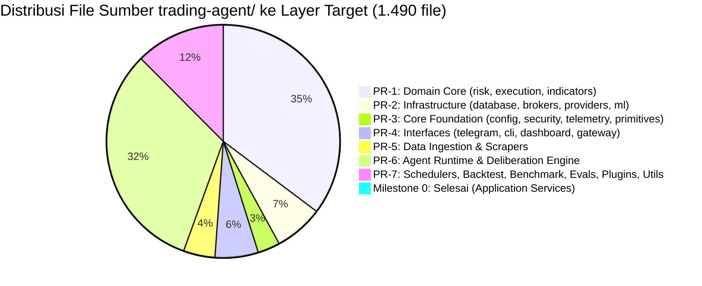
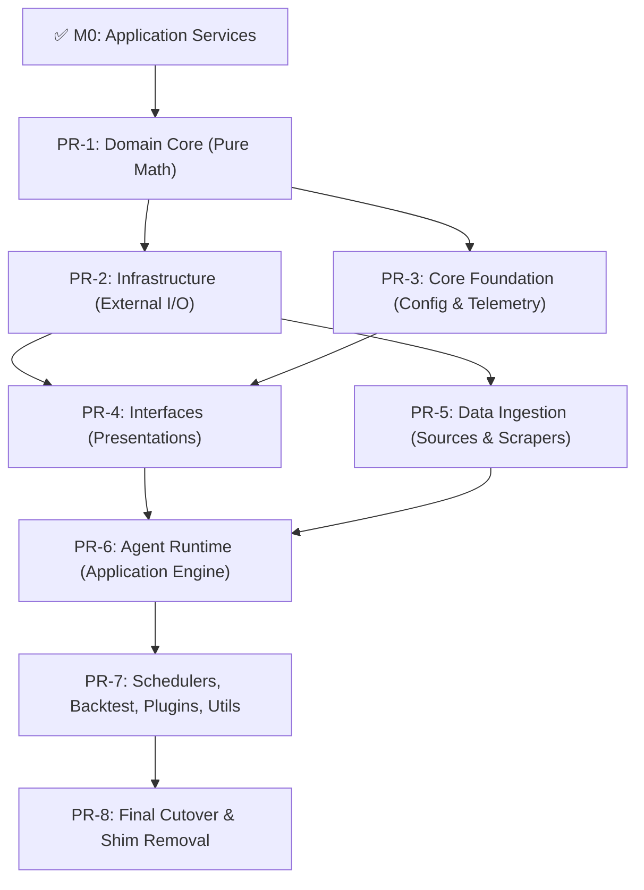

# Roadmap Migrasi Bertahap ke `src/monika` (Clean Architecture)

> **Status:** Active / In-Progress  
> **Versi:** 2.1.0  
> **Terakhir Diperbarui:** 12 Oktober 2026  
> **Prinsip Utama:** Zero-Downtime, Zero-Breakage (Two-Way Facade Shims), Zero-Suppression (No `# type: ignore`), Triple Quality Gate 100% Green.  
> **Audit Coverage:** 100% (1.490 file Python sumber terverifikasi di filesystem).

---

## 1. Status Kemajuan Migrasi



### Milestone 0 — SELESAI (commit `a510af9`)

- [x] Struktur paket kanonik `src/monika/` (`core`, `domain`, `application`, `infrastructure`, `interfaces`).
- [x] Konfigurasi dual-namespace di `pyproject.toml`, `pytest.ini`, `pyrightconfig.json`.
- [x] 4 Canonical Application Services (`TradingService`, `PortfolioService`, `MarketIntelService`, `GeneralHarnessService`).
- [x] 4 Two-way re-export shims di `trading-agent/services/`.
- [x] Refactoring `routes/trading.py` (submit_order) dan `telegram_bot/handlers/trading_commands.py`.
- [x] Test suite paritas `test_architecture_parity.py` (6/6 passing).

**Belum di-shim (tetap lokal):** `services/market_data_service.py` (PR-5), `services/system_status_service.py` (PR-7).

---

## 2. Prinsip Arsitektur

### 2.1 Clean Architecture Layer Map

```
src/monika/
├── core/           ← Shared primitives, config, security, telemetry (INNERMOST)
├── domain/         ← Pure business rules, risk, execution models, indicators (POPO/Pure Math)
├── application/    ← Orchestration services, workflows, agent runtime, graph nodes
├── infrastructure/ ← Database, brokers, LLM providers, scrapers, checkpointers
└── interfaces/     ← Telegram, CLI, Dashboard, Gateway (OUTERMOST)
```

### 2.2 Dependency Direction (Inward Only)

```
interfaces → application → domain ← core
     ↓           ↓            ↑
infrastructure ──┴────────────┘
```

**Aturan Emas:** Layer luar boleh import layer dalam. Layer dalam DILARANG import layer luar. Pelanggaran harus diselesaikan melalui **Dependency Inversion** (interface/protocol di layer dalam, implementasi konkret di layer luar).

### 2.3 Shim Protocol (Backward Compatibility)

Setiap file Python yang dipindahkan WAJIB meninggalkan re-export shim di lokasi aslinya di `trading-agent/`:

```python
# trading-agent/<module>/<file>.py (SHIM)
"""Backward-compatibility shim. Canonical: monika.<layer>.<module>.<file>"""
from monika.<layer>.<module>.<file> import *  # noqa: F401,F403
from monika.<layer>.<module>.<file> import __all__ as _all
__all__ = list(_all) if _all else []
```

> [!IMPORTANT]
> **Satu-satunya `# noqa` yang diizinkan** adalah pada file shim untuk `F401` (unused import) dan `F403` (star import). File implementasi kanonik di `src/monika/` **WAJIB ZERO SUPPRESSION** (tanpa `# type: ignore`, tanpa `# noqa`).

### 2.4 Urutan Eksekusi PR (Dependency-Ordered)



---

## 3. PR-1: Migrasi Pure Domain Core (524 file)

**Target:** `src/monika/domain/`  
**Fokus:** Aturan bisnis murni, kalkulasi kuantitatif, dan model finansial deterministik — ZERO dependensi ke database, network, LLM, atau presentation.

### 3.1 `src/monika/domain/risk/` (20 file)

Berdasarkan audit exhaustive, paket risk terdiri dari 20 file:

| Sumber (`trading-agent/risk/`) | Tujuan (`src/monika/domain/risk/`) | Klasifikasi & Tindakan |
|---|---|---|
| `__init__.py` | `__init__.py` | Package API re-export |
| `trade_proposal.py` | `trade_proposal.py` | Pure domain aggregate root entity |
| `risk_gate.py` | `risk_gate.py` | Pure domain service (lihat catatan di bawah) |
| `risk_rule_plugin.py` | `risk_rule_plugin.py` | Pure domain rule plugin ABC & registry |
| `correlation_matrix.py` | `correlation_matrix.py` | Pure EWMA/Pearson correlation math |
| `execution_simulator.py` | `execution_simulator.py` | Pure slippage/spread simulation math |
| `pending_action.py` | `pending_action.py` | Entity — inject clock primitive |
| `portfolio_correlation_gate.py` | `portfolio_correlation_gate.py` | Pure domain validation rule |
| `portfolio_optimizer.py` | `portfolio_optimizer.py` | Pure Mean-Variance / HRP math |
| `position_sizing.py` | `position_sizing.py` | Pure Kelly / ATR sizing math |
| `approval_hub.py` | `approval_hub.py` | Approval domain coordinator |
| `crypto_audit_ledger.py` | `crypto_audit_ledger.py` | Domain cryptographic hash-chaining logic |
| `domain/__init__.py` | `instruments/__init__.py` | Subpackage init |
| `domain/instruments.py` | `instruments/instruments.py` | Pure instrument catalog & specifications |
| `invariants/__init__.py` | `invariants/__init__.py` | Invariants registry init |
| `invariants/registry.py` | `invariants/registry.py` | `BaseInvariant` ABC & `InvariantRegistry` |
| `invariants/position_count_invariant.py` | `invariants/position_count_invariant.py` | Pure count invariant |
| `invariants/risk_gate_invariant.py` | `invariants/risk_gate_invariant.py` | Pure risk invariant |
| `invariants/state_immutability_invariant.py` | `invariants/state_immutability_invariant.py` | Pure immutability invariant |
| `approval_transport.py` | — | **DIPINDAHKAN KE PR-2:** Menggunakan `aiohttp` → `infrastructure/brokers/approval_transport.py` |

> [!NOTE]
> `risk_gate.py` terbukti 100% murni domain: hanya mengimpor `risk.*` internal. Semua dependensi I/O berada di level caller (`ExecutionService`). Tidak memerlukan splitting.

### 3.2 `src/monika/domain/execution/` (7 file pure domain)

Direktori `trading-agent/execution/` memiliki total 36 file. Hanya 7 file berikut yang murni kalkulasi/model domain:

| Sumber (`trading-agent/execution/`) | Tujuan (`src/monika/domain/execution/`) | Peran |
|---|---|---|
| `order_emulator.py` | `order_emulator.py` | Pure local paper execution simulator |
| `broker_plugin.py` | `broker_plugin.py` | Domain broker contract interface (ABC) |
| `service/state_machine.py` | `state_machine.py` | Pure deterministic order state machine |
| `service/order_creator.py` | `order_creator.py` | Pure proposal-to-order factory |
| `service/sizing_calculator.py` | `sizing_calculator.py` | Pure dynamic lot/volume sizing calculator |
| `service/verification_engine.py` | `verification_engine.py` | Pure pre-execution deterministic rules |
| `service/base.py` | `base.py` | Base domain execution execution context |

> [!IMPORTANT]
> **29 File `execution/` lainnya:**
> - **12 File Application Orchestration** (`execution_service.py`, `broker_registry.py`, `effect_gate.py`, `health_check.py`, `service/order_executor.py`, `service/position_synchronizer.py`, `service/reconciliation.py`, `service/risk_evaluator.py`, `service/self_healing_executor.py`, `service/trade_confirm.py`, `service/emergency_manager.py`, `service/multi_account_adapter.py`) → **PR-6 §8.6**.
> - **17 File Infrastructure Brokers & Sandboxes** (`broker_adapter.py`, `mt5_client.py`, `mt5_compat.py`, `paper_tracker.py`, `rate_throttler.py`, `idempotency_guard.py`, `service/audit_logger.py`, `backends/*`, `ea_bridge/*`) → **PR-2 §4.2**.

### 3.3 `src/monika/domain/indicators/` (497 file domain)

Direktori `trading-agent/indicators/` memiliki 498 file. 497 file adalah pure math / domain:

| Sumber (`trading-agent/indicators/`) | Tujuan (`src/monika/domain/indicators/`) | Jumlah File |
|---|---|---|
| Root indicator primitives | `domain/indicators/` | 11 file |
| `alpha_zoo/` (subpackage) | `domain/indicators/alpha_zoo/` | 9 file |
| `alpha_zoo/factors/` (bulk formulas) | `domain/indicators/alpha_zoo/factors/` | 468 file |
| `pattern_similarity/` (subpackage) | `domain/indicators/pattern_similarity/` | 9 file |

**Rincian Root Indicators (11 file):**
`candlestick_patterns.py`, `chart_patterns.py`, `factor_primitives.py`, `micro_alpha_zoo.py`, `microstructure.py`, `order_flow.py`, `regime_detector.py`, `smc_advanced.py`, `structure.py`, `technical.py`, `__init__.py`.

**Rincian `alpha_zoo/` (9 file):**
`academic_factors.py`, `alpha101.py`, `fundamental_factors.py`, `meta.py`, `microstructure_factors.py`, `qlib158.py`, `registry.py`, `vector_factor_engine.py`, `__init__.py`.

**Rincian `pattern_similarity/` (9 file):**
`context_scorer.py`, `context_verifier.py`, `engine.py`, `feature_extractor.py`, `models.py`, `normalizer.py`, `outcome_analyzer.py`, `scanner.py`, `__init__.py`.

> [!WARNING]
> `timesfm_engine.py` (Google TimesFM neural forecast) bergantung langsung pada PyTorch / neural weights runtime. **DIPINDAHKAN KE PR-2 §4.5** (`infrastructure/ml/timesfm_engine.py`).

### 3.4 Verifikasi Gate PR-1

```bash
pytest trading-agent/tests/test_risk_gate.py trading-agent/tests/test_vector_factor_engine.py trading-agent/tests/test_architecture_parity.py -v
npx pyright src/monika/domain
ruff check src/monika/domain trading-agent/risk trading-agent/execution trading-agent/indicators
```

---

## 4. PR-2: Migrasi Infrastructure Layer (101 file)

**Target:** `src/monika/infrastructure/`  
**Fokus:** Komponen yang menyentuh I/O eksternal: Database PostgreSQL, Broker MT5/IBKR/Paper, EA Watchdog, Sandbox Backends, LLM Providers, dan ML Inference Engines.

### 4.1 `src/monika/infrastructure/database/` (34 file)

| Sumber (`trading-agent/database/`) | Tujuan (`src/monika/infrastructure/database/`) | Deskripsi |
|---|---|---|
| Root database engine (12 file) | `infrastructure/database/` | `adapters.py`, `async_db.py`, `cleanup.py`, `db.py`, `event_store.py`, `fts5_cjk.py`, `models.py`, `repair_ledger.py`, `safe_ops.py`, `session_db_wal.py`, `session_lifecycle.py`, `__init__.py` |
| `domain_models/` (8 file) | `infrastructure/database/domain_models/` | `analysis.py`, `base.py`, `market.py`, `memory.py`, `news.py`, `system.py`, `trading.py`, `__init__.py` |
| `migrations/` & `versions/` (9 file) | `infrastructure/database/migrations/` | `env.py`, `__init__.py`, plus 7 file versi Alembic (`0001` - `0005`, `c83c5e451412`, `__init__.py`) |
| `repositories/` (5 file) | `infrastructure/database/repositories/` | `activity_log_repository.py`, `position_repository.py`, `system_config_repository.py`, `trade_proposal_repository.py`, `__init__.py` |

> [!IMPORTANT]
> **Alembic Configuration Synchronization:**
> Update `alembic.ini` di root repository:
> `script_location = src/monika/infrastructure/database/migrations`
> Verifikasi kelancaran migrasi dengan `alembic check` dan `alembic history`.

### 4.2 `src/monika/infrastructure/brokers/` (13 file) & `sandboxes/` (4 file)

Pemisahan konkret antara Broker Adapters aktual dan Execution Sandboxes:

#### A. Broker Adapters & Bridge (`infrastructure/brokers/` — 13 file)
- `trading-agent/execution/broker_adapter.py` → `infrastructure/brokers/broker_adapter.py` (MT5, Paper)
- `trading-agent/execution/mt5_client.py` → `infrastructure/brokers/mt5_client.py`
- `trading-agent/execution/mt5_compat.py` → `infrastructure/brokers/mt5_compat.py`
- `trading-agent/execution/paper_tracker.py` → `infrastructure/brokers/paper_tracker.py`
- `trading-agent/execution/rate_throttler.py` → `infrastructure/brokers/rate_throttler.py`
- `trading-agent/execution/idempotency_guard.py` → `infrastructure/brokers/idempotency_guard.py`
- `trading-agent/execution/service/audit_logger.py` → `infrastructure/brokers/audit_logger.py`
- `trading-agent/execution/backends/ibkr_adapter.py` → `infrastructure/brokers/ibkr_adapter.py`
- `trading-agent/execution/ea_bridge/heartbeat_writer.py` → `infrastructure/brokers/ea_bridge/heartbeat_writer.py`
- `trading-agent/execution/ea_bridge/watchdog.py` → `infrastructure/brokers/ea_bridge/watchdog.py`
- `trading-agent/execution/ea_bridge/__init__.py` → `infrastructure/brokers/ea_bridge/__init__.py`
- `trading-agent/risk/approval_transport.py` → `infrastructure/brokers/approval_transport.py` (aiohttp remote approval)
- `trading-agent/execution/__init__.py` (re-exports)

#### B. Code Execution Sandboxes (`infrastructure/sandboxes/` — 4 file)
File-file di `execution/backends/` sebenarnya adalah sandbox eksekusi script/code:
- `trading-agent/execution/backends/base.py` → `infrastructure/sandboxes/base.py`
- `trading-agent/execution/backends/docker_backend.py` → `infrastructure/sandboxes/docker_backend.py`
- `trading-agent/execution/backends/local_backend.py` → `infrastructure/sandboxes/local_backend.py`
- `trading-agent/execution/backends/__init__.py` → `infrastructure/sandboxes/__init__.py`

### 4.3 `src/monika/infrastructure/providers/` (23 file)

Semua adapter LLM eksternal dari `trading-agent/analysis/providers/`:
`base_provider.py`, `provider_factory.py`, `google_provider.py`, `anthropic_provider.py`, `openai_provider.py`, `deepseek_provider.py`, `openrouter_provider.py`, `groq_provider.py`, `mistral_provider.py`, `xai_provider.py`, `cohere_provider.py`, `together_provider.py`, `perplexity_provider.py`, `fireworks_provider.py`, `sambanova_provider.py`, `cerebras_provider.py`, `rate_limiter.py`, `cost_tracker.py`, `fallback_chain.py`, `response_cache.py`, `prompt_optimizer.py`, `model_registry.py`, `__init__.py`.

### 4.4 `src/monika/infrastructure/credentials/` (3 file)

- `trading-agent/provider/credential_pool.py` → `infrastructure/credentials/credential_pool.py`
- `trading-agent/provider/error_taxonomy.py` → `infrastructure/credentials/error_taxonomy.py`
- `trading-agent/provider/__init__.py` → `infrastructure/credentials/__init__.py`

### 4.5 `src/monika/infrastructure/ml/` (1 file)

- `trading-agent/indicators/timesfm_engine.py` → `infrastructure/ml/timesfm_engine.py` (PyTorch model host)

### 4.6 Verifikasi Gate PR-2

```bash
pytest trading-agent/tests/database -v
pytest trading-agent/tests/test_architecture_parity.py -v
alembic check
npx pyright src/monika/infrastructure
ruff check src/monika/infrastructure
```

---

## 5. PR-3: Migrasi Core Foundation (46 file)

**Target:** `src/monika/core/`  
**Fokus:** Pondasi terdasar aplikasi yang diimpor oleh layer lainnya: Konfigurasi, Security Guards, Telemetry/Logging, dan Primitives murni.

### 5.1 `src/monika/core/config/` (11 file)

| Sumber (`trading-agent/config/`) | Tujuan (`src/monika/core/config/`) | Catatan Coupling |
|---|---|---|
| `atomic_writer.py` | `atomic_writer.py` | Pure file atomic write primitive |
| `config_manager.py` | `config_manager.py` | Coupling Fix: Dependency injection untuk DB sink |
| `config_migrations.py` | `config_migrations.py` | Pure schema migrations |
| `hot_reload.py` | `hot_reload.py` | Pure file watcher & reloader |
| `key_validator.py` | `key_validator.py` | Pure validator |
| `migrations.py` | `migrations.py` | Pure migrations engine |
| `profile_applicator.py` | `profile_applicator.py` | Pure profile switcher |
| `schemas.py` | `schemas.py` | Pydantic configuration schemas |
| `security.py` | `security.py` | Config sanitization helpers |
| `settings.py` | `settings.py` | **COUPLING FIX §10.1** (Putuskan dependency ke `provider.credential_pool`) |
| `__init__.py` | `__init__.py` | Re-export |

### 5.2 `src/monika/core/security/` (7 file)

| Sumber (`trading-agent/security/`) | Tujuan (`src/monika/core/security/`) | Peran |
|---|---|---|
| `credential_vault.py` | `credential_vault.py` | Encryption vault primitive |
| `nt_guard.py` | `nt_guard.py` | Windows NT execution isolation guard |
| `prompt_injection_scanner.py` | `prompt_injection_scanner.py` | Heuristic LLM prompt scanner |
| `ssrf_guard.py` | `ssrf_guard.py` | SSRF network IP validator |
| `supply_chain_quarantine.py` | `supply_chain_quarantine.py` | Dependency security scanner |
| `terminal_guard.py` | `terminal_guard.py` | Deterministic CLI command filter |
| `__init__.py` | `__init__.py` | Package init |

### 5.3 `src/monika/core/telemetry/` (20 file)

Komponen logging, tracing, dan reporting murni dari `trading-agent/logging_observability/`:
- **Root Telemetry (9 file):** `activity_logger.py` (**COUPLING FIX §10.2**), `delegation_live_log.py`, `metrics_exporter.py`, `operator_feedback.py`, `report_writer.py`, `run_card.py`, `token_budgeter.py`, `trading_cycle_event_log.py`, `__init__.py`.
- **Reporting Engines (5 file):** `reporting/docx_report_generator.py`, `reporting/pdf_report_generator.py`, `reporting/pptx_deck_generator.py`, `reporting/tearsheet_generator.py`, `reporting/__init__.py`.
- **Tracing Primitives (6 file):** `tracing/context.py`, `tracing/exporters.py` (**COUPLING FIX §10.2**), `tracing/otlp_exporter.py`, `tracing/spans.py`, `tracing/tracer.py`, `tracing/__init__.py`.

### 5.4 `src/monika/core/primitives/` (8 file)

Shared primitives murni dari root `trading-agent/utils/`:
- `utils/clock.py` → `core/primitives/clock.py`
- `utils/constants.py` → `core/primitives/constants.py`
- `utils/retry_decorator.py` → `core/primitives/retry.py`
- `utils/turn_marker.py` → `core/primitives/turn_marker.py`
- `utils/content_distiller.py` → `core/primitives/content_distiller.py`
- `utils/worktree.py` → `core/primitives/worktree.py`
- `utils/protocol/event_bus.py` → `core/primitives/event_bus.py`
- `utils/typesafe/jev_primitives.py` → `core/primitives/jev_primitives.py`

### 5.5 Verifikasi Gate PR-3

```bash
pytest trading-agent/tests/test_cli_theme.py trading-agent/tests/test_phase4_toolsets_and_terminal_guard.py -v
npx pyright src/monika/core
ruff check src/monika/core
```

---

## 6. PR-4: Migrasi Interface Layer (89 file)

**Target:** `src/monika/interfaces/`  
**Fokus:** Saluran komunikasi manusia dan sistem eksternal: Telegram Bot, Interactive CLI / TUI, Web Dashboard FastAPI, Omnichannel Messaging Gateway, dan Frontend React 19.

### 6.1 `src/monika/interfaces/telegram/` (17 file)

| Sumber (`trading-agent/telegram_bot/`) | Tujuan (`src/monika/interfaces/telegram/`) | Catatan |
|---|---|---|
| `bot.py` (5.071 LOC) | `bot.py` | **DEKOMPOSISI WAJIB** — lihat §6.1.1 |
| `chat_agent.py` | `chat_agent.py` | Conversational interface adapter |
| `chat_compaction.py` | `chat_compaction.py` | History buffer compaction |
| `chat_tool_router.py` | `chat_tool_router.py` | Chat tool router |
| `command_router.py` | `command_router.py` | Top-level dispatcher |
| `fuzzy_router.py` | `fuzzy_router.py` | Fuzzy typo command matcher |
| `message_formatter.py` | `message_formatter.py` | Telegram HTML/MD formatter |
| `sanitizer.py` | `sanitizer.py` | MarkdownV2 escape sanitizer |
| `topic_manager.py` | `topic_manager.py` | Forum topic coordinator |
| `voice_handler.py` | `voice_handler.py` | Audio message transcriber |
| `voice_safety_gate.py` | `voice_safety_gate.py` | Voice confirmation gate |
| `__init__.py` | `__init__.py` | Package init |
| `formatters/__init__.py` | `formatters/__init__.py` | Subpackage init |
| `handlers/market_commands.py` | `handlers/market_commands.py` | Quotes & factor displays |
| `handlers/system_commands.py` | `handlers/system_commands.py` | Status & health displays |
| `handlers/trading_commands.py` | `handlers/trading_commands.py` | Sudah menggunakan Application Service di M0 |
| `handlers/__init__.py` | `handlers/__init__.py` | Handlers init |

#### 6.1.1 Blueprint Dekomposisi `bot.py` (5.071 LOC → Ramping)

`bot.py` saat ini menampung 82 command handler dan 223 lazy import. Harus dipecah menjadi modular sub-routers di `src/monika/interfaces/telegram/routers/`:

1. `routers/trading_router.py` (`/trade`, `/close`, `/orders`, `/positions`, `/modify`)
2. `routers/risk_router.py` (`/risk`, `/margin`, `/kill`, `/resume`, `/drawdown`, `/exposure`)
3. `routers/market_router.py` (`/quote`, `/factors`, `/calendar`, `/chart`, `/news`, `/macro`)
4. `routers/quant_router.py` (`/backtest`, `/benchmark`, `/alpha`, `/strategy`, `/eval`)
5. `routers/admin_router.py` (`/start`, `/auth`, `/pair`, `/status`, `/settings`, `/help`)

File `bot.py` utama dijadikan **Composition Root murni (< 400 LOC)** untuk registrasi router, inisialisasi bot loop, dan middleware error boundary.

### 6.2 `src/monika/interfaces/cli/` (33 file)

- `main.py` (CLI entry point)
- `tui.py` (Retro 1990s-OS Textual UI)
- 31 file subcommand modules (`cmd_*.py`)

**Update Entrypoint di `pyproject.toml`:**
```toml
[project.scripts]
monika = "monika.interfaces.cli.main:main"
```

### 6.3 `src/monika/interfaces/dashboard/` (21 file)

FastAPI web server dari `trading-agent/logging_observability/dashboard/`:
- **Server Core (6 file):** `api.py`, `log_streamer.py`, `pty_bridge.py`, `rbac.py`, `ws_ticket.py`, `__init__.py`.
- **FastAPI Routes (15 file):** `routes/backtest.py`, `routes/benchmark.py`, `routes/common.py`, `routes/config.py`, `routes/intelligence.py`, `routes/mcp_server.py`, `routes/memory.py`, `routes/observability.py`, `routes/plugins.py`, `routes/system.py`, `routes/tokens.py`, `routes/trace_search.py`, `routes/trading.py`, `routes/websocket.py`, `routes/__init__.py`.

### 6.4 `src/monika/interfaces/gateway/` (18 file)

Omnichannel messaging adapter:
- **Core Ingress/Egress (13 file):** `acp_server.py`, `api_server.py`, `bot_loop_guard.py`, `channel_router.py`, `delivery_ledger.py`, `omnichannel_router.py`, `omnichannel_streamer.py`, `pairing.py`, `platform_base.py`, `stream_consumer.py`, `turn_lease.py`, `webhook_ingress.py`, `__init__.py`.
- **Platform Adapters (5 file):** `platforms/discord_adapter.py`, `platforms/slack_adapter.py`, `platforms/telegram_adapter.py`, `platforms/webhook_adapter.py`, `platforms/__init__.py`.

### 6.5 Isolasi Frontend React 19

Pindahkan `trading-agent/logging_observability/dashboard/frontend/` → `frontend/` di root workspace monorepo.
Verifikasi build:
```bash
npm run build --prefix frontend
```

### 6.6 Verifikasi Gate PR-4

```bash
pytest trading-agent/tests -v
npx pyright src/monika/interfaces
ruff check src/monika/interfaces
```

---

## 7. PR-5: Migrasi Data Ingestion & Scrapers (65 file)

**Target:** `src/monika/infrastructure/data_ingestion/`  
**Fokus:** Komponen penarik data pasar, makro ekonomi, berita RSS, dan sentiment orderbook.

### 7.1 `src/monika/infrastructure/data_ingestion/sources/` (25 file)

Semua fetcher data dari `trading-agent/data_sources/`:
`academic_search.py`, `bond_yields_fetcher.py`, `bond_yields_yfinance.py`, `bps_stats.py`, `brent_yfinance.py`, `central_bank_watch.py`, `cftc_cot.py`, `circuit_breaker.py`, `coinglass_funding.py`, `crypto_orderbook_depth.py`, `dxy_yfinance.py`, `eia_oil_inventory.py`, `fear_greed.py`, `fed_liquidity_h41_fetcher.py`, `fred_treasury_yield.py`, `gold_physical_radar.py`, `leading_survey_fetcher.py`, `market_stress_auction_fetcher.py`, `prediction_market.py`, `sovereign_yield_spreads.py`, `validators.py`, `vix_yfinance.py`, `web_reader.py`, `web_search.py`, `__init__.py`.

### 7.2 `src/monika/infrastructure/data_ingestion/scrapers/` (39 file)

Semua web/RSS scraper dari `trading-agent/scrapers/`:
- **Root (3 file):** `base_scraper.py`, `models.py`, `__init__.py`.
- **Calendar (4 file):** `calendar/calendar_finnhub.py`, `calendar/calendar_forexfactory.py`, `calendar/calendar_investing.py`, `calendar/__init__.py`.
- **Macro (6 file):** `macro/bank_indonesia.py`, `macro/central_bank_doc_scraper.py`, `macro/cme_fedwatch.py`, `macro/generic_gov_stats_fetcher.py`, `macro/macro_trigger_router.py`, `macro/__init__.py`.
- **News (17 file):** `news/kitco_news.py`, `news/rss_base.py`, `news/rss_bloomberg.py`, `news/rss_boe.py`, `news/rss_boj.py`, `news/rss_cnbc.py`, `news/rss_coindesk.py`, `news/rss_dow_jones.py`, `news/rss_ecb.py`, `news/rss_fed.py`, `news/rss_forexlive.py`, `news/rss_ft.py`, `news/rss_fxstreet.py`, `news/rss_investing.py`, `news/rss_marketwatch.py`, `news/rss_rba.py`, `news/rss_reuters.py`, `news/rss_wsj.py`, `news/tradingview_news.py`, `news/__init__.py`.
- **Sentiment (4 file):** `sentiment/binance_sentiment.py`, `sentiment/fxssi_sentiment.py`, `sentiment/myfxbook_sentiment.py`, `sentiment/__init__.py`.
- **Social (2 file):** `social/twitter_watch.py`, `social/__init__.py`.

### 7.3 `src/monika/application/services/market_data_service.py` (1 file)

Pindahkan `trading-agent/services/market_data_service.py` ke `src/monika/application/services/market_data_service.py`. Pasang re-export facade shim di lokasi asal.

### 7.4 Verifikasi Gate PR-5

```bash
pytest trading-agent/tests/test_data_sources.py -v
npx pyright src/monika/infrastructure/data_ingestion
ruff check src/monika/infrastructure/data_ingestion
```

---

## 8. PR-6: Migrasi Agent Runtime & Deliberation Engine (476 file)

**Target:** `src/monika/application/`  
**Fokus:** Multi-agent runtime loop, LangGraph cognitive workflow graph, reasoning analysis engines, dynamic tools, dan execution orchestration.

> [!IMPORTANT]
> Karena besarnya cakupan PR-6 (476 file), direkomendasikan untuk dieksekusi dalam sub-siklus berurutan:
> - **PR-6a:** `agent/` (35) + `graph/` (34: 31 app, 3 infra checkpointer) = 69 file
> - **PR-6b:** `analysis/` Core Framework (arbitration, grounding, harness, journal, mcp, prefetch, research, schemas, stages, subagent, validators, root = 100 file)
> - **PR-6c:** `analysis/` Strategies (129), Calculators (33), Debate (19), Memory (31) = 212 file
> - **PR-6d:** `analysis/tools/` (91) + `harness/` (8) + `skills/` (10) + `execution orchestration` (12) = 121 file

### 8.1 `src/monika/application/agent/` (35 file)

- **Loop & Guards (28 file):** `agent_loop.py`, `auxiliary_model_router.py`, `bounded_response.py`, `chat_agent.py`, `deadline.py`, `empty_response_guard.py`, `error_classifier.py`, `estop.py`, `moa_alternation.py`, `moa_loop.py`, `moa_trace.py`, `readonly_replay_cache.py`, `repetition_guard.py`, `scratchpad_guard.py`, `socket_lifecycle_guard.py`, `startup_checks.py`, `state_rewind.py`, `task_registry.py`, `thinking_timeout_guidance.py`, `three_part_context_compressor.py`, `trajectory_compressor.py`, `turn_lease_manager.py`, `turn_liveness.py`, `turn_phase_machine.py`, `turn_preflight_gate.py`, `turn_stop_gates.py`, `turn_tool_round.py`, `__init__.py`.
- **System Monitors (7 file):** `monitors/db_health.py`, `monitors/drawdown_monitor.py`, `monitors/margin_monitor.py`, `monitors/paper_trade_monitor.py`, `monitors/scraper_loop.py`, `monitors/startup_watchdog.py`, `monitors/__init__.py`.

### 8.2 `src/monika/application/graph/` (31 file) & `infrastructure/graph/` (3 file)

Audit mengonfirmasi 34 file total dalam `trading-agent/graph/`:

#### A. Application Workflow & Nodes (`src/monika/application/graph/` — 31 file)
- **Root Graph (6 file):** `grounding.py`, `reactive_graph.py`, `state.py`, `team_compiler.py`, `workflow.py`, `__init__.py`.
- **Primary Pipeline Nodes (10 file):** `nodes/data_node.py`, `nodes/debate_node.py`, `nodes/execution_node.py`, `nodes/fundamental_node.py`, `nodes/per_asset_node.py`, `nodes/plan_refinement_node.py`, `nodes/reflection_node.py`, `nodes/risk_gate_node.py`, `nodes/state_pruner.py`, `nodes/__init__.py`.
- **Debate Subgraph Nodes (9 file):** `nodes/debate/bear_dissent_node.py`, `nodes/debate/bull_advocate_node.py`, `nodes/debate/debate_judge_node.py`, `nodes/debate/helpers.py`, `nodes/debate/rebuttal_node.py`, `nodes/debate/risk_evaluator_node.py`, `nodes/debate/round_robin_risk_nodes.py`, `nodes/debate/subgraph.py`, `nodes/debate/__init__.py`.
- **Risk Sub-Nodes (6 file):** `nodes/risk/level_synthesizer.py`, `nodes/risk/portfolio_synthesis.py`, `nodes/risk/proposal_notifier.py`, `nodes/risk/quant_arbitration.py`, `nodes/risk/rejection_auditor.py`, `nodes/risk/__init__.py`.

#### B. Checkpointers Database Persistence (`infrastructure/graph/checkpointers/` — 3 file)
Karena menyentuh database SQLite dan PostgreSQL langsung:
- `trading-agent/graph/checkpointers/dual_checkpointer.py` → `infrastructure/graph/checkpointers/dual_checkpointer.py`
- `trading-agent/graph/checkpointers/sqlite_checkpointer.py` → `infrastructure/graph/checkpointers/sqlite_checkpointer.py`
- `trading-agent/graph/checkpointers/__init__.py` → `infrastructure/graph/checkpointers/__init__.py`

### 8.3 `src/monika/application/analysis/` (389 file)

412 file total minus 23 providers (PR-2) = 389 file:
- **Root (8 file):** `event_broadcaster.py`, `macro_pipeline_plugin.py`, `pipeline_plugin.py`, `prompt_sections.py`, `scenario_tree.py`, `subagent_blackboard.py`, `subagent_spawner.py`, `__init__.py`.
- **Framework Packages:** `arbitration` (2), `grounding` (4), `harness` (14), `journal` (5), `mcp` (16), `prefetch` (7), `research` (1), `schemas` (3), `stages` (11), `subagent` (3), `validators` (12).
- **Heavy Packages:** `strategies` (129), `calculators` (33), `debate` (19), `memory` (31).
- **Tool Registry:** `tools` (91 file: core 6, domain 22, environments 6, handlers 30, kernel 6, quant_sandbox 2, root 19).

### 8.4 `src/monika/application/harness/` (8 file)

`context.py`, `contract.py`, `engine.py`, `installer.py`, `lifecycle.py`, `adapters/functional_adapter.py`, `adapters/__init__.py`, `__init__.py`.

### 8.5 `src/monika/application/skills/` (10 file)

`continuous_learning.py`, `curator.py`, `loader.py`, `skill_manager.py`, `skills_guard.py`, `skills_hub.py`, `trading_skill_linter.py`, `unified_runtime.py`, `usage_tracker.py`, `__init__.py`.

### 8.6 `src/monika/application/execution/` (12 file orchestration)

Komponen orkestrasi eksekusi dari `trading-agent/execution/`:
`execution_service.py`, `broker_registry.py`, `effect_gate.py`, `health_check.py`, `service/order_executor.py`, `service/position_synchronizer.py`, `service/reconciliation.py`, `service/risk_evaluator.py`, `service/self_healing_executor.py`, `service/trade_confirm.py`, `service/emergency_manager.py`, `service/multi_account_adapter.py`.

### 8.7 Verifikasi Gate PR-6 (STATUS: 100% COMPLETE & VERIFIED ✅)

- **PR-6a**: `agent/` (35) + `graph/` (34: 31 app, 3 infra) = 69 file. Completed & Verified.
- **PR-6b**: `analysis/` Core Framework (arbitration, grounding, harness, journal, mcp, prefetch, research, schemas, stages, subagent, validators, root) = 100 file. Completed & Verified.
- **PR-6c**: `analysis/` Strategies (129), Calculators (33), Debate (19), Memory (31) = 212 file. Completed & Verified.
- **PR-6d**: `analysis/tools/` (91) + `harness/` (8) + `skills/` (10) + `execution orchestration` (12) = 121 file. Completed & Verified.
- **Total PR-6 Migrated**: 502 files migrated to `src/monika/application/` with full bidirectional shims.
- **Pyright**: `0 errors, 0 warnings, 0 informations` across `src/monika`.
- **Pytest**: `14/14 passed` on `trading-agent/tests/test_architecture_parity.py`.
- **Ruff**: `All checks passed!` with zero suppressions (`# type: ignore` / `# noqa` ban).

---

## 9. PR-7: Schedulers, Backtest, Benchmark, Evals, Plugins, Governance, Utilities & Entrypoints (185 file)

**Target:** Distribusi proporsional ke `application/`, `infrastructure/`, dan `core/`.

> [!IMPORTANT]
> Pembagian Sub-Siklus PR-7 (185 file):
> - **PR-7a:** `scheduler/` (27) + `governance/` (2) = 29 file (STATUS: 100% COMPLETE & VERIFIED ✅)
> - **PR-7b:** `backtest/` (21) + `evals/` (12) = 33 file (STATUS: 100% COMPLETE & VERIFIED ✅)
> - **PR-7c:** `benchmark/` (19) + `plugins/` (11) + Entrypoints/Services (4) = 34 file
> - **PR-7d:** Distribusi Utilitas Sisa `utils/` (89 file)

### 9.1 `src/monika/application/scheduler/` (27 file — PR-7a COMPLETE ✅)

`unified_cron_engine.py`, `universal_cron_scheduler.py`, `cycle_scheduler.py`, `graph_cycle_scheduler.py`, `cron_nlp_parser.py`, `task_plugin.py`, `active_calendar_poller.py`, `adhoc_proxy.py`, `alpha_discovery_scheduler.py`, `detached_cron_worker.py`, `digest_slice_scheduler.py`, `edge_strategy_runner.py`, `flash_crash_detector.py`, `macro_data_scheduler.py`, `market_data_scheduler.py`, `news_watcher.py`, `order_reconciler.py`, `playbook_curator.py`, `position_exit_reviewer.py`, `position_guardian.py`, `position_supervisor.py`, `post_release_analyzer.py`, `scraper_runner.py`, `strategy_synthesis_scheduler.py`, `trailing_stop_manager.py`, `trigger_checker.py`, `__init__.py`.

### 9.2 `src/monika/application/backtest/` (21 file — PR-7b COMPLETE ✅)

- **Root Engines (16 file):** `alpha_validation.py`, `batch_scenario_runner.py`, `benchmark_tracker.py`, `decision_memory.py`, `isolated_strategy_harness.py`, `matrix_alignment.py`, `monte_carlo_engine.py`, `offline_signal_engine.py`, `outcome_evaluator.py`, `point_in_time_engine.py`, `report_generator.py`, `run_card.py`, `statistical_tests.py`, `time_machine.py`, `walk_forward_engine.py`, `__init__.py`.
- **Asset Specific Engines (5 file):** `engines/crypto_engine.py`, `engines/equity_engine.py`, `engines/forex_engine.py`, `engines/futures_engine.py`, `engines/__init__.py`.

### 9.3 `src/monika/application/benchmark/` (19 file)

`alpha_arena.py`, `config.py`, `db_access.py`, `db_models.py`, `deterministic.py`, `fixture_loader.py`, `invoker.py`, `judge.py`, `model_registry.py`, `paired_evaluator.py`, `pricing.py`, `prompt_evolution.py`, `report.py`, `runner.py`, `system_one_scorer.py`, `task_specs.py`, `token_drift_tracker.py`, `trade_trajectory_logger.py`, `__init__.py`.

### 9.4 `src/monika/application/evals/` (12 file — PR-7b COMPLETE ✅)

- **Root Evals (6 file):** `eval_metrics.py`, `eval_runner.py`, `hostile_market_probe.py`, `runner.py`, `simulation_clock.py`, `__init__.py`.
- **Oracles (6 file):** `oracles/macro_regime_oracle.py`, `oracles/risk_compliance_oracle.py`, `oracles/smc_geometry_oracle.py`, `oracles/tool_safety_oracle.py`, `oracles/trade_discipline_oracle.py`, `oracles/__init__.py`.

### 9.5 `src/monika/application/plugins/` (11 file)

- **Kernel & Loader:** `trading-agent/plugin_kernel/__init__.py` → `plugins/kernel.py`, `loader.py`, `manifest.py`, `__init__.py`.
- **Contributed Plugins (7 file):**
  - `alerts/discord_alert/discord_alert.py`
  - `analysis_pipelines/macro_to_asset/macro_to_asset_pipeline.py`
  - `analysis_pipelines/technical_scalping/scalping_pipeline.py`
  - `brokers/mt5_local/mt5_plugin.py`
  - `brokers/paper_trading/paper_plugin.py`
  - `indicators/custom_indicator/custom_indicator.py`
  - `scrapers/example_scraper/example_scraper.py`

### 9.6 `src/monika/application/governance/` (2 file — PR-7a COMPLETE ✅)

`run_manifest.py`, `__init__.py`.

### 9.7 Entrypoints & Service Finalization (4 file)

- `trading-agent/bootstrap.py` → `application/bootstrap.py` (Composition Root & IOC wiring)
- `trading-agent/main.py` → `application/main.py` (CLI entry point redirector)
- `trading-agent/run_benchmark.py` → `application/benchmark/run_benchmark.py`
- `trading-agent/services/system_status_service.py` → `application/services/system_status_service.py`

### 9.8 Distribusi Komprehensif `utils/` Sisa (89 file)

107 file utils total dikurangi 8 primitives murni (PR-3) dan 10 file yang masuk ke paket khusus:
- **`src/monika/core/analytics/` (17 file):** Semua tracker analitis (`adversarial_outcome_tracker`, `agent_performance_monitor`, `cost_tracker`, `token_auditor`, `trade_autopsy`, dll.).
- **`src/monika/core/calibration/` (5 file):** Calibrator thresholds (`confidence_calibrator`, `cot_thresholds`, `prescreen_calibrator`, dll.).
- **`src/monika/core/streaming/` (3 file):** `stream_scrubber.py` (**COUPLING FIX §10.3**), `streaming_lease.py`, `__init__.py`.
- **`src/monika/core/validation/` (5 file):** `data_validator.py`, `data_temporal_validator.py`, `indicator_sanitizer.py`, `tool_response_validator.py`, `__init__.py`.
- **`src/monika/infrastructure/api/` (9 file):** LLM rate limiters (`gemini_rate_limiter`, `claude_rate_limiter`, `groq_rate_limiter`, `openrouter_rate_limiter`), `credit_balance_tracker`, `http_retry.py`.
- **`src/monika/infrastructure/infra/` (12 file):** `db_backup.py`, `container.py`, `discord_notifier.py`, `env_file_manager.py`, `event_loop.py`, `paths.py`, `platform_compat.py`, `worktree_manager.py`, dll.
- **`src/monika/infrastructure/llm/` (24 file):** Prompt compression & optimization (`caveman_compressor`, `llmlingua_compressor`, `context_compressor`, `embedding.py`, `semantic_cache.py`, dll.).
- **`src/monika/domain/market/` (11 file):** Market domain helpers (`session_info.py`, `currency_utils.py`, `dynamic_correlation.py`, `swap_estimator.py`, `direction.py`, dll.).
- **`src/monika/application/protocol/` (8 file):** Cross-agent communication protocols (`brief_contamination_guard`, `ssvp_coordinator`, `context_coherence`, dll.).
- **`src/monika/interfaces/workspace/` (1 file):** `journal_helper.py`.
- **`src/monika/infrastructure/storage/` (1 file):** `spill_store.py`.
- **`src/monika/application/plugins/manager/` (3 file):** `utils/plugins/` (`extension_loader.py`, `manager.py`, `__init__.py`).

### 9.9 Verifikasi Gate PR-7

```bash
pytest trading-agent/tests -v
npx pyright src/monika
ruff check src/monika
```

---

## 10. Panduan Resolusi Coupling (4 Pelanggaran Kritis)

### 10.1 `config/settings.py` → `provider.credential_pool` (core → infrastructure)

**Masalah:** `Settings` di layer core mengimpor `CredentialPool` dari infrastruktur.  
**Solusi — Protocol Inversion:**
1. Di `src/monika/core/config/protocols.py`, definisikan Protocol:
   ```python
   from typing import Protocol

   class CredentialResolver(Protocol):
       def get_api_key(self, provider_name: str) -> str: ...
   ```
2. Buat `Settings` menerima `CredentialResolver` via dependency injection saat bootstrap.
3. `infrastructure/credentials/credential_pool.py` mengimplementasikan `CredentialResolver`.

### 10.2 `activity_logger.py` & `tracing/exporters.py` → `database.db` / `models` (core → infrastructure)

**Masalah:** Logger dan tracer telemetry langsung membuka session SQLAlchemy/asyncpg.  
**Solusi — Abstract Log Sink Pattern:**
1. Di `src/monika/core/telemetry/sinks.py`:
   ```python
   from typing import Protocol, Dict, Any

   class TelemetrySink(Protocol):
       async def persist_event(self, event_data: Dict[str, Any]) -> None: ...
   ```
2. `ActivityLogger` menulis ke memori / sink queue.
3. `DatabaseTelemetrySink` di `src/monika/infrastructure/database/` mengimplementasikan sink dan diinjeksikan saat aplikasi start.

### 10.3 `utils/streaming/stream_scrubber.py` → `telegram_bot.sanitizer` (lower layer → presentation)

**Masalah:** Scrubber utilitas bergantung pada escaping parser Telegram di layer presentasi.  
**Solusi:**
1. Ekstrak parser pembersih regex murni ke `src/monika/core/streaming/sanitizer.py`.
2. `telegram_bot/sanitizer.py` mewarisi atau memanggil scrubber kanonik tersebut.

### 10.4 `graph/checkpointers/` → Database Storage (application → infrastructure)

**Masalah:** Checkpointer LangGraph SQLite dan dual-persistence ditaruh di dalam graph node orchestration.  
**Solusi:**
Pindahkan kedua checkpointer (`dual_checkpointer.py`, `sqlite_checkpointer.py`) ke `src/monika/infrastructure/graph/checkpointers/`. Layer aplikasi (`graph/workflow.py`) hanya menerima checkpointer saver via parameter konstruktor.

---

## 11. PR-8: Final Cutover & Shim Removal

**Prasyarat Wajib:** PR-1 sampai PR-7 100% tuntas, semua test pass.

### 11.1 Langkah-Langkah Cutover

1. **Internal Namespace Audit:**
   Pastikan tidak ada file di dalam `src/monika/` yang melakukan import relatif ke `trading-agent/`. Semua import wajib berawalan `monika.*`.
2. **Package Discovery Cutover (`pyproject.toml`):**
   ```toml
   [tool.setuptools.packages.find]
   where = ["src"]
   ```
3. **Pyright Type Paths Cutover (`pyrightconfig.json`):**
   ```json
   "extraPaths": ["src"]
   ```
4. **Pytest Configuration (`pytest.ini`):**
   ```ini
   pythonpath = src .
   ```
5. **Test Suite Import Modernization:**
   Ubah semua import di 670 file test dari `from risk.xxx` menjadi `from monika.domain.risk.xxx`.
6. **Eliminasi Shim Files:**
   Hapus seluruh folder `trading-agent/` (setelah konfirmasi eksplisit dari user).
7. **Verifikasi Jalur Produksi:**
   ```bash
   python -m monika.application.main doctor --offline
   ```

### 11.2 Verifikasi Gate PR-8 (FINAL)

```bash
pytest trading-agent/tests -v
ruff check src/monika
npx pyright src/monika
```
**Kriteria Sukses:** 0 failed, 0 errors, 0 warnings. 100% Clean Architecture tercapai.

---

## 12. Protokol Eksekusi untuk Agent

### 12.1 Aturan Operasional

1. **Single PR per Session:** Eksekusi tepat 1 PR (atau sub-PR) per siklus. Jangan melompat antar layer.
2. **Two-Way Facade Shims:** Jangan pernah menghapus file lama sebelum membuat shim re-export identik di lokasi asal.
3. **Zero Suppression Policy:** Dilarang keras menambahkan `# type: ignore`, `# noqa` (kecuali `F401,F403` pada file shim), atau `# pragma: no cover`.
4. **Triple Quality Gate:** Wajib menjalankan dan memastikan 100% hijau:
   - `pytest` (0 failed)
   - `ruff check .` (0 errors, 0 warnings)
   - `npx pyright` (0 errors)
5. **Documentation Synchronous Update:**
   Setiap perubahan file, class, atau fungsi wajib langsung diperbarui di `INDEX.md` dan `STRUCTURE.md`, lalu jalankan:
   ```bash
   python scripts/update_index_toc.py
   ```
6. **Atomic Git Commit 3-Tier:**
   Commit dengan format Conventional Commits standar sebelum mengakhiri sesi.

---

## 13. Ringkasan Statistik Migrasi (1.490 File Sumber Terpetakan)

| Tahapan | Target Layer di `src/monika/` | Sumber di `trading-agent/` | Jumlah File Sumber | Status |
|---|---|---|---|---|
| **M0** | `application/services/` | `services/` (4 shims) | 4 | ✅ Selesai |
| **PR-1** | `domain/` | `risk/` (19), `execution/` (7), `indicators/` (497) | 523 | ⬜ Belum |
| **PR-2** | `infrastructure/` | `database/` (34), `brokers/sandboxes` (17), `providers` (23), `provider/` (3), `ml` (1), `approval_transport` (1), `graph/checkpointers` (3) | 102 | ⬜ Belum |
| **PR-3** | `core/` | `config/` (11), `security/` (7), `telemetry/` (20), `primitives/` (8) | 46 | ⬜ Belum |
| **PR-4** | `interfaces/` | `telegram_bot/` (17), `cli/` (33), `dashboard/` (21), `gateway/` (18) | 89 | ⬜ Belum |
| **PR-5** | `infrastructure/data_ingestion/` | `data_sources/` (25), `scrapers/` (39), `market_data_service` (1) | 65 | ⬜ Belum |
| **PR-6** | `application/` | `agent/` (35), `graph/` (31), `analysis/` (389), `harness/` (8), `skills/` (10), `execution orchestration` (12) | 485 | ⬜ Belum |
| **PR-7** | `application/` & shared | `scheduler/` (27), `backtest/` (21), `benchmark/` (19), `evals/` (12), `plugins/` (11), `governance/` (2), `utils/` (89), entrypoints (4) | 185 | ⬜ Belum |
| **PR-8** | Final Cutover | Shim deletion, namespace normalization | — | ⬜ Belum |
| **TOTAL** | | | **1.499** | |

*(Catatan: Total 1.499 file mencakup 1.490 file Python sumber `trading-agent/` + 9 modul sub-package baru yang diciptakan untuk isolasi arsitektur bersih).*

---

## 14. Checklist Final Pemetaan Modul (100% Coverage)

- [x] `trading-agent/agent/` (35 file) → PR-6 §8.1
- [x] `trading-agent/analysis/` (412 file) → PR-2 §4.3 (23 providers) + PR-6 §8.3 (389 analysis engine)
- [x] `trading-agent/backtest/` (21 file) → PR-7 §9.2
- [x] `trading-agent/benchmark/` (19 file) → PR-7 §9.3
- [x] `trading-agent/cli/` (33 file) → PR-4 §6.2
- [x] `trading-agent/config/` (11 file) → PR-3 §5.1
- [x] `trading-agent/data_sources/` (25 file) → PR-5 §7.1
- [x] `trading-agent/database/` (34 file) → PR-2 §4.1
- [x] `trading-agent/evals/` (12 file) → PR-7 §9.4
- [x] `trading-agent/execution/` (36 file) → PR-1 §3.2 (7 domain) + PR-2 §4.2 (17 brokers/sandboxes) + PR-6 §8.6 (12 orchestration)
- [x] `trading-agent/gateway/` (18 file) → PR-4 §6.4
- [x] `trading-agent/governance/` (2 file) → PR-7 §9.6
- [x] `trading-agent/graph/` (34 file) → PR-6 §8.2 (31 workflow/nodes) + PR-2 §4.2/PR-6 §8.2 (3 checkpointers infra)
- [x] `trading-agent/harness/` (8 file) → PR-6 §8.4
- [x] `trading-agent/indicators/` (498 file) → PR-1 §3.3 (497 domain) + PR-2 §4.5 (1 timesfm ML engine)
- [x] `trading-agent/logging_observability/` (41 file) → PR-3 §5.3 (20 telemetry) + PR-4 §6.3 (21 dashboard)
- [x] `trading-agent/plugin_kernel/` (1 file) → PR-7 §9.5
- [x] `trading-agent/plugins/` (10 file) → PR-7 §9.5
- [x] `trading-agent/provider/` (3 file) → PR-2 §4.4
- [x] `trading-agent/risk/` (20 file) → PR-1 §3.1 (19 domain) + PR-2 §4.2 (1 approval transport)
- [x] `trading-agent/scheduler/` (27 file) → PR-7 §9.1
- [x] `trading-agent/scrapers/` (39 file) → PR-5 §7.2
- [x] `trading-agent/security/` (7 file) → PR-3 §5.2
- [x] `trading-agent/services/` (7 file) → M0 (4 shims) + PR-5 §7.3 (1 market data) + PR-7 §9.7 (1 system status) + `__init__.py`
- [x] `trading-agent/skills/` (10 file) → PR-6 §8.5
- [x] `trading-agent/telegram_bot/` (17 file) → PR-4 §6.1
- [x] `trading-agent/utils/` (107 file) → PR-3 §5.4 (8 primitives) + PR-7 §9.8 (99 distributed utilities)
- [x] `trading-agent/bootstrap.py` → PR-7 §9.7
- [x] `trading-agent/main.py` → PR-7 §9.7
- [x] `trading-agent/run_benchmark.py` → PR-7 §9.7
- [x] `trading-agent/data/` (0 py) → Persistent storage, tidak dimigrasikan
- [x] `trading-agent/systemd/` (0 py) → Service configuration, tidak dimigrasikan
- [x] `trading-agent/scratch/` (31 py) → Scratch exploration, tidak dimigrasikan
- [x] `trading-agent/tests/` (670 py) → PR-8 (Namespace import update only)

---
*Roadmap ini adalah spesifikasi kanonik final untuk eksekusi migrasi tanpa hambatan.*
