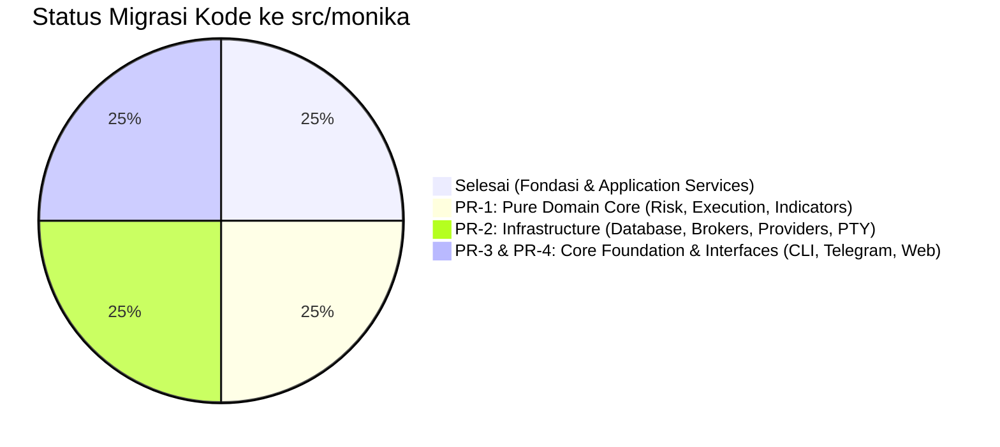

# Roadmap Migrasi Bertahap ke `src/monika` (Clean Architecture)

> **Status:** Active / In-Progress  
> **Versi:** 1.0.0  
> **Terakhir Diperbarui:** 12 Oktober 2026  
> **Prinsip Utama:** Zero-Downtime, Zero-Breakage (Two-Way Facade Shims), Zero-Suppression (No `# type: ignore`), Triple Quality Gate 100% Green.

---

## 1. Status Kemajuan Migrasi

- [x] **Milestone 0 (Fondasi Arsitektur & Application Service Layer) — SELESAI (`a510af9`)**
  - Struktur paket kanonik `src/monika/` (`core`, `domain`, `application`, `infrastructure`, `interfaces`).
  - Konfigurasi `pyproject.toml`, `pytest.ini`, `pyrightconfig.json` mendukung dual-namespace.
  - Implementasi 4 Canonical Application Services (`TradingService`, `PortfolioService`, `MarketIntelService`, `GeneralHarnessService`).
  - Two-way compatibility shims di `trading-agent/services/`.
  - Refactoring router `routes/trading.py` dan Telegram bot `trading_commands.py`.
  - Test suite paritas `trading-agent/tests/test_architecture_parity.py` (6/6 passing).

---

## 2. Rincian PR (Pekerjaan Rumah) Lanjutan

### PR-1: Migrasi Pure Domain Core (`src/monika/domain/`)
**Fokus:** Memindahkan seluruh aturan bisnis dan model finansial murni yang tidak boleh bergantung pada layer luar (inward dependency only).

1. **`src/monika/domain/risk/`**:
   - Pindahkan `trading-agent/risk/risk_gate.py` -> `src/monika/domain/risk/risk_gate.py`.
   - Pindahkan `trading-agent/risk/trade_proposal.py` -> `src/monika/domain/risk/trade_proposal.py`.
   - Pindahkan invariants & correlation gates.
   - Pasang re-export shims di `trading-agent/risk/*.py`.
2. **`src/monika/domain/execution/`**:
   - Pindahkan state machine, order validator, dan reconciliation logic.
   - Pasang re-export shims di `trading-agent/execution/*.py`.
3. **`src/monika/domain/indicators/`**:
   - Pindahkan `VectorFactorEngine` dan kalkulator alpha.
   - Hubungkan ke `trading-agent/data/alpha_catalog/`.
   - Pasang re-export shims di `trading-agent/indicators/*.py`.
4. **Verifikasi Gate:**
   - `pytest trading-agent/tests/test_risk_gate.py trading-agent/tests/test_vector_factor_engine.py -v`
   - `npx pyright src/monika/domain`

---

### PR-2: Migrasi Infrastructure & Persistence Layer (`src/monika/infrastructure/`)
**Fokus:** Memindahkan akses eksternal (Database PostgreSQL/SQLite, Broker MT5, LLM APIs, PTY Socket).

1. **`src/monika/infrastructure/database/`**:
   - Pindahkan ORM models (`database/models.py`), repositories (`database/repositories/`), session factories (`database/db.py`, `database/async_db.py`).
   - Pertahankan jalur Alembic migrations yang sinkron.
   - Pasang re-export shims di `trading-agent/database/*.py`.
2. **`src/monika/infrastructure/brokers/`**:
   - Pindahkan `mt5_client.py`, `paper_tracker.py`, broker adapters ke `src/monika/infrastructure/brokers/`.
   - Pasang re-export shims di `trading-agent/execution/backends/` dan `trading-agent/execution/`.
3. **`src/monika/infrastructure/providers/`**:
   - Pindahkan LLM clients (`analysis/providers/`), credential pool, dan rate limiters ke `src/monika/infrastructure/providers/`.
   - Pasang re-export shims di `trading-agent/provider/`.
4. **`src/monika/infrastructure/pty/`**:
   - Pindahkan `pty_bridge.py` ke `src/monika/infrastructure/pty/`.
5. **Verifikasi Gate:**
   - `pytest trading-agent/tests/database -v`
   - `alembic check`
   - `npx pyright src/monika/infrastructure`

---

### PR-3: Migrasi Core Foundation (`src/monika/core/`)
**Fokus:** Primitives bersama yang digunakan lintas domain dan infrastructure.

1. **`src/monika/core/config/`**:
   - Pindahkan `config/settings.py`, `config_manager.py`, dan schemas ke `src/monika/core/config/`.
   - Pasang re-export shims di `trading-agent/config/*.py`.
2. **`src/monika/core/security/`**:
   - Pindahkan `security/terminal_guard.py`, `credential_vault.py`, `nt_guard.py`, `prompt_injection_scanner.py` ke `src/monika/core/security/`.
   - Pasang re-export shims di `trading-agent/security/*.py`.
3. **`src/monika/core/telemetry/`**:
   - Pindahkan structured logging, log redactor, dan metrics reporter.
4. **Verifikasi Gate:**
   - `pytest trading-agent/tests/test_cli_theme.py trading-agent/tests/test_phase4_toolsets_and_terminal_guard.py -v`
   - `npx pyright src/monika/core`

---

### PR-4: Migrasi & Dekomposisi Interface Layer (`src/monika/interfaces/`) & Frontend Monorepo
**Fokus:** Presentasi pengguna, pemecahan monolith interface, dan isolasi frontend.

1. **Dekomposisi Monolith `telegram_bot/bot.py` (5.069 LOC)**:
   - Pecah menjadi sub-router ramping di `src/monika/interfaces/telegram/handlers/`:
     - `trading_router.py` (command `/trade`, `/close`, `/orders`, `/positions`)
     - `risk_router.py` (command `/risk`, `/margin`, `/kill`, `/resume`)
     - `market_router.py` (command `/quote`, `/factors`, `/calendar`, `/chart`)
     - `harness_router.py` (command AI general chat & tool execution)
     - `admin_router.py` (autentikasi & pairing)
   - Jadikan `bot.py` hanya sebagai *Composition Root* (< 400 LOC) tanpa 223 lazy imports.
2. **`src/monika/interfaces/cli/`**:
   - Pindahkan `cli/main.py`, `cli/tui.py`, subcommands ke `src/monika/interfaces/cli/`.
   - Pasang entrypoint `monika = monika.interfaces.cli.main:main` di `pyproject.toml`.
3. **`src/monika/interfaces/dashboard/`**:
   - Pindahkan FastAPI router dan WebSocket streamer ke `src/monika/interfaces/dashboard/`.
4. **Isolasi Frontend React 19**:
   - Pindahkan `trading-agent/logging_observability/dashboard/frontend` ke root `frontend/`.
   - Konfigurasi TypeScript `strict: true` dan script build monorepo.
5. **Otomatisasi Dokumentasi AST (`scripts/generate_architecture_docs.py`)**:
   - Buat skrip pembaca AST otomatis untuk menghasilkan update `STRUCTURE.md` dan `INDEX.md` tanpa editing manual rentan desinkronisasi.
6. **Verifikasi Gate:**
   - `pytest trading-agent/tests -v`
   - `ruff check .`
   - `npx pyright` (0 error, 0 warning di seluruh repositori)
   - `npm run build` di `frontend/`

---

## 3. Protokol Eksekusi untuk Agent Selanjutnya

Setiap Agent yang melanjutkan PR ini **WAJIB** mematuhi:
1. **Aturan Single Intent**: Eksekusi tepat 1 PR per siklus (jangan mencampur PR-1 dengan PR-2 atau PR-4).
2. **Aturan Backward Compatibility**: Jangan pernah menghapus file di `trading-agent/` tanpa memasang re-export shim identik (`from monika.x.y import Z; __all__ = ["Z"]`).
3. **Aturan Zero-Suppression**: Dilarang menggunakan `# type: ignore`, `# noqa`, atau bypass kotor.
4. **Triple Quality Gate**: `pytest`, `ruff`, `pyright` harus 100% hijau sebelum commit.
5. **Conventional Commit 3-Tier**: Commit wajib menyertakan Header, Technical Body, dan Provenance Footer (`Verified-by`).
