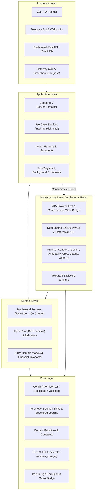
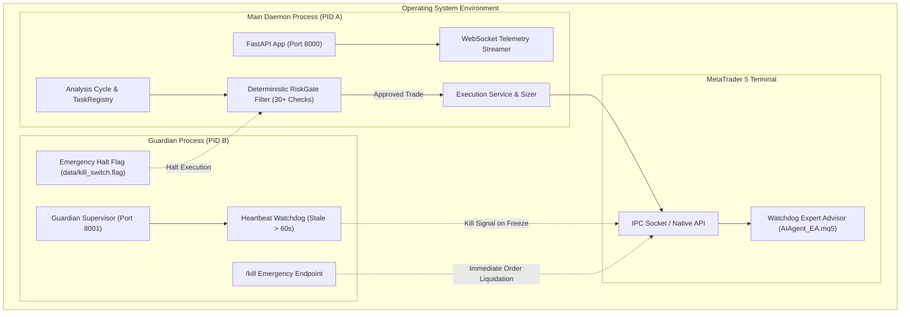

# Monika System Architecture & Technical Specification

> **Version**: 2.0.0 | **Author**: Saiful Akbar & Contributors | **Status**: Active Quantitative Research & Production Framework

---

## 1. Architectural Philosophy & Layer Discipline

Monika is structured under strict **Clean Architecture (Hexagonal / Ports-and-Adapters)** principles. Dependencies flow **strictly inward**:



### Layer Rules & Invariants
1. **Interfaces Layer (`src/monika/interfaces`)**:
   - Thin adapters translating protocol/UI events into application use-case calls.
   - Zero financial calculation, zero SQL, zero direct broker communication.
2. **Application Layer (`src/monika/application`)**:
   - Orchestration workflows, background task management (`TaskRegistry`), and composition root (`bootstrap.py`).
   - Modularized orchestrator mixins (`AgentBuilderMixin`, `AgentLifecycleMixin`, `AgentMonitorsMixin`, `AgentRecoveryMixin`).
   - Depends only on Domain and Core; communicates with Infrastructure strictly via abstract interfaces (ports).
3. **Domain Layer (`src/monika/domain`)**:
   - Pure business entities, deterministic risk algorithms (`RiskGate`), mathematical sizing (`PositionSizing`), and alpha formulas.
   - Pure Python / NumPy: zero network, zero database, zero framework imports.
4. **Core Layer (`src/monika/core`)**:
   - Primitive data types, configuration parsers, security scanners, runtime paths, and high-performance computation bridges:
     - `monika_core_rs`: Compiled Rust C-ABI kernel for high-throughput indicators, SMC pivots, and Monte Carlo equity path evaluation.
     - `polars_bridge`: Vectorized Polars dataframes for zero-lookahead stepping and multi-asset matrix alignment.
5. **Infrastructure Layer (`src/monika/infrastructure`)**:
   - Concrete implementations of external systems: MT5 client, dual SQLite/PostgreSQL databases, AI model providers, scrapers, and external notifications.

---

## 2. Process Topology & Mechanical Fortress



### The Invariants of the Mechanical Fortress
- **Rule 1 (AI Proposes, Fortress Disposes)**: LLMs formulate structured trade hypotheses; LLMs NEVER talk directly to broker sockets or place orders.
- **Rule 2 (Unbypassable RiskGate)**: Every trade must satisfy position sizing, broker constraints, drawdown ceilings, news blackouts, and stop-loss invariants across over 30 deterministic checks.
- **Rule 3 (Fail-Closed Execution)**: In any calculation error, network timeout, or ambiguous signal, the proposal is rejected immediately (`WAIT` / `NO TRADE`).
- **Rule 4 (Autonomous Watchdog)**: The independent Guardian process on port 8001 liquidates positions and halts trading even if the primary Python event loop is blocked.
- **Rule 5 (Paper Trading by Default)**: All operations run in simulated paper mode (`paper_trading.enabled: true`) unless live credentials and explicit human operator confirmation are present.

---

## 3. Dual-Tier Database Architecture

Monika supports a seamless dual-tier database strategy designed for zero-friction evaluation and institutional production scaling:

| Dimension | Trial Tier (Default) | Full / Production Tier |
| :--- | :--- | :--- |
| **Engine** | Canonical SQLite (`data/monika.db`) | PostgreSQL 16+ with connection pooling |
| **Concurrency Mode** | Write-Ahead Logging (WAL) with busy timeout | Asyncpg + `psycopg[pool]` + Advisory Locks |
| **Setup Overhead** | Zero-config, automatic creation in ~2 minutes | External PostgreSQL service |
| **Migration Path** | Run `python -m monika.interfaces.cli.main upgrade` to migrate state | Seamless upgrade with Alembic migration head `0018` |
| **Schema Mapping** | 75 mapped SQLAlchemy DeclarativeBase tables across `domain_models/` | Identical schema parity guaranteed |

---

## 4. High-Performance Computation & Accelerators

1. **Native Rust C-ABI Accelerator (`monika_core_rs`)**:
   - Compiled shared library (`monika_core_rs.dll` / `.so` / `.dylib`) loaded via ctypes with SHA-256 shadow-copy loading on Windows to prevent file-locking.
   - Accelerated routines:
     - `monika_vpin_fractional_f64`: Microstructure Volume-Synchronized Probability of Informed Trading.
     - `monika_kyle_lambda_ols_f64`: Rolling OLS price impact coefficient.
     - `monika_tick_rule_cvd_f64`: Lee-Ready tick-rule cumulative volume delta.
     - `monika_find_swings_f64` & `monika_find_swing_pivots_f64`: SMC fractal swing high/low detection.
     - `monika_eval_equity_paths_f64` & `monika_monte_carlo_simulate_f64`: High-throughput equity path simulation.
     - `monika_cscv_pbo_from_chunks_f64`: Combinatorially Symmetric Cross-Validation Probability of Backtest Overfitting.
     - 14 Classic Indicators: vectorized SIMD implementations of EMA, SMA, RSI, ATR, Bollinger Bands, Donchian, Supertrend, etc.
   - **Vectorized Fallback**: 100% mathematical parity with pure NumPy vectorized kernels if the native library is absent or disabled (`MONIKA_DISABLE_RUST_ACCEL=1`).

2. **Polars High-Throughput Pipeline (`core/dataframe/polars_bridge.py`)**:
   - Employs Apache Arrow columnar memory for zero-copy transforms and rapid historical candle stepping.
   - Eliminates Python iteration overhead during multi-timeframe indicator alignment.

---

## 5. Multi-Model AI Routing & Antigravity Bridge

Monika decouples analytical task roles from hardcoded models:
- **Role-Based Task Routing**: Roles (`stage1_fundamental`, `stage1_escalation`, `stage2_prescreen`, `debate_bull`, `debate_bear`, `debate_judge`) map to configured model providers with automated multi-tier fallbacks.
- **Antigravity Desktop OAuth**: Direct PKCE authentication with local Antigravity Bridge proxy (`http://127.0.0.1:8877/v1`), enabling Google Gemini 3.8 Flash inference classified as zero-cost free-tier in token usage tracking.
- **Multi-Horizon AI Budget Governor**: Strict ceilings ($3.00/day, $18.00/week, $60.00/month) with 90% soft-guard throttling and 100% hard circuit breakers on AI calls while preserving deterministic mechanical capital protection.
- **Adaptive Memory Supervisor**: Automatic compaction and token budget pruning to prevent context blowout during 24/7 continuous operation.

---

## 6. Concurrent Task Topology

The trading daemon coordinates over 35 concurrent background tasks supervised by `TaskRegistry` with automatic restart and exponential backoff:

```
┌─────────────────────────────────────────────────────────────────────────────┐
│                       TASK REGISTRY SUPERVISORY TREE                        │
├─────────────────────────┬───────────────────────────────────────────────────┤
│ Market & Data           │ MarketDataScheduler, MacroDataScheduler,          │
│                         │ ActiveCalendarPoller, TickStream                  │
├─────────────────────────┼───────────────────────────────────────────────────┤
│ Analysis & Deliberation │ GraphCycleScheduler, DailyReportScheduler,        │
│                         │ NewsWatcher, DigestSliceScheduler,                │
│                         │ PostReleaseAnalyzer, TriggerChecker               │
├─────────────────────────┼───────────────────────────────────────────────────┤
│ Strategy & Playbooks    │ EdgeStrategyRunner, AlphaDiscoveryScheduler,      │
│                         │ StrategySynthesisScheduler, PlaybookCurator,      │
│                         │ MicroPlaybookCompiler, SkillCurator               │
├─────────────────────────┼───────────────────────────────────────────────────┤
│ Financial Guardians     │ PositionGuardian, TrailingStopManager,            │
│                         │ PositionSupervisor, OrderReconciler,              │
│                         │ FlashCrashDetector, FridayCloseGuardian,          │
│                         │ FloatingDrawdownMonitor, MarginGuardian,          │
│                         │ PaperTradeMonitor, PositionExitReviewer           │
├─────────────────────────┼───────────────────────────────────────────────────┤
│ System & Monitoring     │ HeartbeatManager, EAWatchdog, Dashboard API,      │
│                         │ MT5HealthMonitor, DBHealthCheck, CacheReaper,     │
│                         │ MemorySupervisor, ScraperLoop, WhatIfResolver,    │
│                         │ NotifierOutboxFlusher, RiskParameterReloader,     │
│                         │ ConfigManagerWatcher, TelegramBot, PluginEngine,  │
│                         │ UniversalCron, GuardianSupervisor                 │
└─────────────────────────┴───────────────────────────────────────────────────┘
```
