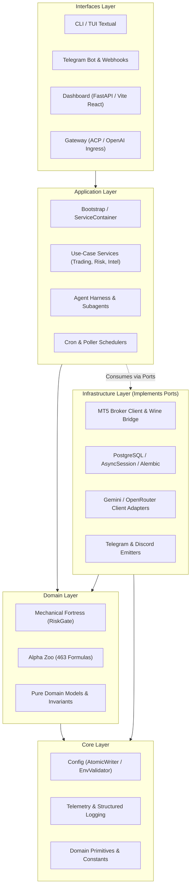
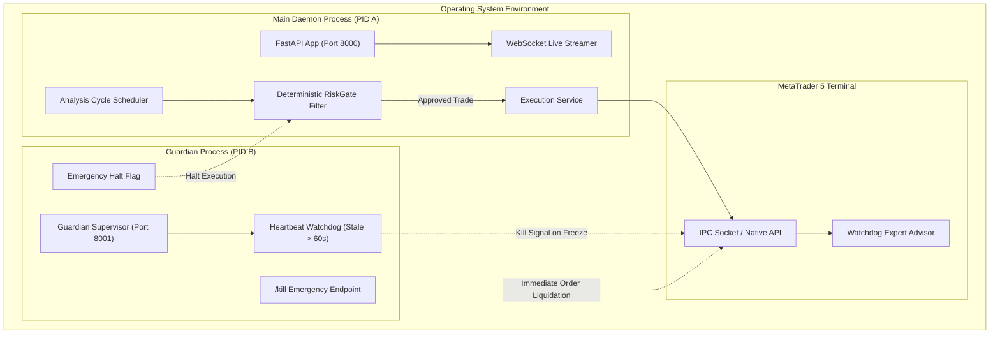

# Monika System Architecture & Technical Specification

> **Version**: 1.0.0 | **Author**: Saiful Akbar | **Status**: Production-Ready

---

## 1. Architectural Philosophy & Layer Discipline

Monika is structured under strict **Clean Architecture (Hexagonal / Ports-and-Adapters)** principles. Dependencies flow **strictly inward**:

### Layer Rules & Invariants
1. **Interfaces Layer (`src/monika/interfaces`)**:
   - Thin adapters translating protocol/UI events into application use-case calls.
   - Zero financial calculation, zero SQL, zero direct broker communication.
2. **Application Layer (`src/monika/application`)**:
   - Orchestration workflows, background task management, and composition root.
   - Depends only on Domain and Core; communicates with Infrastructure strictly via abstract interfaces (ports).
3. **Domain Layer (`src/monika/domain`)**:
   - Business entities, deterministic risk algorithms, mathematical sizing, and alpha formulas.
   - Pure Python: zero network, zero database, zero framework imports.
4. **Core Layer (`src/monika/core`)**:
   - Primitive data types, configuration parsers, and low-level utility primitives.
5. **Infrastructure Layer (`src/monika/infrastructure`)**:
   - Concrete implementations of external systems: MT5 bridge, PostgreSQL database, AI model providers, scrapers.

---

## 2. Process Topology & Mechanical Fortress

### The Invariants of the Mechanical Fortress
- **Rule 1 (AI Proposes, Fortress Disposes)**: LLMs formulate structured trade hypotheses; LLMs NEVER talk directly to broker sockets or place orders.
- **Rule 2 (Unbypassable RiskGate)**: Every trade must satisfy position sizing, margin capacity, drawdown ceilings, and stop-loss invariants.
- **Rule 3 (Fail-Closed Execution)**: In any calculation error, network timeout, or ambiguous signal, the proposal is rejected immediately.
- **Rule 4 (Autonomous Watchdog)**: The independent Guardian process on port 8001 liquidates positions and halts trading even if the primary Python event loop is blocked.
- **Rule 5 (Paper Trading by Default)**: All operations run in simulated paper mode unless live credentials and explicit human operator confirmation are present.
