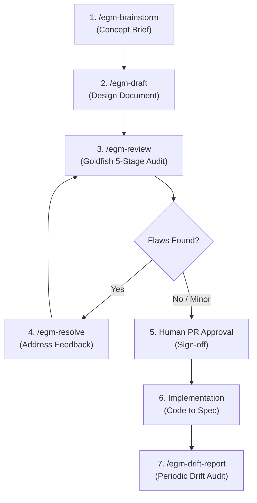

# Monika — EGM Design Specifications Sitemap

> **Elephant-Goldfish Model (EGM)** Index for Monika Algorithmic Trading Platform.
> Authoritative Specifications and Architectural Designs.

---

## 1. Overview & Architectural Grounding

This directory hosts the technical specifications drafted using the **Elephant-Goldfish Model (EGM)**. Every feature or architectural change within Monika that requires non-trivial design decisions must be specified and reviewed here before implementation.

All designs in this directory **must strictly adhere to**:
1. **The Mechanical Fortress** ([PRD.md](../../PRD.md)): AI proposes trade hypotheses; the deterministic `RiskGate` (`src/monika/domain/risk/risk_gate.py`) disposes. No LLM may execute orders directly.
2. **Fail-Closed Invariants** ([AGENTS.md](../../AGENTS.md)): Missing, stale, NaN, or unparseable market/equity data must reject or hold trades—never default open.
3. **Financial Precision**: All monetary and risk calculations must use `Decimal`. Order volume must be rounded **down** to the symbol's step constraint.
4. **Clean Architecture Boundary**: Domain layers never import Application, Infrastructure, or Interfaces.

---

## 2. EGM Lifecycle in Monika

### Workflow Reference:
1. **Brainstorming**: Run `/egm-brainstorm <feature concept>` to explore constraints and generate `concepts_brief.md`.
2. **Drafting**: Run `/egm-draft` to iteratively compile the specification into `docs/designs/<feature-name>.md`.
3. **Adversarial Audit**: Run `/egm-review docs/designs/<feature-name>.md` to dispatch zero-context Goldfish subagents (`egm-zoom-out`, `egm-comprehension`, `egm-design`, `egm-implementation-readiness`).
4. **Resolution**: Run `/egm-resolve` to update the document based on Goldfish findings.
5. **Approval & Coding**: Once approved by the repository owner, write tests and code strictly matching the spec.
6. **Drift Detection**: Run `/egm-drift-report docs/designs/` periodically to ensure code and documents remain synchronized.

---

## 3. Specifications Index

| Specification | Author / Date | Status | Primary Subsystem | Target Files / Contracts |
| :------------ | :------------ | :----- | :---------------- | :----------------------- |
| [Database Architecture Modernization](database_architecture_modernization.md) | Antigravity Core / 2026-11-03 | `Draft` | `infrastructure/database` | `src/monika/infrastructure/database/` |
| [Runtime Storage Separation & Layered Overlay](runtime_storage_separation.md) | Antigravity Core / 2026-11-03 | `Draft` | `core/paths`, `application/skills`, `application/strategies` | `src/monika/core/paths.py`, `src/monika/application/skills/loader.py`, `src/monika/application/analysis/strategies/registry.py` |
| *(Example / Template)* | Monika Team | Template | `domain/risk` | `src/monika/domain/risk/` |

> *Status values: `Draft` | `In Review` | `Approved` | `Implemented` | `Deprecated`*
