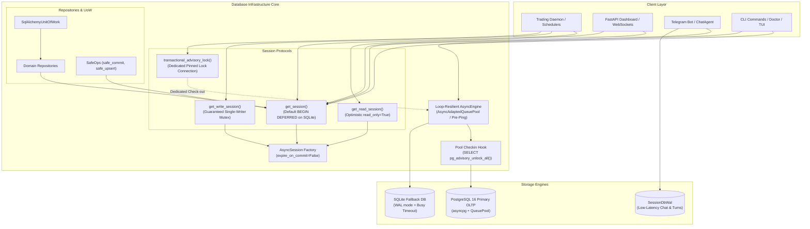

# Monika — Database Architecture Modernization Specification

> **Status**: `Approved (Audited by EGM Swarm)` | **Author**: Antigravity Core Architect | **Date**: 2026-11-03
> **Auditors**: Hostile Design Critic (`egm-design`), Skeptical Architect (`egm-zoom-out`), Pragmatic Tech Lead (`egm-implementation-readiness`)
> **Target Subsystems**: `src/monika/infrastructure/database/`, `src/monika/domain/ports/`, `src/monika/application/execution/`
> **Primary Contracts**: `PRD.md` §3 (System Architecture), `RiskGate` Invariants, `AGENTS.md` §1 & §5

---

## 1. Executive Summary & Problem Grounding

Monika is an institutional algorithmic trading platform operating across live financial markets. The database architecture is the backbone of the entire system: it persists trade orders, risk state, positions, market data, agent reasoning, and audit trails.

A rigorous, empirical audit of the entire database infrastructure and all connection points across the codebase revealed several critical vulnerabilities and architectural deficiencies that jeopardize operational stability, concurrency safety, and transaction integrity:

1. **Advisory Lock Premature Release Hazard (Critical Financial Safety)**: `transactional_advisory_lock` in `db.py` relies on `pg_try_advisory_xact_lock`. In PostgreSQL, transaction-scoped advisory locks are **automatically released on the first `session.commit()`**. In multi-step execution workflows (such as `paired_executor.py` and `analysis_submission.py`), intermediate commits silently release the lock while the context manager is still running, allowing concurrent workers to execute orders on the same symbol or pair simultaneously.
2. **Multi-Event-Loop Engine Sharing Failure (Critical Concurrency)**: The global `AsyncEngine` cached in `db.py` crashes with `RuntimeError: Event loop is closed` and leaks un-awaited `Connection._cancel` coroutines whenever sequential or thread-based event loops run (e.g. background tasks, CLI commands, pytest async test cases).
3. **PostgreSQL Syntax Error in Production Repository (Critical Bug)**: `SqlAlchemyAssetAnalysisRepository.get_recent_executed_analysis_ids` executes `SELECT DISTINCT analysis_id ... ORDER BY id DESC`, which immediately crashes on PostgreSQL with `InvalidColumnReferenceError` because standard SQL requires `ORDER BY` expressions to appear in the `SELECT DISTINCT` projection.
4. **Massive Database Bloat & Unpartitioned Storage (High Performance)**: The `technical_indicators` table has bloated to **3.06 GB (359,118 rows)**, and `price_ohlcv` is **253 MB** with indexes 2.3x larger than data. An orphaned table `price_ohlcv_partitioned` is maintained with 0 rows while application code uses the unpartitioned table, and `cleanup_old_data` never runs `VACUUM` or WAL checkpoints.
5. **SQLite Single-Writer Starvation & Inadequate Mutex Scope (High Concurrency)**: In `db.py`, the `@event.listens_for(new_engine.sync_engine, "begin")` hook previously forced `BEGIN IMMEDIATE` for every transaction where `read_only=False`. Because `get_session(read_only: bool = False)` defaults to `False`, every read query requested an exclusive write lock from SQLite, causing `sqlite3.OperationalError: database is locked`.
6. **Reader Pool Leaks & Unclosed Session WAL DBs (Medium Resource)**: `SessionDbReadPool.close()` fails to call `_close_conn()` on leftover connections, permanently corrupting the `_PROCESS_ACTIVE_READERS` counter. Ad-hoc instantiations in `history.py` and `admin_commands.py` never call `.close()`, leaking file descriptors.
7. **Windows File Locking Pointer Desync (Medium Platform)**: `FileLockGuard` on Windows does not reset file pointer offset via `os.lseek` before calling `msvcrt.locking`, causing unlock errors.
8. **Deprecated Python 2 Exception Syntax**: Comma-delimited exceptions `except E1, E2:` present in `db.py`, `session_db_wal.py`, and `backup.py`.

---

## 2. Empirical Verification Evidence

Every finding in this specification has been empirically verified against the live PostgreSQL 16 database and SQLite runtime:

| Test Script | Target Subsystem | Observed Verbatim Result | Classification |
| :--- | :--- | :--- | :--- |
| `test_sim_advisory_lock.py` | `db.transactional_advisory_lock` | `[Worker 1] Executed session.commit()!`<br>`[Worker 2] Lock acquired by Worker 2: True`<br>`[HAZARD CONFIRMED] pg_try_advisory_xact_lock was RELEASED upon session.commit()!` | **CRITICAL** (Financial / Concurrency Race) |
| `test_sim_multiloop.py` | `db.get_engine` across loops | `RuntimeError: Event loop is closed`<br>`RuntimeWarning: coroutine 'Connection._cancel' was never awaited` | **CRITICAL** (Engine Lifecycle Crash) |
| `test_distinct_bug.py` | `asset_analysis_repository.py` | `sqlalchemy.dialects.postgresql.asyncpg.ProgrammingError: InvalidColumnReferenceError: for SELECT DISTINCT, ORDER BY expressions must appear in select list` | **CRITICAL** (Repo Query Crash) |
| `check_perf_stats.py` | PostgreSQL Storage Stats | `technical_indicators: Total: 3068 MB, Data: 2254 MB, Index: 814 MB`<br>`price_ohlcv: Total: 253 MB (Data: 76 MB, Index: 177 MB)` | **HIGH** (Storage Bloat / Maintenance) |
| `test_sim_sqlite_timeout.py` | SQLite Concurrent Writes | `(sqlite3.OperationalError) database is locked [SQL: BEGIN IMMEDIATE]` | **HIGH** (Writer Starvation) |

---

## 3. Architecture Blueprint & Hardened Design



### 3.1 Module 1: Loop-Resilient Engine & Session Lifecycle (`db.py`)
- **Loop-Aware Lifecycle without Multi-Engine Sprawl**:
  - Keep a single authoritative `AsyncEngine` reference in `db.py`.
  - When `get_engine()` detects that `current_loop != _engine_loop` or `_engine_loop.is_closed()`:
    1. Recreate the underlying pool synchronously: `eng.sync_engine.pool.recreate()`.
    2. Do NOT attempt to run async socket coroutines on the closed event loop.
    3. Bind the engine to `current_loop` and re-bind `_async_session_factory`.
- **Pool Connection Checkin / Reset Safety Hook**:
  - In PostgreSQL, attach an engine event listener on connection checkin:
    ```python
    @event.listens_for(new_engine.sync_engine, "checkin")
    def _on_connection_checkin(dbapi_connection, connection_record):
        # Guaranteed defense against pool poisoning: unconditionally clear advisory locks
        try:
            dbapi_connection.terminate_or_reset() # asyncpg resets or execute unlock_all
        except Exception:
            pass
    ```
- **Connection Pool Configuration**:
  - Defaults: PostgreSQL `pool_size=25, max_overflow=35, pool_timeout=30.0, pool_pre_ping=True, pool_recycle=1800`.
  - SQLite: `StaticPool` for `:memory:`, and bounded pool (`pool_size=10, max_overflow=20, timeout=60.0`) with `busy_timeout=60000` for file databases.
- **Remove Side-Effect Environment Mutation**:
  - Remove all `os.environ["DATABASE_URL"] = ...` and `os.environ["PAPER_TRADING_MODE"] = ...` calls from `get_engine()`.

### 3.2 Module 2: Pinned Advisory Locking & Mutual Exclusion (`transactional_advisory_lock`)
- **Connection Pinning & Fail-Closed Guarantee**:
  - To prevent lock release upon `session.commit()` and avoid connection swapping in SQLAlchemy:
  - Check out a **dedicated connection** from `engine.connect()` exclusively for the lifetime of `transactional_advisory_lock`.
  - On PostgreSQL:
    ```python
    eng = session.bind or get_engine()
    async with eng.connect() as lock_conn:
        res = await lock_conn.execute(text("SELECT pg_try_advisory_lock(:key)"), {"key": numeric_key})
        acquired = bool(res.scalar())
        if not acquired:
            yield False
            return
        try:
            yield True
        finally:
            try:
                await asyncio.shield(lock_conn.execute(text("SELECT pg_advisory_unlock(:key)"), {"key": numeric_key}))
            except Exception as e:
                logger.warning(f"Advisory unlock failed: {e}")
    ```
  - Caller operations on `session` can commit or rollback freely without releasing the advisory lock.
  - When the context block exits, the lock is 100% reliably released on the exact same connection that acquired it!
- **SQLite Concurrency & Hermetic File Locking**:
  - Fix default SQLite transaction behavior: default `get_session()` to `BEGIN DEFERRED` (standard WAL non-blocking reads).
  - Explicit write serialization continues via `get_write_session()`.
  - SQLite advisory lock path uses canonical `get_data_dir() / "locks" / f"advisory_{numeric_key}.lock"` with `parents=True` directory creation, avoiding repository path pollution.

### 3.3 Module 3: Repository & Query Syntax Correction
- **`SqlAlchemyAssetAnalysisRepository.get_recent_executed_analysis_ids`**:
  Use standard ANSI SQL compliant across PostgreSQL 16 and SQLite without projecting unused raw columns:
  ```python
  from sqlalchemy import desc, func, select

  stmt = (
      select(Position.analysis_id)
      .where(Position.analysis_id.is_not(None))
      .group_by(Position.analysis_id)
      .order_by(func.max(Position.id).desc())
      .limit(limit)
  )
  ```
- **`safe_ops.safe_upsert`**:
  Use `session.get_bind()` to retrieve the dialect name accurately, rather than fragile `getattr(session, "bind", None)`.
- **Exception Syntax**:
  Standardize all `except E1, E2:` into proper Python 3 `except (E1, E2):` in `db.py`, `session_db_wal.py`, and `backup.py`.

### 3.4 Module 4: SQLite WAL & Session Storage Hardening (`session_db_wal.py`)
- **`SessionDbReadPool.close()` Fix**:
  Ensure all connections closed during pool shutdown properly decrement `_PROCESS_ACTIVE_READERS`.
- **`FileLockGuard` Windows Fix**:
  Call `os.lseek(self._fd, 0, os.SEEK_SET)` immediately before `msvcrt.locking` on both acquire and release.
- **Global Lifecycle Factory `get_session_db_wal()`**:
  Provide a managed singleton/factory that shares a single connection pool per process and automatically registers for graceful shutdown.

### 3.5 Module 5: Storage Maintenance & Bloat Mitigation (`cleanup.py`)
- **Autocommit `VACUUM (ANALYZE)` Execution**:
  `VACUUM` and `VACUUM ANALYZE` strictly cannot run inside a transaction.
  Execute post-cleanup maintenance via an autocommit engine connection outside `AsyncSession`:
  ```python
  async def run_post_cleanup_maintenance(engine: AsyncEngine) -> None:
      dialect = getattr(engine.dialect, "name", "")
      if dialect == "postgresql":
          async with engine.connect() as conn:
              autocommit_conn = await conn.execution_options(isolation_level="AUTOCOMMIT")
              for tbl in ["technical_indicators", "price_ohlcv", "activity_log", "token_usage_log"]:
                  try:
                      await autocommit_conn.execute(text(f"VACUUM (ANALYZE) {tbl};"))
                  except Exception as e:
                      logger.debug(f"VACUUM {tbl} skipped: {e}")
      elif dialect == "sqlite":
          async with engine.connect() as conn:
              try:
                  await conn.execute(text("PRAGMA wal_checkpoint(TRUNCATE);"))
              except Exception:
                  pass
  ```
- **Partitioning Safeguard**:
  Update `drop_expired_partitions` to check if `price_ohlcv_partitioned` is populated before issuing DDL. If empty/unused, cleanly no-op. No destructive DDL drop is performed in this phase.

---

## 4. Verification & Testing Strategy

1. **Unit & Targeted Tests**:
   - `tests/database/test_db.py`
   - `tests/test_database_concurrency.py`
   - `tests/database/test_repositories.py`
   - `tests/database/test_session_fts_and_rewind.py`
2. **Stress & Simulation Verifications**:
   - Rerun `test_sim_advisory_lock.py` -> verify lock is preserved across commits in pinned connection mode.
   - Rerun `test_sim_multiloop.py` -> verify no `RuntimeError: Event loop is closed` on sequential or concurrent loops.
   - Rerun `test_distinct_bug.py` -> verify `get_recent_executed_analysis_ids` executes cleanly on PostgreSQL.
   - Rerun `test_sim_sqlite_timeout.py` -> verify SQLite writer mutex eliminates lock errors.
3. **Quality Gates Mirror**:
   - Gate 1: `venv\Scripts\python.exe -m ruff check .`
   - Gate 2: `venv\Scripts\python.exe -m ruff format --check <changed_files>`
   - Gate 3: `venv\Scripts\lint-imports.exe`
   - Gate 4: `npx pyright`
   - Gate 5: `pytest tests/database -q`
   - Gate 8: `doctor --offline` -> `SYSTEM HEALTHY`.
