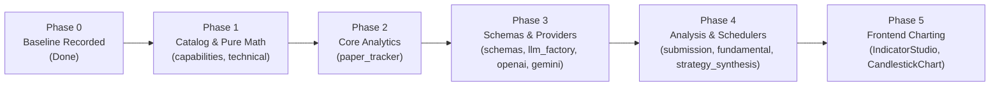

# Monika — Architectural Specification: Modular Refactoring of God Modules

> **Document Version**: 2.0.0 (Post-Goldfish Adversarial Review)
> **Author**: Antigravity Architecture Swarm
> **Status**: `In Review` | **Target**: Architecture Modernization & Modularity
> **Anchors**: [PRD.md](../../PRD.md), [AGENTS.md](../../AGENTS.md), [SITEMAP.md](SITEMAP.md)

---

## 1. Executive Summary & Pragmatic Scope

Following rigorous adversarial review by the Goldfish Swarm (`egm-design`, `egm-zoom-out`, `egm-implementation-readiness`), this specification adopts an **anti-quotaist, high-reliability approach**:
- **Focus strictly on true god modules with high blast radius and mixed concerns.**
- **Prune cosmetic micro-refactoring**:
  - `src/monika/core/native/monika_core_rs/src/lib.rs` (1,597 lines of pure, stateless, C-ABI extern math kernels) is retained as a single file to prevent Windows DLL lock / shadow-copy compilation friction and build fragility.
  - `src/monika/application/agent/harness/agent_harness.py` (1,562 lines) is retained as the cohesive ReAct coordinator; it already delegates to 15+ submodules in `harness/`.
  - Monolithic regression test suites (`test_application_execution_full_coverage.py` and `test_domain_risk_full_coverage.py`) are retained intact to prevent fixture leakage, ordering regressions, and destructive file deletion prohibited by AGENTS.md §1.

### Target Inventory (Production Codefiles)

| # | Module / Subsystem | Current Lines | Primary Problem | Target Modular Architecture |
|---|---|---|---|---|
| **1** | `src/monika/infrastructure/providers/capabilities.py` | 1,832 | 1,300-line static dictionary coupled with resolver logic | Sibling `capabilities_catalog.py` (types + catalog) + `capabilities.py` (resolvers) |
| **2** | `src/monika/infrastructure/providers/llm_factory.py` | 2,053 | Circuit breaker + 1,080-line `FallbackClientWrapper` in one file | Sibling `circuit_breaker.py` + `fallback_wrapper.py` (with abstract protocol) + `llm_factory.py` |
| **3** | `src/monika/domain/indicators/technical.py` | 2,178 | Core math + 660-line UI workspace series calculation engine | Sibling `workspace_indicators.py` + `technical.py` (classic indicators & facade) |
| **4** | `src/monika/core/analytics/paper_tracker.py` | 1,775 | Execution tracking mixed with reporting math & equity simulation | Sibling `paper_analytics.py` (pure functions) + `paper_suspension.py` + `paper_tracker.py` |
| **5** | `src/monika/application/analysis/schemas/pydantic_schemas.py` | 2,124 | Enums, sub-schemas, 420-line asset schema, 730-line brief schema | Flat siblings in `schemas/`: `common.py`, `analysis_schemas.py`, `brief_schemas.py`, `strict.py` |
| **6** | `src/monika/application/analysis/tools/mixins/analysis_submission.py` | 2,072 | 1,330-line submission method with inline validation logic | Consolidate validation into existing `analysis_validation.py` + typed `AnalysisSubmissionContext` |
| **7** | `src/monika/infrastructure/providers/openai_provider.py` | 1,958 | Protocol converters, stream parsing, and completions | Sibling `openai_protocol.py` + `openai_streaming.py` + `openai_provider.py` |
| **8** | `src/monika/infrastructure/providers/gemini_provider.py` | 1,645 | Key pool rotation, block checking, and tool loop | Sibling `gemini_key_manager.py` + `gemini_protocol.py` + `gemini_provider.py` |
| **9** | `src/monika/application/analysis/stages/fundamental_stage.py` | 1,757 | 1,075-line `run()` method with macro debate & prompts | Sibling `fundamental_debate.py` + `fundamental_prompts.py` + `fundamental_stage.py` |
| **10** | `src/monika/application/scheduler/strategy_synthesis_scheduler.py` | 1,656 | AST code repair, sandbox compilation, and evaluation | Sibling modules: `synthesis_validator.py`, `synthesis_sandbox.py`, `synthesis_evaluator.py` |
| **11** | `frontend/src/components/charts/IndicatorStudioPopover.tsx` | 2,022 | 4 distinct tabs, presets, and color pickers in one file | Modular subfolder: `frontend/src/components/charts/indicator_studio/tabs/` |
| **12** | `frontend/src/components/charts/CandlestickChart.tsx` | 1,724 | HUD rendering, resize observer, and indicator series in one file | Sibling `ChartHud.tsx` + `useChartIndicators.ts` + `CandlestickChart.tsx` |

---

## 2. Architectural Invariants & Anti-Trap Discipline

### 2.1 The Strict DAG Rule (No Upward Imports)
To completely prevent circular import errors (`ImportError: cannot import name ... from partially initialized module`):
- **Rule**: Extracted sibling/subordinate modules must NEVER import from their parent facade module or package `__init__.py`.
- All shared types, protocols, enums, and constants must reside in leaf modules and be imported downward.
- The parent facade imports from the leaf/sibling modules and re-exports symbols in `__all__`.

### 2.2 Protocol Decoupling for `LLMFactory` & `FallbackClientWrapper`
- `fallback_wrapper.py` must NEVER import `LLMFactory` at the module level.
- Define `ProviderResolverProtocol` in `monika.infrastructure.providers.base_provider` or a dedicated `protocol.py`.
- `FallbackClientWrapper` types its `factory` argument against `ProviderResolverProtocol`, breaking the circular dependency.

### 2.3 `capabilities.py` Type Placement
- `ModelCapabilities` and `DEFAULT_CAPABILITIES` are defined inside `capabilities_catalog.py`.
- `capabilities.py` imports `ModelCapabilities` and `MODEL_CAPABILITIES` from `capabilities_catalog.py` and re-exports them.

### 2.4 Test Patch & Monkeypatch Invariance
Existing unit tests and `tests/conftest.py` rely heavily on patching module-level attributes:
- **`AgentHarness._log_tool_call`**: Must remain an instance method on `AgentHarness` (monkeypatched in `conftest.py`).
- **`gemini_provider.streaming_request`**: `gemini_provider` must preserve its module-level namespace references monkeypatched in `conftest.py`.
- **`strategy_synthesis_scheduler.get_session`**: Patched in `test_strategy_synthesis_scheduler.py`; any helper must accept session injection or look up via scheduler.
- **Private test helpers**: Any `_`-prefixed function imported across `tests/` (e.g. `_resolve_initial_stop_loss`, `_group_by_symbol`) MUST remain re-exported in the facade.

### 2.5 Pyright (Gate 4) & Composition Over Mixins
- Multiple-inheritance mixins without explicit state declarations cause Pyright member access errors.
- Prefer **pure functions** and **composition**:
  - `paper_analytics.py`: Pure calculation functions (`calculate_statistics(trades)`, `simulate_equity_curve(trades)`). `PaperTracker` delegates to them.
  - Central `_PAPER_TRACKER_LOCK`: Remains on the `PaperTracker` instance to guarantee async concurrency.
  - In `paper_tracker.py`, `_close_linked_position` database status mirroring (`Position.status = "closed"`) must never be separated from `check_and_close_trades` error handling to prevent RiskGate deadlocks.

### 2.6 Mechanical Fortress (PRD.md / AGENTS.md §1) Compliance in `analysis_submission.py`
- In `_tool_submit_asset_analysis`, error classification precedence is inviolable:
  - `error_class in ("GATE", "GATE_FATAL")` MUST immediately reject / force `WAIT`.
  - `BracketOptimizer` auto-healing can only trigger on `STRUCTURAL` errors after repeated attempts, NEVER on `GATE_FATAL`.

---

## 3. Phased Execution Roadmap

Execution proceeds in **5 clean, independently verifiable phases**:

### Phase 1: Pure Data Catalog & Domain Math (Zero Risk)
1. **`capabilities.py` (1,832 lines -> ~450 lines)**
   - Extract `ModelCapabilities` and `MODEL_CAPABILITIES` to `src/monika/infrastructure/providers/capabilities_catalog.py`.
   - Re-export in `capabilities.py`.
   - *Verification*: `pytest tests/analysis/providers/test_capabilities.py` + `npx pyright`.
2. **`technical.py` (2,178 lines -> ~700 lines)**
   - Extract workspace time-series evaluation (`normalize_chart_workspace_config`, `evaluate_workspace_indicators`, series helpers) into sibling `src/monika/domain/indicators/workspace_indicators.py`.
   - Re-export in `technical.py`.
   - *Verification*: `pytest tests/indicators/` + `pytest tests/core/test_rust_native_bridge.py`.

### Phase 2: Core Analytics & Paper Tracker (Low Risk)
1. **`paper_tracker.py` (1,775 lines -> ~750 lines)**
   - Extract reporting analytics (`get_statistics`, `simulate_equity_curve`, `_group_by_symbol`, `_group_by_symbol_direction`) into `src/monika/core/analytics/paper_analytics.py`.
   - Extract symbol suspension policy into `src/monika/core/analytics/paper_suspension.py`.
   - `PaperTracker` retains order execution and position lifecycle (`_close_linked_position`, `_PAPER_TRACKER_LOCK`).
   - Re-export all functions in `paper_tracker.py`.
   - *Verification*: `pytest tests/utils/test_analysis_tracker.py tests/test_paper_tracker_accounting.py`.

### Phase 3: Schemas & Infrastructure Providers (Medium Risk)
1. **`pydantic_schemas.py` (2,124 lines -> ~100 lines facade)**
   - Split into flat sibling files in `src/monika/application/analysis/schemas/`:
     - `common.py`: Enums (`TradeDirection`, `ConfidenceLevel`, etc.) & coercions.
     - `sub_models.py`: Value objects (`SpecialistAdjudication`, `PricedInAssessment`, etc.).
     - `analysis_schemas.py`: `SubmitAssetAnalysisSchema` (~420 lines).
     - `brief_schemas.py`: `SubmitFundamentalBriefSchema` (~730 lines).
     - `strict_schema.py`: `make_openai_strict_schema`, `get_tool_schema`.
   - `pydantic_schemas.py` re-exports everything in `__all__`.
   - *Verification*: `pytest tests/analysis/test_adjudication_and_risk.py` + full test suite.
2. **`llm_factory.py` (2,053 lines -> ~400 lines)**
   - Extract `ProviderCircuitBreaker` and `EndpointBlackhole` to `circuit_breaker.py`.
   - Extract `FallbackClientWrapper` to `fallback_wrapper.py`, typed against `ProviderResolverProtocol`.
   - Re-export in `llm_factory.py`.
   - *Verification*: `pytest tests/analysis/test_provider_failover_classifier.py tests/provider/test_role_fallback_chain.py`.
3. **`openai_provider.py` (1,958 lines -> ~650 lines)**
   - Extract schema helpers to `openai_protocol.py` and stream processing to `openai_streaming.py`.
   - Re-export in `openai_provider.py`.
   - *Verification*: `pytest tests/analysis/providers/test_providers_and_cost_engine.py`.
4. **`gemini_provider.py` (1,645 lines -> ~600 lines)**
   - Extract key pool manager to `gemini_key_manager.py` and protocol helpers to `gemini_protocol.py`.
   - Re-export in `gemini_provider.py`.
   - *Verification*: `pytest tests/analysis/providers/test_providers_and_cost_engine.py`.

### Phase 4: Analysis Tools & Schedulers (Medium Risk)
1. **`analysis_submission.py` (2,072 lines -> ~700 lines)**
   - Move validation logic (`_cross_validate_priced_in`, `_cross_validate_directional_coherence`, `_validate_ssvp_and_context_drift`) into the existing `src/monika/application/analysis/tools/mixins/analysis_validation.py`.
   - Retain `AssetAnalysisSubmissionMixin` with delegates to preserve exact class interface.
   - *Verification*: `pytest tests/analysis/test_stage2_structural_fixes.py`.
2. **`fundamental_stage.py` (1,757 lines -> ~500 lines)**
   - Extract macro debate orchestration to `fundamental_debate.py`.
   - Extract prompt formatting to `fundamental_prompts.py`.
   - *Verification*: `pytest tests/analysis/test_fundamental_stage.py`.
3. **`strategy_synthesis_scheduler.py` (1,656 lines -> ~550 lines)**
   - Extract AST sanitization and repair to `synthesis_validator.py`.
   - Extract candidate evaluation and scoring to `synthesis_evaluator.py`.
   - Delegate methods preserved on `StrategySynthesisScheduler`.
   - *Verification*: `pytest tests/scheduler/test_strategy_synthesis_scheduler.py`.

### Phase 5: Frontend Charting (Low Risk)
1. **`IndicatorStudioPopover.tsx` (2,022 lines -> ~300 lines)**
   - Extract tabs to `frontend/src/components/charts/indicator_studio/tabs/`:
     - `OverlaysTab.tsx`, `OscillatorsTab.tsx`, `SmcTab.tsx`, `ExecutionTab.tsx`.
   - *Verification*: `npm run build` in `frontend/`.
2. **`CandlestickChart.tsx` (1,724 lines -> ~400 lines)**
   - Extract HUD display to `ChartHud.tsx`.
   - Extract series indicator management to `useChartIndicators.ts`.
   - *Verification*: `npm run build` in `frontend/`.

---

## 4. Verification Gate Protocol Per Phase

Every single phase commit must pass the full 10-point gate sequence in Windows PowerShell 5.1:
1. `venv\Scripts\python.exe -m ruff check .`
2. `venv\Scripts\python.exe -m ruff format --check <changed_files>`
3. `venv\Scripts\lint-imports.exe`
4. `npx pyright` (must remain 0 errors, 0 warnings)
5. `venv\Scripts\python.exe -m pytest <touched_tests> -q`
6. `venv\Scripts\python.exe scripts/generate_ast_docs.py` then `... --check`
7. `venv\Scripts\python.exe -m monika.interfaces.cli.main doctor --offline`
8. `Push-Location frontend; npm run build; Pop-Location` (when touching frontend)
9. Full pytest regression: `venv\Scripts\python.exe -m pytest tests -q -m "not live and not network"` (before final commit).
