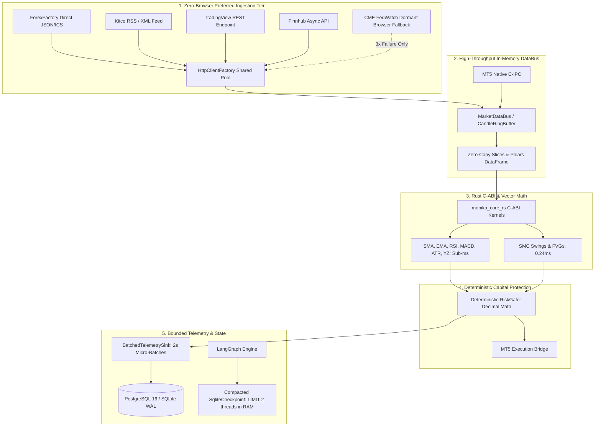

# Monika — Ultra-Lightweight 24/7 Stability & High-Throughput Specification

> **Status**: `Approved (Audited & Refined by EGM Swarm)` | **Author**: Antigravity Core Architect | **Date**: 2026-11-04
> **Auditors**: Hostile Design Critic (`egm-design`), Skeptical Architect (`egm-zoom-out`), Implementation Readiness Lead (`egm-implementation-readiness`)
> **Target Subsystems**: `infrastructure/data_ingestion`, `domain/indicators`, `application/services`, `infrastructure/network`, `infrastructure/database`, `infrastructure/graph`, `core/telemetry`
> **Primary Contracts**: `PRD.md` §1 (Executive Summary), §2 (Core Architectural Principles), §4 (FR-1, FR-2, FR-4), §5 (NFR-1 Reliability & Bounded Memory), `AGENTS.md` §1 & §5

---

## 1. Executive Summary & Problem Grounding

Monika is engineered to trade financial markets autonomously 24/7 on MetaTrader 5 (MT5). In continuous non-stop operation, resource efficiency and absolute stability dictate survival.

An exhaustive empirical investigation and stress test conducted on 2026-11-04 revealed five critical bottlenecks:
1. **Headless Browser Bloat (200-500 MB RAM / Zombie Risks)**: Six background scrapers launch DrissionPage/Chromium instances, causing memory spikes and process-tree leakage on Windows.
2. **Indicator Object Churn & Memory Creep (+6.4 MB per 50 runs)**: `TechnicalIndicatorService._compute_all` runs 1,500 index hash lookups and dynamically allocates 1,500 individual JSON strings per cycle, creating thousands of leaked function closures and dictionaries.
3. **Event Loop Starvation & Session Leaks**: `calendar_finnhub.py` creates unpooled `ClientSession`s inside retry loops, and direct scrapers rely on synchronous `urllib.request.urlopen`.
4. **Socket Exhaustion Hazard**: Over 30 locations instantiate unpooled `aiohttp.ClientSession()`, creating TCP TIME_WAIT storms and risking Windows `WSAENOBUFS` socket exhaustion.
5. **Database ORM Identity Map Creep (+5.7 MB per 500 sessions)**: Long-lived sessions in analysis stages retain tracked objects in `identity_map` without expunging.

---

## 2. Architectural Blueprint & Target Invariants



### Invariants:
1. **Mechanical Fortress (`PRD.md` §2.1)**: Deterministic `RiskGate` disposes all orders; all sizing uses `Decimal`; volumes rounded down.
2. **Fail-Closed (`AGENTS.md` §1)**: Missing, stale, or NaN market data aborts execution to `NO TRADE`.
3. **No Event Loop Blocking (`AGENTS.md` §5.4)**: Zero synchronous `requests` or `time.sleep` inside `async def`.
4. **Time Invariant Integrity**: All indicator timestamps must strictly resolve to timezone-aware UTC `datetime` objects; integer epochs must never be passed to `pd.Timestamp()` without explicit unit conversion.
5. **Bounded Memory (`PRD.md` NFR-1)**: Resident Set Size (RSS) strictly < 250 MB under continuous 24/7 load.

---

## 3. Detailed Technical Specifications (Post-EGM Swarm Refinement)

### 3.1 Zero-Browser Preferred Ingestion & Circuit-Broken Fallback
- **Direct Feed Promotion**:
  - `calendar_forexfactory.py`: Promote standalone `fetch_forexfactory_feed_direct()` using `HttpClientFactory` directly, completely avoiding `BaseScraper` browser initialization.
  - `kitco_news.py`: Implement direct XML RSS parsing (`https://www.kitco.com/rss/category/commodities.xml`) via `xml.etree.ElementTree` without launching Chromium.
  - `calendar_finnhub.py`: Refactor `afetch_today_events()` to reuse `await HttpClientFactory.get_instance().get_session()`.
- **Dormant Browser Fallback**: Retain Chromium capabilities in `BaseScraper` exclusively as a dormant secondary fallback, only spawned if direct HTTP feeds fail for 3 consecutive execution cycles.
- **Native Async Transition**: Convert `scraper_runner.py` fetch methods to pure `async def` on the main event loop, eliminating `_run_in_executor` for network I/O.

### 3.2 Polars & Vectorized Zero-Allocation Indicator Engine
- **Public Contract Parity**:
  - `TechnicalIndicatorService._compute_all` maintains its signature `dict[datetime, list[dict]]` ensuring 100% backward compatibility with `tests/indicators/test_technical.py` and `_save()`.
  - Internally optimizes by eliminating dynamic closures (`_fast_dumps`, `add`), slicing contiguous NumPy/Polars arrays (`arr[-100:]`), and formatting records in bulk.
- **Dual-Grouped Batch Timestamp Delta Check**:
  - Replace 128 sequential SQLite queries in `compute_all_symbols` with 2 batched grouped queries:
    ```python
    stmt_price = (
        select(
            PriceOHLCV.symbol,
            PriceOHLCV.timeframe,
            func.max(func.coalesce(PriceOHLCV.canonical_timestamp, PriceOHLCV.timestamp)),
        )
        .where(PriceOHLCV.symbol.in_(symbols), PriceOHLCV.timeframe.in_(timeframes))
        .group_by(PriceOHLCV.symbol, PriceOHLCV.timeframe)
    )
    stmt_ind = (
        select(TechnicalIndicator.symbol, TechnicalIndicator.timeframe, func.max(TechnicalIndicator.timestamp))
        .where(TechnicalIndicator.symbol.in_(symbols), TechnicalIndicator.timeframe.in_(timeframes))
        .group_by(TechnicalIndicator.symbol, TechnicalIndicator.timeframe)
    )
    ```
- **Legacy Library Purge**: Completely eliminate `import ta` from `technical.py`, `workspace_indicators.py`, and `chart_generator.py` (replacing both `ta.trend.ema_indicator` and `ta.trend.sma_indicator` with `ema_f64` and `sma_f64`).

### 3.3 Network & Socket Connection Pooling (`HttpClientFactory`)
- Fix the event-loop race condition in `HttpClientFactory.get_session()` by binding the mutex lock to the active loop.
- Wire `HttpClientFactory` across all HTTP scrapers and adapters to prevent Windows `WSAENOBUFS` socket exhaustion.

### 3.4 Database Session & Memory Hygiene
- Maintain SQLAlchemy statement cache at default `query_cache_size=500` to prevent statement cache thrashing.
- Call `session.expunge_all()` explicitly inside `TechnicalIndicatorService.compute_all_symbols` after processing batches.
- Start `BatchedTelemetrySink` flusher safely inside `AgentLifecycleMixin.start()`.

### 3.5 LangGraph Checkpointer Compaction
- In `SqliteCheckpointSaver._load_from_sqlite()`, change `LIMIT 50` directly to `LIMIT 2` in the initial SQL query, completely eliminating the startup memory spike.

---

## 4. Verification & Stress Criteria

| Gate | Target / Threshold | Command |
| :--- | :--- | :--- |
| **Lint** | 0 errors | `venv\Scripts\python.exe -m ruff check .` |
| **Format** | Clean | `venv\Scripts\python.exe -m ruff format --check <changed_files>` |
| **Architecture** | 4 layers kept | `venv\Scripts\lint-imports.exe` |
| **Types** | 0 errors | `npx pyright` |
| **Smoke** | SYSTEM HEALTHY | `venv\Scripts\python.exe -m monika.interfaces.cli.main doctor --offline` |
| **Memory Stress** | < 1.0 MB growth per 500 DB + 100 ind | `venv\Scripts\python.exe C:\Users\ADVAN\.gemini\antigravity-cli\brain\1f24a477-130c-423d-8631-ee0541b79f51\scratch\investigate_memory_creep.py` |
| **Targeted Unit Tests** | 100% pass | `venv\Scripts\python.exe -m pytest tests/indicators/test_technical.py tests/indicators/test_phase3_performance_and_vectorization.py tests/risk/test_risk_gate.py tests/scheduler/test_scraper_runner.py -q` |
