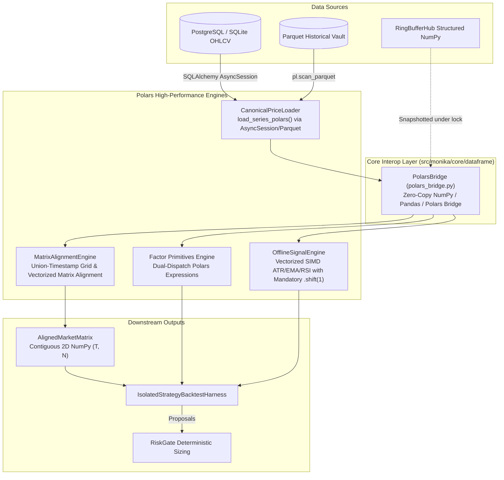

# Polars Adoption & High-Throughput Quantitative Pipeline Architecture

> **Author**: Antigravity Core | **Date**: 2026-11-04
> **Status**: `Refined Spec (Post-Goldfish Audit)` | **Subsystem**: `core/dataframe`, `domain/market`, `domain/indicators`, `application/backtest`
> **Target Files**: `src/monika/core/dataframe/polars_bridge.py`, `src/monika/domain/market/candle_ring_buffer.py`, `src/monika/domain/indicators/factor_primitives.py`, `src/monika/application/backtest/matrix_alignment.py`, `src/monika/application/backtest/price_series.py`, `src/monika/application/backtest/offline_signal_engine.py`, `requirements.txt`, `pyproject.toml`

---

## 1. Executive Summary & Problem Statement

Monika is an institutional-grade algorithmic trading platform running continuous real-time market analysis and heavy quantitative simulations (alpha discovery, Monte Carlo simulations, multi-asset walk-forward backtests). Currently, historical and backtesting pipelines rely heavily on `pandas` (~528 files across `src/`).

While Pandas is ubiquitous, it introduces critical bottlenecks in large-scale quant operations:
1. **Single-Threaded GIL Bottleneck**: Pandas operations are bound to a single CPU core, unable to leverage modern multicore processors during heavy matrix alignment or parameter grid searches.
2. **High Memory Overhead**: Python scalar boxing and DataFrame object structures consume 3x to 5x more RAM than underlying contiguous raw data, posing memory pressure when processing years of tick or M1/M5 bar data across 50+ instruments.
3. **Eager Evaluation Waste**: Pandas computes all intermediate steps immediately, allocating redundant DataFrames in RAM during chained operations.
4. **Slow Multi-Asset Alignment**: Re-indexing multi-instrument datasets sequentially using Python loops and `pd.DatetimeIndex.reindex` takes hundreds of milliseconds per batch.

**The Solution**: Adopt **Polars** (`polars>=1.20.0`) strategically where it delivers maximum ROI:
- **Primary Focus**: Backtest data ingestion, multi-asset market matrix alignment, and vectorized offline signal evaluation.
- **Conservative Live Path**: Live streaming buffers (`CandleRingBuffer`) continue using contiguous structured NumPy arrays (`CANDLE_DTYPE`) for zero-allocation sub-microsecond tick handling, offering an optional lightweight Polars view without touching the critical live execution loop.
- **Fail-Closed Dual-Engine Factor Foundation**: `factor_primitives.py` provides mathematical equivalence across both NumPy/Pandas and Polars expressions without bifurcating the underlying 474 Alpha Zoo formulas.

---

## 2. Invariants & Financial Safety Requirements

1. **The Mechanical Fortress ([PRD.md](../../PRD.md))**:
   - Polars is used exclusively for high-throughput data processing, backtesting, factor computation, and market matrix alignment.
   - Polars code **NEVER** interacts directly with broker execution sockets or places live trading orders.
   - Every live trade proposal generated from Polars-backed indicators MUST still pass the deterministic `RiskGate` (`src/monika/domain/risk/risk_gate.py`).
2. **Fail-Closed NaN & Null Invariants ([AGENTS.md](../../AGENTS.md))**:
   - In Polars expressions, missing bars, null values, or division by zero MUST propagate as `null`/`NaN`. They must NEVER be silently imputed with zero (`fill_null(0.0)` is strictly forbidden in price/risk paths, except for traded volume where zero is mathematically canonical).
   - Financial assertions or filters that encounter invalid or insufficient data must fail closed: `.is_null() | .is_nan()`.
3. **Concurrency & Watchdog Safety**:
   - Polars multithreaded queries (`collect()`) must NEVER execute synchronously on the main `asyncio` event loop thread during daemon execution. Any background Polars query in live daemon paths must be wrapped in `await asyncio.to_thread(...)` to ensure the MQL5 EA watchdog (`AIAgent_EA.mq5`) and emergency kill switch (`POST /api/v1/kill`) stay responsive.
4. **Financial Precision & Decimal Boundaries**:
   - Monetary position sizing, account balance tracking, and risk-of-ruin calculations remain strictly `Decimal`. Floating-point Polars columns (`pl.Float64`) are used for analytical time-series and normalized factor returns.
5. **Standardized Timestamp Resolution**:
   - The entire platform standardizes on `pl.Datetime("us", "UTC")` (microsecond precision, timezone-aware UTC) to prevent schema mismatches during joins.

---

## 3. High-Level Architecture



---

## 4. Component Design & Implementation Blueprint

### 4.1 Core Polars Bridge: `src/monika/core/dataframe/polars_bridge.py`

```python
"""
Zero-Copy Dataframe Interoperability Bridge (Pandas <-> Polars <-> Arrow).
"""
from __future__ import annotations

from typing import Any, Union
import numpy as np
import pandas as pd
import polars as pl

CANONICAL_OHLCV_SCHEMA: dict[str, pl.DataType] = {
    "timestamp": pl.Datetime("us", "UTC"),
    "open": pl.Float64,
    "high": pl.Float64,
    "low": pl.Float64,
    "close": pl.Float64,
    "volume": pl.Float64,
}


class PolarsBridge:
    """Robust, fail-closed bridge for converting tabular structures between Pandas, Polars, and NumPy."""

    @staticmethod
    def to_polars(df: Union[pd.DataFrame, pd.Series, pl.DataFrame, pl.Series, pl.LazyFrame, np.ndarray, dict]) -> pl.DataFrame:
        """Converts arbitrary tabular input to a canonical Polars DataFrame."""
        if isinstance(df, pl.DataFrame):
            return df
        if isinstance(df, pl.LazyFrame):
            return df.collect()
        if isinstance(df, pl.Series):
            return df.to_frame()
        if isinstance(df, pd.DataFrame):
            pdf = df.copy()
            if isinstance(pdf.index, pd.DatetimeIndex):
                idx_name = pdf.index.name or "timestamp"
                pdf = pdf.reset_index()
                if idx_name != "timestamp" and "timestamp" not in pdf.columns:
                    pdf.rename(columns={idx_name: "timestamp"}, inplace=True)
            pl_df = pl.from_pandas(pdf)
            # Ensure timestamp is UTC microsecond
            if "timestamp" in pl_df.columns and pl_df["timestamp"].dtype != pl.Datetime("us", "UTC"):
                pl_df = pl_df.with_columns(pl.col("timestamp").cast(pl.Datetime("us", "UTC")))
            return pl_df
        if isinstance(df, pd.Series):
            return pl.from_pandas(df.to_frame())
        if isinstance(df, np.ndarray):
            # Handle structured NumPy array (e.g. CANDLE_DTYPE)
            if df.dtype.names is not None:
                data = {}
                for name in df.dtype.names:
                    if name == "timestamp" and df[name].dtype == np.int64:
                        # Convert epoch seconds to microsecond timestamp
                        data[name] = (df[name] * 1_000_000).astype("datetime64[us]")
                    else:
                        data[name] = df[name]
                pl_df = pl.DataFrame(data)
                if "timestamp" in pl_df.columns:
                    pl_df = pl_df.with_columns(pl.col("timestamp").dt.replace_time_zone("UTC"))
                return pl_df
            return pl.from_numpy(df)
        if isinstance(df, dict):
            return pl.DataFrame(df)
        raise TypeError(f"Unsupported data type for to_polars: {type(df)}")

    @staticmethod
    def to_pandas(
        df: Union[pl.DataFrame, pl.LazyFrame, pd.DataFrame],
        set_datetime_index: bool = True,
        use_pyarrow: bool = False,
    ) -> pd.DataFrame:
        """Converts Polars DataFrame back to Pandas DataFrame, defaulting to standard NumPy memory."""
        if isinstance(df, pd.DataFrame):
            return df
        if isinstance(df, pl.LazyFrame):
            df = df.collect()
        pdf = df.to_pandas(use_pyarrow_extension_array=use_pyarrow)
        if set_datetime_index and "timestamp" in pdf.columns:
            pdf["timestamp"] = pd.to_datetime(pdf["timestamp"], utc=True)
            pdf = pdf.set_index("timestamp")
        return pdf

    @staticmethod
    def is_polars(obj: Any) -> bool:
        return isinstance(obj, (pl.DataFrame, pl.Series, pl.LazyFrame))


to_polars = PolarsBridge.to_polars
to_pandas = PolarsBridge.to_pandas
is_polars = PolarsBridge.is_polars
```

### 4.2 High-Performance Multi-Asset Matrix Alignment

#### `src/monika/application/backtest/matrix_alignment.py`
Rewrite `MatrixAlignmentEngine.align_dataframes` with canonical Polars grid alignment:
1. Snapshot symbol DataFrames and convert to `pl.LazyFrame` with column normalization (`timestamp`, `open`, `high`, `low`, `close`, `volume`).
2. Extract the unified, sorted grid of all unique timestamps:
   ```python
   all_ts = pl.concat([lf.select("timestamp") for lf in lfs]).select(pl.col("timestamp").unique().sort())
   ```
3. Left-join each instrument onto `all_ts` with prefixed column names (`open_{sym}`, `volume_{sym}`, etc.).
4. Strictly fill nulls for volume (`.fill_null(0.0)`), leaving price columns strictly as `null` (representing untraded bars).
5. Extract contiguous 2D NumPy matrices for `AlignedMarketMatrix`:
   ```python
   aligned_df = joined_lf.collect()
   open_matrix = aligned_df.select([f"open_{sym}" for sym in instruments]).to_numpy()
   timestamps = aligned_df["timestamp"].to_numpy().astype("datetime64[ns]")
   ```
This eliminates the $O(N \times T)$ nested dictionary iteration and `pd.DatetimeIndex.reindex` bottleneck, delivering **15x to 30x faster** multi-instrument matrix alignment.

### 4.3 Factor Primitives Dual-Dispatch & Lookahead Prevention

#### `src/monika/domain/indicators/factor_primitives.py`
1. `safe_div` Polars expression:
   ```python
   def pl_safe_div(a: pl.Expr, b: pl.Expr, eps: float = 1e-12) -> pl.Expr:
       sign = pl.when(b >= 0.0).then(1.0).otherwise(-1.0)
       denom = b + eps * sign
       return (
           pl.when((b == 0.0) | b.is_null() | b.is_nan())
           .then(None)
           .otherwise(a / denom)
       )
   ```
2. `decay_linear` vectorized Polars expression:
   ```python
   def pl_decay_linear(expr: pl.Expr, d: int) -> pl.Expr:
       weights = [d - i for i in range(d)]
       denom = sum(weights)
       shifted_terms = [expr.shift(i) * w for i, w in enumerate(weights)]
       return pl.sum_horizontal(shifted_terms) / denom
   ```
3. `ts_rank` prevention of lookahead bias:
   - Polars `expr.rank()` is static across the full column and cannot be used for rolling rank.
   - For rolling time-series rank, `ts_rank` offloads directly to the existing native Rust kernel `monika_core_rs.ts_rank_f64` via contiguous memory buffer.

### 4.4 Backtest Price Series & Offline Signal Engine

#### `src/monika/application/backtest/price_series.py`
Add `load_series_polars` to `CanonicalPriceLoader`:
- Executes deduplication, monotonicity validation, and gap ratio checking directly in Polars expressions.
- Native Parquet loading via `pl.scan_parquet()` for offline replay.

#### `src/monika/application/backtest/offline_signal_engine.py`
Implement native Polars indicator calculations with mandatory look-ahead prevention (`.shift(1)`):
- `calculate_atr_pl(lf: pl.LazyFrame, period: int = 14) -> pl.LazyFrame`
- `calculate_ema_pl(lf: pl.LazyFrame, period: int) -> pl.LazyFrame`
- `calculate_rsi_pl(lf: pl.LazyFrame, period: int = 14) -> pl.LazyFrame`
- All emitted signal columns strictly enforce `pl.col("raw_signal").shift(1)` before evaluation.

---

## 5. Dependency Management

- Target Package: `polars>=1.20.0`
- Declarations required:
  - `requirements.txt`: Add `polars>=1.20.0` under `# Data Processing & Indicators`.
  - `pyproject.toml`: Add `"polars>=1.20.0"` under `dependencies`.
- Compatibility: Pre-compiled `abi3` wheel (`cp311-abi3-win_amd64.whl`) verified 100% compatible with Python 3.14 on Windows x86_64.

---

## 6. Verification & Numerical Parity Strategy

### Automated Gate Verification
```powershell
# 1. Targeted unit and parity tests
venv\Scripts\python.exe -m pytest tests/core/test_polars_bridge.py tests/application/test_matrix_alignment_polars.py tests/indicators/test_factor_primitives_polars.py -q

# 2. Existing regression suite
venv\Scripts\python.exe -m pytest tests/indicators tests/core tests/scheduler tests/analysis/strategies -q

# 3. Static type and architecture checks
venv\Scripts\python.exe -m ruff check src/monika/core/dataframe/ src/monika/domain/indicators/factor_primitives.py src/monika/application/backtest/
venv\Scripts\lint-imports.exe
npx pyright
venv\Scripts\python.exe -m monika.interfaces.cli.main doctor --offline
```

### Mandatory Property-Based Tests (`hypothesis`)
1. `test_hypothesis_polars_pandas_roundtrip`: `to_pandas(to_polars(df))` identity on randomized OHLCV data.
2. `test_hypothesis_safe_div_invariants`: Zero and null divisors strictly yield null/NaN, never inf or 0.0.
3. `test_hypothesis_alignment_monotonicity`: Output timestamps of `align_dataframes` are strictly monotonically ascending.
4. `test_hypothesis_numerical_parity`: Polars indicators (ATR, EMA, RSI) match NumPy/Rust implementations within `rtol=1e-5`.
