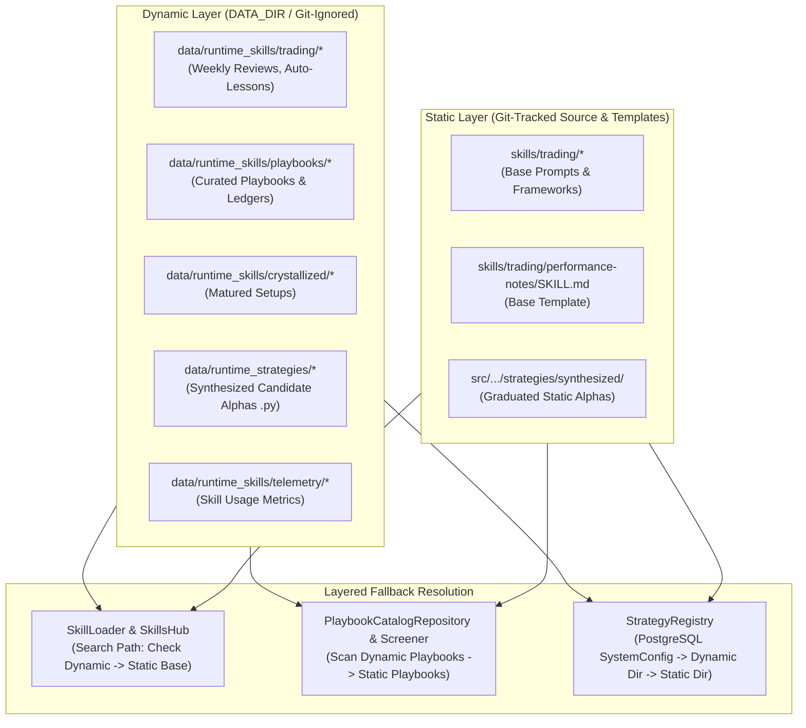

# Architectural Design Specification: Runtime Storage Separation & Layered Resolution Engine

> **Feature**: Runtime Storage Separation & Layered Resolution Engine
> **Status**: `In Review (Post-Goldfish Audited)`
> **Target Subsystems**: `core/paths`, `application/skills`, `application/analysis/strategies`, `application/scheduler`, `core/analytics`, `infrastructure/storage`
> **Author**: Antigravity Quantitative Core Team
> **Date**: 2026-11-03
> **Parent Spec / Authority**: [PRD.md](../../PRD.md), [AGENTS.md](../../AGENTS.md)

---

## 1. Executive Summary & Problem Diagnosis

### 1.1 Problem Statement
Currently, several autonomous daemons and memory modules in Monika generate runtime artifacts directly within the Git-tracked working tree:
1. **Dynamic Alphas (`.py`)**: `StrategySynthesisScheduler` writes newly synthesized candidate strategies into `src/monika/application/analysis/strategies/synthesized/<strategy_id>.py`.
2. **Performance Reviews (`.md`)**: `PerformanceReviewer` overwrites tracked templates `skills/trading/performance-notes/SKILL.md` and `skills/trading/fundamental-performance-notes/SKILL.md`.
3. **Lessons Learned (`.md`)**: `LessonConsolidator` appends empirical trade reflections to `skills/trading/lessons-learned/SKILL.md`.
4. **Crystallized Playbooks (`.md`, `.jsonl`, blobs)**: `PlaybookCurator`, `SkillCrystallizer`, and `PlaybookLedger` write playbooks to `skills/trading/playbooks/` and `skills/crystallized/`, along with internal blobs (`.backups/blobs/`) and state files (`.curator_ledger.jsonl`, `.playbook_lifecycle.json`).
5. **Skill Telemetry (`.json`)**: `SkillUsageTracker` writes `.usage.json` directly inside each skill directory.

### 1.2 Core Architectural Defects
- **Working Tree Pollution**: Background daemons and test suites dirty the Git repository with untracked or modified files (e.g. `alpha_xtiusd_6c7726.py`), causing merge conflicts on `git pull` and breaking CI/CD hygiene.
- **Violation of Hermetic Testing ([AGENTS.md](../../AGENTS.md) §5.6)**: Aturan rekayasa Monika secara eksplisit mewajibkan pengujian bersifat hermetik—hanya menulis ke `tmp_path` dan tidak pernah mengubah file di dalam working tree git.
- **Conflation of Code vs State**: Git is for source code, configuration templates, and deterministic unit tests. Machine-learned heuristics, weekly execution reviews, and autonomous alpha candidates are **runtime operational state** and must reside in dedicated, persistent, Git-ignored storage under `DATA_DIR`.

---

## 2. Invariants & Governance

1. **Mechanical Fortress Disposition ([PRD.md](../../PRD.md))**:
   Storage path redirection has zero impact on `RiskGate` (`src/monika/domain/risk/risk_gate.py`). Every candidate strategy—regardless of whether loaded from static source or runtime storage—must pass deterministic risk gates, drawdown limits, and microstructure validation before execution.
2. **Fail-Closed Strategy Loading ([AGENTS.md](../../AGENTS.md) §1)**:
   If a runtime strategy file is missing, 0-byte corrupt, unparseable, or fails AST linting, the system must quarantine the strategy and refuse to trade. It must never execute unverified code.
3. **Atomic File Replacement Protocol on Windows**:
   Direct `write_text` truncates files to 0 bytes before writing. To prevent 0-byte read poisoning or Windows file lock collisions (`WinError 32`), all dynamic file writes must use a resilient atomic replacement protocol (`.tmp` + `os.replace` with backoff retry).
4. **Zero Test Regressions & Hermetic Isolation**:
   All 5,145+ unit and integration tests must pass. In automated tests, runtime storage must redirect to `tmp_path` via `MONIKA_RUNTIME_DATA_DIR` so no residual files accumulate in `data/`.

---

## 3. Architecture Blueprint: The Layered Storage Topology



---

## 4. Subsystem Specifications & Detailed Fixes

### 4.1 Canonical Path Resolution & Atomic Write Helper (`src/monika/core/paths.py`)
Add explicit, CWD-invariant accessor functions anchored to `REPO_ROOT` and `DATA_DIR`:
```python
def get_static_skills_dir() -> Path:
    """Return immutable git-tracked static skills directory (anchored to REPO_ROOT)."""
    return REPO_ROOT / "skills"

def get_static_strategies_dir() -> Path:
    """Return immutable git-tracked static synthesized strategies directory."""
    return PACKAGE_ROOT / "application" / "analysis" / "strategies" / "synthesized"

def get_runtime_skills_dir() -> Path:
    """Return dynamic runtime skills directory inside DATA_DIR (respecting MONIKA_RUNTIME_DATA_DIR)."""
    override = os.environ.get("MONIKA_RUNTIME_DATA_DIR")
    base = Path(override).resolve() if override else get_data_dir()
    p = base / "runtime_skills"
    p.mkdir(parents=True, exist_ok=True)
    return p

def get_runtime_strategies_dir() -> Path:
    """Return dynamic runtime strategies directory inside DATA_DIR."""
    override = os.environ.get("MONIKA_RUNTIME_DATA_DIR")
    base = Path(override).resolve() if override else get_data_dir()
    p = base / "runtime_strategies"
    p.mkdir(parents=True, exist_ok=True)
    return p

def get_runtime_playbooks_dir() -> Path:
    """Return dynamic runtime playbooks directory inside runtime skills."""
    p = get_runtime_skills_dir() / "playbooks"
    p.mkdir(parents=True, exist_ok=True)
    return p
```

#### Windows-Resilient Atomic Write Protocol
```python
def atomic_write_text(target: Path, content: str, encoding: str = "utf-8", max_retries: int = 3) -> None:
    """
    Atomically writes text using a temporary file and os.replace with backoff retry.
    Prevents 0-byte truncation poisoning and Windows WinError 32 file lock conflicts.
    """
    target = target.resolve()
    target.parent.mkdir(parents=True, exist_ok=True)
    tmp_path = target.parent / f".tmp_{uuid.uuid4().hex}"
    try:
        tmp_path.write_text(content, encoding=encoding)
        for attempt in range(max_retries):
            try:
                os.replace(tmp_path, target)
                break
            except (PermissionError, OSError) as exc:
                if attempt == max_retries - 1:
                    raise
                time.sleep(0.05 * (2 ** attempt))
    finally:
        if tmp_path.exists():
            try:
                tmp_path.unlink()
            except OSError:
                pass
```

### 4.2 Security Containment & Layered Resolution (`src/monika/application/skills/loader.py`)
1. **Multi-Root Security Containment**:
   Update `_read_skill_raw` to allow paths residing in either the static skills directory or the runtime skills directory:
   ```python
   allowed_roots = [get_static_skills_dir().resolve(), get_runtime_skills_dir().resolve()]
   if not any(resolved.is_relative_to(root) for root in allowed_roots):
       raise ValueError(f"Directory traversal detected outside allowed skill folders: '{name}'")
   ```
2. **0-Byte Guard & Non-Empty Validation**:
   When evaluating candidate paths, only accept a file if `path.exists() and path.is_file() and path.stat().st_size > 0`. If a runtime file is 0-byte or corrupt, cleanly fall back to the static template.
3. **Dynamic Precedence in Search Order**:
   In `_read_skill_raw`, prepend runtime search candidates:
   - `get_runtime_skills_dir() / "trading" / v / "SKILL.md"`
   - `get_runtime_skills_dir() / "playbooks" / f"{v}.md"`
   - `get_runtime_skills_dir() / "crystallized" / f"{v}.md"`
   followed by static candidate paths in `get_static_skills_dir()`.
4. **List Skills Aggregation**:
   In `list_skills()`, scan both `get_runtime_skills_dir()` and `get_static_skills_dir()`, returning a deduplicated list of active skills.

### 4.3 Screener & Playbook Catalog Sync
- **`PlaybookCatalogRepository`** (`src/monika/infrastructure/storage/playbook_catalog_repository.py`):
  Update directory discovery to scan both `get_runtime_playbooks_dir()` and `get_static_skills_dir() / "trading" / "playbooks"`, merging playbooks with runtime overrides taking precedence.
- **`loader.py:get_dynamic_micro_skills`**:
  Check `get_runtime_playbooks_dir()` first, then static playbooks directory.

### 4.4 Strategy Synthesis & Registry
- **`StrategySynthesisScheduler`**:
  Set `SYNTHESIZED_DIR = get_runtime_strategies_dir()`.
  Use `atomic_write_text` to write synthesized `.py` candidate files.
- **`StrategyRegistry`**:
  Set `SYNTHESIZED_DIR = get_runtime_strategies_dir()`.
  Compile candidates from PostgreSQL `SystemConfig`. For disk reconciliation/self-healing fallback:
  1. Check `get_runtime_strategies_dir() / f"{s_id}.py"`.
  2. Check `get_static_strategies_dir() / f"{s_id}.py"`.
  Also perform static filesystem discovery on startup for any static graduated alphas present in `get_static_strategies_dir()`.
- **`startup_checks.py`**:
  Inspect both `get_runtime_strategies_dir()` and `get_static_strategies_dir()`.

### 4.5 Analytical Writers Redirection
1. **`PerformanceReviewer`**:
   - `PERFORMANCE_NOTES_PATH = get_runtime_skills_dir() / "trading" / "performance-notes" / "SKILL.md"`
   - `FUNDAMENTAL_PERFORMANCE_NOTES_PATH = get_runtime_skills_dir() / "trading" / "fundamental-performance-notes" / "SKILL.md"`
   - Write using `atomic_write_text`.
2. **`LessonConsolidator`**:
   - Target: `get_runtime_skills_dir() / "trading" / "lessons-learned" / "SKILL.md"`.
   - If not yet present, read initial baseline from static `get_static_skills_dir() / "trading" / "lessons-learned" / "SKILL.md"` before appending consolidated lessons. Write using `atomic_write_text`.
3. **`PlaybookCurator`, `PlaybookLedger`, `PlaybookLifecycle`**:
   - `playbooks_dir = get_runtime_playbooks_dir()`
   - `crystallized_dir = get_runtime_skills_dir() / "crystallized"`
   - Store `.curator_ledger.jsonl`, `.playbook_lifecycle.json`, and `.backups/blobs/` exclusively inside `get_runtime_playbooks_dir()`.
4. **`SkillCrystallizer`**:
   - `SKILLS_DIR = get_runtime_skills_dir() / "crystallized"`.
5. **`SkillsHub` & `SkillCurator`**:
   - Add `get_runtime_skills_dir()` to `SkillsHub.search_directories`.
   - Direct `SkillCurator.archive_dir` to `get_runtime_skills_dir() / ".archive"`.
6. **`SkillUsageTracker`**:
   - Store usage files in `get_runtime_skills_dir() / "telemetry" / f"{namespaced_name}.usage.json"`.

---

## 5. Working Tree Migration & Hygiene

1. **Move Untracked Artifact**:
   Move `src/monika/application/analysis/strategies/synthesized/alpha_xtiusd_6c7726.py` to `data/runtime_strategies/alpha_xtiusd_6c7726.py`.
2. **Untrack Legacy Playbook Blobs**:
   Remove tracked backup blobs from git cache:
   `git rm -r --cached skills/trading/playbooks/.backups/`
3. **Enhance `.gitignore`**:
   Ensure `**/.usage.json` and `**/*.usage.json` are explicitly ignored. (Note: `/data/`, `**/.curator_ledger.jsonl`, `**/.playbook_lifecycle.json`, and `**/.backups/` are already covered in `.gitignore`).

---

## 6. Test Suite Invariants & Hermetic Verification

1. **Hermetic Test Isolation**:
   In `tests/conftest.py`, configure an autouse fixture setting `MONIKA_RUNTIME_DATA_DIR` to `tmp_path / "data"` so tests never write to the actual `data/` or `skills/` folders.
2. **Automated Clean-Tree Test (`tests/test_runtime_storage_separation.py`)**:
   - Execute a complete synthesis pass, performance review pass, and playbook curation pass.
   - Assert `git status --porcelain` remains 100% empty.
   - Assert dynamic files are generated in runtime directories and properly loaded with dynamic precedence over static templates.
3. **Full CI Quality Gate**:
   - `ruff check .`
   - `ruff format --check src tests`
   - `lint-imports`
   - `pyright`
   - `pytest tests -q -m "not live and not network"` (5,145+ passed, 100% green).
