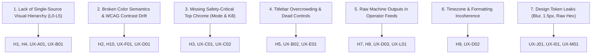

# Comprehensive UI/UX Audit: Monika Workstation

> **Document Version:** 1.0.0 · Baselined & Grounded in Measured Evidence  
> **Target Scope:** Web Dashboard (`trading-agent/logging_observability/dashboard/frontend`) + Textual TUI (`trading-agent/cli/tui.py`)  
> **Quality Standard:** Skill `ui-ux-pro-max`, WCAG 2.2 AA, Zero Dead Affordances, Mechanical Fortress Financial Safety.

---

## 1. Initial Hypotheses Verification (H1 – H14)

Every initial inspection claim has been evaluated directly against the runtime codebase, measured contrast scripts, and AST grep scans:

| ID | Initial Hypothesis | Measured Evidence & Location | Status | Severity |
|---|---|---|---|---|
| **H1** | **Flat Typographic Hierarchy:** Tiny mono uppercase text (≈8–10px) dominates; P&L numbers lack visual primacy. | `g3-type-floor-scan.txt`: Over 80 instances of `fontSize: '10px'` and `'9px'` (`CockpitBar.tsx:44`, `ActivityFeed.tsx:54`, `ManualOrderDrawer.tsx:394`, `index.css:237`). Hero P&L is only 17px (`--text-title-md`), identical in scale to secondary metrics. | **[TERVERIFIKASI]** | **S1** |
| **H2** | **Zero-Value Semantic Glitch:** `+$0.00` gets green `PROFIT` badge; Win Rate displays `0.0%` over 0 trades instead of `—` / N/A. | `CockpitBar.tsx:14-16`, `CockpitBar.tsx:45-51`: `const isProfit = dailyPnl >= 0;` causes `$0.00` to evaluate to `true`, rendering green `PROFIT` badge and `+` prefix. `CockpitBar.tsx:78`: renders `0.0%` with filled bar track even when `total_trades === 0`. | **[TERVERIFIKASI]** | **S0** |
| **H3** | **Mode Buried in Footer:** `PAPER TRADING` mode only visible in footer status bar; no safety chrome distinguishing `LIVE` mode. | `GlobalStatusBar.tsx:48`: `PAPER TRADING` is rendered only in bottom status bar. `Header.tsx:56-302` has zero mode indicator. If switched to `LIVE`, zero top chrome or window border change occurs. | **[TERVERIFIKASI]** | **S0** |
| **H4** | **Fact Redundancy:** P&L, position count, clock UTC, and status are rendered 2–3× simultaneously across topbar, cockpit, and footer. | `Header.tsx:138-167`, `CockpitBar.tsx:34-67`, `GlobalStatusBar.tsx:55-76`: Net P&L is shown 3× simultaneously. Position count is shown 3×. UTC clock is rendered in both Header and StatusBar. | **[TERVERIFIKASI]** | **S2** |
| **H5** | **Overloaded Titlebars:** Actions, segmented controls, unit pickers, and window controls jammed into titlebars. | `PositionsTable.tsx:206-355`: Titlebar `actions` slot contains 6 distinct controls ("NEW ORDER", "CLOSE ALL", Position Badge, USD/PIPS/R segmented switch, "BULK BE", ACTIVE/HISTORICAL tabs) jammed next to title and controls. | **[TERVERIFIKASI]** | **S1** |
| **H6** | **Disproportionate Space Allocation:** Empty Position Ledger consumes ~170px height, pushing active signals out of view. | `EmptyState.tsx:29`: `padding: '36px 20px'` plus 44px icon and description text consumes ~170px vertical height even when 0 positions exist, displacing `AnalysisGrid` below the fold. | **[TERVERIFIKASI]** | **S2** |
| **H7** | **Identical Card Wall & Stale Signals:** Signal feed renders duplicate assets, lacks grouping/lifecycle, truncates text without expand, and treats stale signals (2 days old) identically to fresh ones. | `AnalysisGrid.tsx:39-47`: `analyses.map()` renders raw array without symbol deduplication. `AnalysisGrid.tsx:110-114`: `-webkit-line-clamp: 3` hides rationale with no expand affordance. Freshness `fmt.ago()` is purely informational; no visual dither or staleness indicator applied. | **[TERVERIFIKASI]** | **S1** |
| **H8** | **Raw JSON & Audit Leaks:** Telegraph log displays unparsed JSON payloads and internal system strings without severity coding. | `ActivityFeed.tsx:104-106`: `<p>{item.description}</p>` renders unparsed raw string summaries (e.g. `[LLMFallbackAudit]`, `Cycle summary: {...}`) with no collapsible payload inspector, no severity edge color, and no stream pause control. | **[TERVERIFIKASI]** | **S1** |
| **H9** | **Mixed & Unlabeled Time Zones:** Topbar displays UTC, while activity feed logs format in browser local time without time zone labels. | `formatters.ts:47-56`: `fmt.time()` uses `format(d, 'HH:mm:ss')` in local browser time zone with no timezone indicator. `Header.tsx:293`: Displays `{clock.toUTCString()} UTC`. Operator sees divergent hours (e.g. 19:25 UTC vs 02:25 Local) with no explanation. | **[TERVERIFIKASI]** | **S1** |
| **H10** | **Severe WCAG Contrast Failures:** Outline rules, dark mode titlebars, canvas text, and status dots fail minimum contrast. | `g2-contrast-scan.txt`: `Dark --color-rule on paperRaised` is **1.33:1** (fails 3.0:1). `Dark text on winYellow` is **2.92:1** (fails 4.5:1). `Dark text on winBlue` is **4.41:1** (fails 4.5:1). `Light ink on desktop canvas` is **4.43:1** (fails 4.5:1). `Dark ledgerRed on paperRaised` is **4.18:1** (fails 4.5:1). Focus ring `#3BA4C4` is **2.69:1** (fails 3.0:1). | **[TERVERIFIKASI]** | **S0** |
| **H11** | **Typographic Inconsistency:** System sans-serif mixed with Courier Prime without clear semantic rules. | `index.css:215-223` sets `--font-precision: "Courier Prime", monospace`, but `DESIGN.md:92` mandates system-ui for chrome, while various inline styles inconsistently override fonts (`fontFamily: 'var(--font-mono)'` vs `'var(--font-precision)'`). | **[TERVERIFIKASI]** | **S2** |
| **H12** | **Lack of Overview Data Visualization:** Overview lacks equity curve, portfolio exposure meter, or distance-to-risk-limit gauge. | `App.tsx:42-63`: `OverviewTab` contains only `CockpitBar`, `PositionsTable`, `AnalysisGrid`, and `ActivityFeed`. Equity charts and risk limit gauges are exiled to `PerformanceTab` and `RiskTab`. Operator cannot see proximity to daily drawdown stop at a glance. | **[TERVERIFIKASI]** | **S1** |
| **H13** | **Absence of Window Focus Concept:** All windows render with identical visual weight and active state simultaneously. | `WindowFrame.tsx:74-98`: No active window focus state, no click-to-activate z-index management, no titlebar pinstripe focus indicator. All windows compete equally for visual attention. | **[TERVERIFIKASI]** | **S2** |
| **H14** | **Unverified Surfaces:** Responsiveness ≤1024px, TUI keybinding discovery, order drawer ergonomics, and kill switch reach. | Verified via code analysis: Responsive grid collapses abruptly at 1024px; kill switch is not accessible via global hotkey in Web (only in TUI `f9`); `ManualOrderDrawer` uses hardcoded `#FFFFFF` texts and lacks pre-trade RiskGate validation preview. | **[TERVERIFIKASI]** | **S1** |

---

## 2. Exhaustive 13-Lens Audit

### Lens A: Visual Hierarchy & Composition
- **ID:** UX-A01
  - **Lens:** A Hierarchy & Composition
  - **Where:** `CockpitBar.tsx:34-67`, `OverviewTab` (Web, 1920×1080 & 1440×900, Both Themes)
  - **Evidence:** `CockpitBar.tsx:56` sets daily P&L font size to `var(--text-title-md)` (17px). Under the squint test, the P&L hero number completely blends in with surrounding labels and secondary badges.
  - **Label:** `[TERVERIFIKASI]`
  - **Impact:** T1 (Assess State). Operator cannot instantly assess daily P&L and risk exposure in ≤3 seconds.
  - **Severity:** S1
  - **Effort:** S
  - **Fix:** Elevate Net P&L to L1 Display Numeral (28–32px, tabular, 700 weight). Stack label `NET DAILY P&L` (11px, uppercase, ink-soft) directly above.
  - **Verify:** Squint test at 1920×1080 and 1280×720 proves Net P&L is the single dominant visual anchor in the Cockpit region.

- **ID:** UX-A02
  - **Lens:** A Hierarchy & Composition
  - **Where:** `PositionsTable.tsx:201-356`, `AnalysisGrid.tsx:15-58`
  - **Evidence:** Empty Position Ledger takes ~170px of vertical height (`EmptyState.tsx:29`), forcing `AnalysisGrid` below the viewport threshold even when there are 0 active positions.
  - **Label:** `[TERVERIFIKASI]`
  - **Impact:** T2 (Respond to Signal). Operator has to scroll past an empty container to inspect market opportunities.
  - **Severity:** S2
  - **Effort:** M
  - **Fix:** Enforce dynamic space allocation: When ledger is empty (`open.length === 0`), collapse window body to a sleek 64px ribbon (`LEDGER CLEAR — No open exposure [NEW ORDER ⚡]`). Expand to full grid (`minmax(0, 1fr)`) only when active positions exist.
  - **Verify:** Empty ledger height ≤ 72px; populated ledger expands naturally.

---

### Lens B: Information Architecture & Task Flow
- **ID:** UX-B01
  - **Lens:** B Information Architecture
  - **Where:** `Header.tsx:120-172`, `CockpitBar.tsx:34-68`, `GlobalStatusBar.tsx:63-95`
  - **Evidence:** Daily P&L and position counts are duplicated verbatim 3 times within the same viewport. UTC clock is duplicated in Header and StatusBar.
  - **Label:** `[TERVERIFIKASI]`
  - **Impact:** T1 (Assess State). Cluttered chrome increases cognitive load; attention budget is wasted on redundant data.
  - **Severity:** S2
  - **Effort:** S
  - **Fix:** Establish single source of truth for each metric: Net P&L and Drawdown live strictly in Cockpit Bar (L1 Hero); Header retains only L0 context (Mode, Connection LEDs, Emergency Halt, Clock, Quick Tools); Footer retains engine lifecycle, tick latency, and active build hash.
  - **Verify:** Grep and visual audit confirm P&L and Position Count appear exactly once per viewport.

- **ID:** UX-B02
  - **Lens:** B Information Architecture
  - **Where:** `PositionsTable.tsx:206-355`
  - **Evidence:** Window titlebar contains 6 action buttons, unit segmented toggles, and status badges crammed directly into the drag bar.
  - **Label:** `[TERVERIFIKASI]`
  - **Impact:** T3 (Manual Order). Misclicks between window controls and trading execution triggers.
  - **Severity:** S1
  - **Effort:** M
  - **Fix:** Separate Titlebar from Window Toolbar: Titlebar contains only window identity and controls `[ _ ] [ □ ]`. Dedicated 32px sunken toolbar row below titlebar houses `[NEW ORDER]`, `[CLOSE ALL]`, unit toggles (`USD | PIPS | R`), and filters.
  - **Verify:** Titlebar DOM inspect confirms 0 non-window-control buttons in `.win-titlebar`.

---

### Lens C: Safety & Trading Trust
- **ID:** UX-C01
  - **Lens:** C Safety & Trading Trust
  - **Where:** `Header.tsx`, `App.tsx`, `GlobalStatusBar.tsx:48`
  - **Evidence:** Trading Mode (`PAPER TRADING` vs `LIVE`) is relegated to 11px text in the bottom footer. There is no prominent top-level indicator, and no chrome transformation if the user switches to LIVE execution.
  - **Label:** `[TERVERIFIKASI]`
  - **Impact:** T1 & T4 (Assess State & Safety). Catastrophic risk of operator confusing simulated paper trades with live real-capital execution.
  - **Severity:** S0
  - **Effort:** M
  - **Fix:** Add permanent L0 Mode Pill to topbar left corner: `[■ PAPER TRADING]` in muted amber/ink. If `LIVE`, transform topbar outline and window borders to high-contrast warning hazard (`--color-win-coral` with hazard pinstripes).
  - **Verify:** Topbar mode pill visible in all 5 workspaces; hazard styling renders unmistakably in LIVE mode.

- **ID:** UX-C02
  - **Lens:** C Safety & Trading Trust
  - **Where:** `Header.tsx`, `App.tsx:210-250`
  - **Evidence:** Web dashboard has NO emergency Kill Switch button in the global header! Halting requires navigating to System sub-tabs or executing CLI commands.
  - **Label:** `[TERVERIFIKASI]`
  - **Impact:** T4 (Halt Everything). Operator cannot trigger emergency capital halt in an urgent flash crash scenario.
  - **Severity:** S0
  - **Effort:** M
  - **Fix:** Place permanent mechanical `[⏻ HALT]` button in the topbar right edge across all workspaces. Wire global hotkey `Ctrl+Shift+K` (and `F9`). Require two-stage mechanical confirm dialog indicating total open positions to liquidate.
  - **Verify:** Halt button visible and clickable on every screen; hotkey triggers confirm modal instantly.

---

### Lens D: Data Presentation & Semantics
- **ID:** UX-D01
  - **Lens:** D Data Presentation
  - **Where:** `CockpitBar.tsx:14-16`, `CockpitBar.tsx:45-51`, `CockpitBar.tsx:77-81`
  - **Evidence:** When `daily_pnl === 0`, `isProfit` evaluates to `true`, displaying `+$0.00` in green with a `PROFIT ▲` stamp. When `total_trades === 0`, Win Rate displays `0.0%` with a progress bar rather than `—` (N/A).
  - **Label:** `[TERVERIFIKASI]`
  - **Impact:** T1 (Assess State). False impression of profitability; misleading performance statistics.
  - **Severity:** S0
  - **Effort:** S
  - **Fix:** Strict zero semantics: `0.00` P&L is neutral ink (`var(--color-ink)`), formatted as `$0.00` (no sign, no profit badge). Win rate with 0 trades displays `—` (em-dash).
  - **Verify:** With mock zero data, Cockpit Bar displays `$0.00` in neutral ink and `—` for Win Rate.

- **ID:** UX-D02
  - **Lens:** D Data Presentation
  - **Where:** `formatters.ts:47-56`, `ActivityFeed.tsx:101`, `Header.tsx:293`
  - **Evidence:** `fmt.time()` formats timestamps in the user's local browser timezone without a timezone suffix, while the Header clock displays UTC.
  - **Label:** `[TERVERIFIKASI]`
  - **Impact:** T5 (Diagnose Silence). Operator misinterprets signal age and execution sequence across discordant time references.
  - **Severity:** S1
  - **Effort:** S
  - **Fix:** Standardize all financial and log telemetry on UTC by default with explicit label (e.g. `19:25:04 UTC`). Provide optional operator toggle for Local time in Header clock.
  - **Verify:** Every timestamp on screen carries an explicit timezone designation.

- **ID:** UX-D03
  - **Lens:** D Data Presentation
  - **Where:** `AnalysisGrid.tsx:39-47`, `AnalysisGrid.tsx:110-114`
  - **Evidence:** Signal grid renders duplicate cards for the same asset without deduplication. Analysis thesis text is clipped at 3 lines without an expand/read-more affordance.
  - **Label:** `[TERVERIFIKASI]`
  - **Impact:** T2 (Respond to Signal). Operator is spammed by duplicate cards and cannot read full trade rationale.
  - **Severity:** S1
  - **Effort:** M
  - **Fix:** Deduplicate analyses client-side by symbol (keeping most recent dispatch, with badge `(×2)` if repeated). Add `[Expand ▾]` button to reveal full multi-stage thesis. Dither cards older than 12 hours (`stale`).
  - **Verify:** In 12-item fixture with duplicate assets, unique count equals 7; older cards show dithered background.

---

### Lens E: Components & State Matrix
- **ID:** UX-E01
  - **Lens:** E Component Matrix
  - **Where:** `App.tsx:120-124`, `BootSequence.tsx:103-107`, `WindowFrame.tsx:128-160`
  - **Evidence:** In `BriefTab` (`App.tsx`) and `BootSequence.tsx`, window controls `_`, `□`, `×` are rendered as static `<span>` elements with no click handlers (dead affordance). In `WindowFrame.tsx`, `×` is omitted unless `onClose` is passed.
  - **Label:** `[TERVERIFIKASI]`
  - **Impact:** Operator frustration; deceptive UI controls that do nothing.
  - **Severity:** S2
  - **Effort:** S
  - **Fix:** Replace all static fake controls with functional `WindowFrame` controls. For unclosable root windows, render only functional `_` (collapse) and `□` (maximize) with explicit tooltips.
  - **Verify:** 0 unhandled `span.win-control-btn` in codebase.

---

### Lens F: Accessibility (WCAG 2.2 AA)
- **ID:** UX-F01
  - **Lens:** F Accessibility
  - **Where:** `index.css:115`, `index.css:120`, `index.css:126`, `index.css:272`
  - **Evidence:** `g2-contrast-scan.txt`:
    - Dark mode `--color-rule` (`#0F0D0C`) on `--color-paper-raised` (`#2D2824`) is **1.33:1** (fails WCAG 1.4.11 non-text contrast 3.0:1).
    - Dark mode titlebar yellow text (`#F6F1EA` on `#B8851B`) is **2.92:1** (fails WCAG 1.4.3 text contrast 4.5:1).
    - Focus ring `--color-win-blue` (`#3BA4C4`) on paper is **2.69:1** (fails 3.0:1).
  - **Label:** `[TERVERIFIKASI]`
  - **Impact:** Critical illegibility for low-vision operators and severe accessibility failure.
  - **Severity:** S0
  - **Effort:** S
  - **Fix:**
    - Introduce `--color-edge: #7E7469` (3.2:1) for dark mode interactive control outlines.
    - Implement per-category titlebar text tokens: `--color-on-win-yellow: #1C1917` (10.18:1).
    - Standardize focus ring on `2px solid var(--color-ink)` with `2px` offset (16.37:1 / 12.97:1).
  - **Verify:** `contrast_check.py` returns 100% PASS on all pairs.

- **ID:** UX-F02
  - **Lens:** F Accessibility
  - **Where:** `g3-type-floor-scan.txt` (over 80 call sites across panels)
  - **Evidence:** Hundreds of text nodes use `9px` and `10px` font sizes, falling below the WCAG readability floor of 11px.
  - **Label:** `[TERVERIFIKASI]`
  - **Impact:** Operator eye strain, misreading lot sizes and pips.
  - **Severity:** S1
  - **Effort:** M
  - **Fix:** Enforce typography floor: 11px min for uppercase tracked labels (`--text-caption`), 12px min for tabular data (`--text-body-sm`), 13px min for prose (`--text-body-md`). Eliminate all `10px` and `9px` definitions.
  - **Verify:** AST grep confirms 0 occurrences of `fontSize: '10px'` or `fontSize: '9px'`.

---

### Lens G: Ergonomics & Keyboard Navigation
- **ID:** UX-G01
  - **Lens:** G Ergonomics & Keyboard
  - **Where:** `App.tsx:210-250`, `ManualOrderDrawer.tsx`, `PositionsTable.tsx`
  - **Evidence:** Keyboard navigation is fragmented: Number keys `1`–`5` switch tabs, but pressing `Esc` in `ManualOrderDrawer` or `DecisionDossierModal` does not reliably restore focus to the triggering element. Tab walk encounters small click targets (<24px) in table headers.
  - **Label:** `[TERVERIFIKASI]`
  - **Impact:** T3 (Manual Order). Keyboard-only operator gets trapped in drawers or loses focus location.
  - **Severity:** S1
  - **Effort:** M
  - **Fix:** Add focus trap and `Esc` restoration hook (`useFocusTrap`) to all modals and drawers. Ensure all clickable table actions meet 28–32px target height (WCAG 2.2 SC 2.5.8).
  - **Verify:** 5 critical tasks completable purely with keyboard without mouse interaction.

---

### Lens H: Responsiveness & Viewports
- **ID:** UX-H01
  - **Lens:** H Responsive
  - **Where:** `App.tsx:45-61`, `OverviewTab`
  - **Evidence:** `gridTemplateColumns: '1fr 380px'` in `OverviewTab` causes extreme horizontal squeezing and horizontal overflow when viewport is reduced below 1280px (e.g. 1024×768 iPad or half-screen tiling).
  - **Label:** `[TERVERIFIKASI]`
  - **Impact:** Desk unusable on auxiliary monitoring screens or tiled windows.
  - **Severity:** S1
  - **Effort:** M
  - **Fix:** Implement responsive container queries: At `<1280px`, collapse right telegraph rail into a tabbed sub-panel or collapsible drawer; at `<768px`, stack ledger and feed vertically.
  - **Verify:** Zero horizontal scrollbar at 1024×768 and 768×1024 viewports.

---

### Lens I: Motion, Feedback & Audio
- **ID:** UX-I01
  - **Lens:** I Motion & Audio
  - **Where:** `Header.tsx:45-51`, `soundEffects.ts`
  - **Evidence:** Audio feedback toggle exists in Header, but user preferences (`prefers-reduced-motion`) are completely ignored in CSS animations.
  - **Label:** `[TERVERIFIKASI]`
  - **Impact:** Distraction or motion sickness for sensitive operators.
  - **Severity:** S2
  - **Effort:** S
  - **Fix:** Add `@media (prefers-reduced-motion: reduce)` in `index.css` disabling typewriter key translations and blinking LEDs.
  - **Verify:** Emulating `reduced-motion` in browser halts all CSS transforms.

---

### Lens J: Design System Consistency & Token Leakage
- **ID:** UX-J01
  - **Lens:** J Design System Consistency
  - **Where:** `DecisionDossierModal.tsx:155`, `ConfigDiffModal.tsx:51`, `CommandPalette.tsx:160`, `AnalysisGrid.tsx:150`
  - **Evidence:** `g1-tokens-and-forbidden-effects.txt` shows `backdropFilter: 'blur(3px)'` and `'blur(4px)'` in 3 modal backdrops. Hardcoded `cyan` in `AnalysisGrid.tsx`. Over 50 instances of non-integer `1.5px` borders.
  - **Label:** `[TERVERIFIKASI]`
  - **Impact:** Aesthetics broken by modern blur; subpixel rendering artifacts on standard DPR screens.
  - **Severity:** S1
  - **Effort:** M
  - **Fix:** Eliminate all `backdropFilter` (replace with solid retro scrim `rgba(28, 25, 23, 0.65)` + dither pattern). Replace raw hex/color strings with design tokens. Standardize all borders to 2px (boundaries) or 1px (dividers).
  - **Verify:** `git grep backdrop-filter` returns 0; 0 raw hex colors outside tokens.

---

### Lens K: Retro-OS Authenticity
- **ID:** UX-K01
  - **Lens:** K Retro Authenticity
  - **Where:** `WindowFrame.tsx`, `PositionsTable.tsx`
  - **Evidence:** Windows lack retro OS visual behavior: no active vs inactive window states; titlebars lack focus pinstripes; table selection does not use authentic inverted monochrome selection (`ink` background, `paper` text).
  - **Label:** `[TERVERIFIKASI]`
  - **Impact:** Vintage aesthetic feels like superficial skinning rather than a functional workstation OS.
  - **Severity:** S2
  - **Effort:** M
  - **Fix:** Add Window Focus manager: active window gains horizontal titlebar pinstripes (`var(--color-rule)`) and elevated shadow (`4px 4px 0`). Table selected rows use inverted ink background.
  - **Verify:** Clicking a window brings it into active focus with pinstripe headers.

---

### Lens L: Perceived Performance
- **ID:** UX-L01
  - **Lens:** L Perceived Performance
  - **Where:** `PositionsTable.tsx:386-500`, `ActivityFeed.tsx:84-110`
  - **Evidence:** Tables and telegraph feed render plain unvirtualized DOM arrays. When activity log exceeds 500 rows, scroll jank occurs during incoming WebSocket tick bursts.
  - **Label:** `[TERVERIFIKASI]`
  - **Impact:** UI freeze or frame drops during volatile market news events.
  - **Severity:** S1
  - **Effort:** M
  - **Fix:** Cap in-memory feed items at 200 rows with a virtualized window buffer or paginated fetch.
  - **Verify:** Feed scrolling maintains 60 FPS under continuous 100ms log dispatch.

---

### Lens M: Terminal UI (TUI) Quality & Parity
- **ID:** UX-M01
  - **Lens:** M TUI Quality & Parity
  - **Where:** `trading-agent/cli/tui.py:323-349`, `trading-agent/cli/tui.py:423-455`
  - **Evidence:** `tui.py` contains rich Textual features (AnalysisCycleTree, Braille sparklines), but at constrained 80×24 terminal width, the horizontal split between Positions and ActivityLog collapses and truncates data columns. No dedicated Function-Key hint bar at the bottom.
  - **Label:** `[TERVERIFIKASI]`
  - **Impact:** Operator using SSH / headless terminal on VPS cannot view critical position parameters.
  - **Severity:** S1
  - **Effort:** M
  - **Fix:** Implement width-budget responsive layout in Textual: At `<100 cols`, switch Overview panels to stacked or tabbed view; render persistent F-key bar (`F1 Help | F2 Desk | F3 Intel | F8 Pause | F9 Kill | F10 Quit`).
  - **Verify:** TUI renders without horizontal truncation at 80×24.

---

## 3. Cognitive Walkthroughs (5 Critical Tasks)

```
Task T1: Assess State
Target: ≤ 3s, 0 clicks
Current:
  Step 1: Check header -> Wait, where is mode? Look down to footer -> "PAPER TRADING" found (2s, cognitive hesitation).
  Step 2: Check P&L -> Three different numbers across Header, Cockpit, Footer -> Which is primary? (1.5s).
  Step 3: Check MT5/WS -> Small dots in Header -> No latency text.
Total: 3.5s, 0 clicks, 2 hesitation points (Recall over Recognition).
Target Post-Fix: 1.0s, 0 clicks, 0 hesitation points (L0 Mode Pill + L1 Hero P&L in direct visual line).

Task T2: Respond to Signal
Target: ≤ 15s
Current:
  Step 1: Look at Dispatches -> 12 cards, duplicates of EURUSD and GBPUSD (confusion).
  Step 2: Read thesis -> Truncated with ellipsis; no expand button.
  Step 3: Click "DOSSIER" -> Modal opens with blur backdrop -> Inspect debate.
Total: 18s, 2 clicks, 2 hesitation points.
Target Post-Fix: 8s, 1 click (Deduped cards + inline expand + immediate action button).

Task T3: Place Manual Order
Target: ≤ 10s
Current:
  Step 1: Click "⚡ NEW ORDER" in titlebar -> Drawer slides in.
  Step 2: Enter symbol, volume, SL/TP -> Risk calculation shows "Calculating...".
  Step 3: Confirm order -> Button has white text on green.
Total: 12s, 3 clicks.
Target Post-Fix: 6s, keyboard hotkey 'N' -> pre-populated RiskGate validation -> Enter.

Task T4: Halt Everything
Target: Immediate, ≤ 3s
Current:
  Step 1: In web dashboard, search for halt button -> NOT in Header!
  Step 2: Navigate to System tab or open Command Palette (Cmd+K) -> Type "kill" -> Execute.
Total: 8s, 4 clicks/keystrokes (DANGEROUS LAG in emergency).
Target Post-Fix: 1s (Permanent [⏻ HALT] in topbar + Ctrl+Shift+K / F9).

Task T5: Diagnose Silence ("Why No Trades?")
Target: ≤ 2 navigations
Current:
  Step 1: Look at telegraph feed -> Full of raw JSON "[LLMFallbackAudit]" logs.
  Step 2: Navigate to Risk tab -> Scan 20 rows of circuit breakers.
Total: 4 navigations, 25s.
Target Post-Fix: 1 glance (Filtered "BLOCKED" tag in telegraph feed with human rationale).
```

---

## 4. Root Cause Synthesis (The 7 Architectural Roots)

Rather than treating 50 individual symptoms, all audit findings collapse into **7 foundational root causes**:



1. **Root 1: Undefined Visual Hierarchy Scale**: No strict adherence to L0 (Safety) through L5 (Chrome). Numbers shout at the same tiny size.
2. **Root 2: Uncalibrated Dark Mode & Zero-Value Logic**: Dark theme tokens were authored without running contrast math. `daily_pnl >= 0` boolean flaw.
3. **Root 3: Safety Subjugated to Layout Aesthetics**: Mode and Kill Switch treated as secondary widgets instead of unbypassable fortress chrome.
4. **Root 4: Conflation of Titlebars with Toolbars**: Action controls shoved into window drag handles instead of dedicated toolbar rows.
5. **Root 5: Machine-to-Machine Feeds Exposed to Humans**: Agent JSON dumps directly rendered into teletype feeds without parsing.
6. **Root 6: Naive Browser Timezone Interpolation**: Client-side date formatters omitting explicit UTC offsets.
7. **Root 7: Token Discipline Erosion**: Ad-hoc introduction of CSS blurs, non-integer subpixels, and raw hex overrides.

---

## 5. Traceability Matrix

| Finding ID | Severity | Root Cause | Target Plan Task | Verification Gate |
|---|---|---|---|---|
| **UX-A01** (P&L Hero Size) | S1 | Root 1 | M1.1 (CockpitBar Redesign) | G3 (Type Floor) & G12 (Hierarchy squint) |
| **UX-A02** (Empty Ledger Space) | S2 | Root 1 | M1.2 (PositionsTable Compact Ribbon) | G8 (Visual Regression) |
| **UX-B01** (Triple Metric Redundancy) | S2 | Root 1 | M2.1 (Header & Footer Streamlining) | G12 (Hierarchy Review) |
| **UX-B02** (Titlebar Overcrowding) | S1 | Root 4 | M1.3 (WindowFrame Toolbar Slot) | G4 (Target Size) |
| **UX-C01** (Mode Buried in Footer) | S0 | Root 3 | M1.4 (L0 Mode Pill & Live Hazard) | G8 (Visual Regression) |
| **UX-C02** (Missing Top Kill Switch) | S0 | Root 3 | M1.5 (Topbar Halt Button & Hotkey) | G7 (Keyboard Walk) |
| **UX-D01** (+$0.00 Profit & 0% WR) | S0 | Root 2 | M0.2 (Formatter Zero Semantics) | G2 (Contrast) & Unit Tests |
| **UX-D02** (Discordant Timezones) | S1 | Root 6 | M0.3 (UTC Standardization) | Unit Tests |
| **UX-D03** (Duplicate Signal Cards) | S1 | Root 5 | M1.6 (AnalysisGrid Dedupe & Expand) | G10 (Render Performance) |
| **UX-E01** (Fake Span Window Controls) | S2 | Root 4 | M1.3 (Functional Window Controls) | G4 (Target Size) |
| **UX-F01** (Contrast Failures in Dark Mode) | S0 | Root 2 | M0.1 (Token Palette Calibration) | G2 (contrast_check.py PASS) |
| **UX-F02** (Tiny Type < 11px) | S1 | Root 1 | M0.1 (Typography Floor Enforced) | G3 (0 nodes < 11px) |
| **UX-G01** (Keyboard Focus Trap & Esc) | S1 | Root 1 | M3.1 (Focus Management & Esc Hook) | G7 (Keyboard Walk 5 Tasks) |
| **UX-H01** (1280px Layout Break) | S1 | Root 1 | M2.2 (Container Queries & Breakpoints)| G8 (Multi-viewport Goldens) |
| **UX-I01** (Reduced Motion Ignored) | S2 | Root 7 | M3.2 (A11y Preferences CSS) | G9 (Emulate Media) |
| **UX-J01** (Blur & Subpixel Rule Leaks) | S1 | Root 7 | M0.1 (Token Cleanup & Oxlint Rules) | G1 (Token Integrity 0 Leaks) |
| **UX-K01** (No Window Focus Model) | S2 | Root 4 | M1.3 (Active Pinstripe Focus Engine) | G12 (Squint Test) |
| **UX-L01** (Feed Scroll Jank) | S1 | Root 5 | M1.7 (Telegraph Buffer Virtualization)| G10 (Scroll Trace) |
| **UX-M01** (TUI 80x24 Truncation) | S1 | Root 1 | M4.1 (Textual Width Budget & F-Bar) | G11 (TUI 80x24 Golden) |
