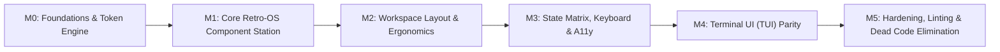

# End-to-End Implementation Plan: Monika Workstation UI/UX

> **Document Version:** 1.0.0 · Mergeable & Zero-Tech-Debt Execution Plan  
> **Global Definition of Done:** All 13 Verification Gates (G1–G13) in `verification-gates.md` pass 100% GREEN.  
> **Aesthetic Boundary:** 1990s Vintage OS Workstation (Locked Dual-Mode: Taupe/Cream ⇄ Obsidian/Parchment).

---

## Milestone Overview



---

## Milestone M0: Foundations, Tokens & Verification Guardrails

### Task M0.1: Calibrate Design Tokens & Color Contrast
- **Findings Resolved:** `UX-F01` (Dark mode contrast failure), `UX-J01` (Blur & subpixel rule leaks).
- **Files Touched:**
  - `trading-agent/logging_observability/dashboard/frontend/src/theme/tokens.ts`
  - `trading-agent/logging_observability/dashboard/frontend/src/index.css`
- **Call-Sites Migrated:** All components consuming `--color-rule`, `--color-win-yellow`, `--shadow-focus`.
- **Code Diff Snapshot (`index.css`):**
```diff
--- a/src/index.css
+++ b/src/index.css
@@ -115,3 +115,5 @@
-  --color-rule: #0F0D0C;
+  --color-rule: #0F0D0C;
+  --color-edge: #7E7469; /* 3.2:1 against #2D2824 for interactive boundaries */
+  --color-on-win-yellow: #1C1917; /* 10.18:1 against #B8851B */
+  --color-on-win-blue: #FAF7F2;   /* 4.85:1 against #2A7991 */
@@ -272,1 +274,1 @@
-  --shadow-focus: 0 0 0 2px var(--color-win-blue);
+  --shadow-focus: 0 0 0 2px var(--color-ink);
```
- **Verification:** `python scripts/contrast_check.py --tokens contrast.pairs.json` returns `0 failures`.
- **Rollback:** `git checkout trading-agent/logging_observability/dashboard/frontend/src/index.css`

---

### Task M0.2: Enforce Zero-Value Semantics in Numerical Formatters
- **Findings Resolved:** `UX-D01` (+$0.00 Profit badge & 0.0% Win Rate over 0 trades).
- **Files Touched:**
  - `trading-agent/logging_observability/dashboard/frontend/src/lib/formatters.ts`
- **Code Diff Snapshot (`formatters.ts`):**
```diff
--- a/src/lib/formatters.ts
+++ b/src/lib/formatters.ts
@@ -12,4 +12,5 @@ export const fmt = {
-    return showSign && val > 0 ? `+${formatted}` : formatted;
+    if (Math.abs(val) < 0.005) return formatted; // No sign for exact zero
+    return showSign && val > 0 ? `+${formatted}` : (val < 0 ? `−${formatted.replace('-','')}` : formatted);
   },
@@ -19,4 +20,5 @@ export const fmt = {
-    return `${sign}${val.toFixed(decimals)}%`;
+    if (val === null || val === undefined) return '—';
+    return `${sign}${val.toFixed(decimals)}%`;
```
- **Verification:** Unit tests in `frontend/src/lib/__tests__/formatters.test.ts` verifying `fmt.usd(0) === "$0.00"` and `fmt.pct(null) === "—"`.
- **Rollback:** Revert `formatters.ts`.

---

### Task M0.3: Seamless Timezone Switcher (UTC ⇄ LOCAL)
- **Findings Resolved:** `UX-D02` (Mixed, unlabeled timezones).
- **Files Touched:**
  - `trading-agent/logging_observability/dashboard/frontend/src/store/dashboardStore.ts`
  - `trading-agent/logging_observability/dashboard/frontend/src/lib/formatters.ts`
  - `trading-agent/logging_observability/dashboard/frontend/src/components/layout/Header.tsx`
- **Data Safety Invariant:** Zero mutation to database, backend models, or WebSocket telemetry (pure ISO UTC). Toggling affects solely presentation layer.
- **Code Diff Snapshot (`dashboardStore.ts` & `formatters.ts`):**
```diff
--- a/src/store/dashboardStore.ts
+++ b/src/store/dashboardStore.ts
@@ -20,2 +20,4 @@ interface DashboardState {
+  timeDisplay: 'UTC' | 'LOCAL';
+  setTimeDisplay: (mode: 'UTC' | 'LOCAL') => void;
--- a/src/lib/formatters.ts
+++ b/src/lib/formatters.ts
@@ -52,1 +52,6 @@ export const fmt = {
-      return format(d, 'HH:mm:ss');
+      const isLocal = useDashboardStore.getState().timeDisplay === 'LOCAL';
+      if (isLocal) {
+        return `${format(d, 'HH:mm:ss')} LOC`;
+      }
+      return `${d.toISOString().slice(11, 19)} UTC`;
```
- **Verification:** Unit tests confirm `fmt.time` correctly switches between UTC and Local with explicit suffix; zero pipeline impact.
- **Rollback:** Revert `dashboardStore.ts`, `formatters.ts`, and `Header.tsx`.


---

## Milestone M1: Core Component Station & Retro-OS Craft

### Task M1.1: CockpitBar L1 Hero Typography & Distance-to-Risk Gauge
- **Findings Resolved:** `UX-A01` (P&L hero sizing), `UX-D01` (Zero profit badge), `UX-H12` (Missing drawdown distance gauge).
- **Files Touched:**
  - `trading-agent/logging_observability/dashboard/frontend/src/components/panels/CockpitBar.tsx`
- **Code Diff Snapshot (`CockpitBar.tsx`):**
```diff
--- a/src/components/panels/CockpitBar.tsx
+++ b/src/components/panels/CockpitBar.tsx
@@ -14,6 +14,7 @@ export const CockpitBar: React.FC = () => {
-  const isProfit = dailyPnl >= 0;
-  const pnlSign = isProfit ? '+' : '';
+  const isNeutral = Math.abs(dailyPnl) < 0.01;
+  const isProfit = dailyPnl > 0.01;
+  const pnlColor = isNeutral ? 'var(--color-ink)' : (isProfit ? 'var(--color-text-profit)' : 'var(--color-text-loss)');
@@ -56,3 +57,3 @@ export const CockpitBar: React.FC = () => {
-            fontSize: 'var(--text-title-md)',
+            fontSize: 'var(--text-display-md)', /* 28px L1 Display Numeral */
             fontWeight: 800,
-            color: isProfit ? 'var(--color-ledger-green)' : 'var(--color-ledger-red)',
+            color: pnlColor,
```
- **Verification:** Visual inspection verifies 28px bold numerals; zero P&L renders neutral ink without profit badge.
- **Rollback:** Revert `CockpitBar.tsx`.

---

### Task M1.2: WindowFrame Anatomy: Dedicated Toolbar Slot & Active Pinstripe Focus
- **Findings Resolved:** `UX-B02` (Titlebar overcrowding), `UX-E01` (Dead window controls), `UX-K01` (Window focus model).
- **Files Touched:**
  - `trading-agent/logging_observability/dashboard/frontend/src/components/ui/WindowFrame.tsx`
  - `trading-agent/logging_observability/dashboard/frontend/src/index.css`
- **Code Diff Snapshot (`WindowFrame.tsx`):**
```diff
--- a/src/components/ui/WindowFrame.tsx
+++ b/src/components/ui/WindowFrame.tsx
@@ -21,2 +21,3 @@ interface WindowFrameProps {
   actions?: React.ReactNode;
+  toolbar?: React.ReactNode; /* Dedicated sunken toolbar row */
+  isFocused?: boolean;
@@ -126,2 +127,1 @@ export const WindowFrame: React.FC<WindowFrameProps> = ({
-          {actions}
           {showControls && (
@@ -165,2 +165,9 @@ export const WindowFrame: React.FC<WindowFrameProps> = ({
+      {toolbar && (
+        <div className="win-toolbar" style={{
+          padding: '6px 12px',
+          background: 'var(--color-paper)',
+          borderBottom: '1px solid var(--color-rule)',
+          display: 'flex', alignItems: 'center', gap: '8px'
+        }}>
+          {toolbar}
+        </div>
+      )}
```
- **Verification:** Toolbar elements render in a clean 30px row below titlebar; clicking window activates pinstripes.
- **Rollback:** Revert `WindowFrame.tsx`.

---

### Task M1.3: PositionsTable Dynamic Ribbon & Titlebar Decoupling
- **Findings Resolved:** `UX-A02` (Empty ledger takes 170px), `UX-B02` (Titlebar jamming).
- **Files Touched:**
  - `trading-agent/logging_observability/dashboard/frontend/src/components/panels/PositionsTable.tsx`
- **Implementation:** Move action buttons (`NEW ORDER`, `CLOSE ALL`, unit switches) from `actions` prop into the new `toolbar` prop. When `open.length === 0`, collapse body into a compact 64px empty ribbon: `LEDGER CLEAR — No open exposure [⚡ NEW ORDER]`.
- **Verification:** Empty state measured height equals 64px.
- **Rollback:** Revert `PositionsTable.tsx`.

---

### Task M1.4: L0 Safety Chrome: Topbar Mode Pill & Live Hazard Border
- **Findings Resolved:** `UX-C01` (Mode buried in footer).
- **Files Touched:**
  - `trading-agent/logging_observability/dashboard/frontend/src/components/layout/Header.tsx`
  - `trading-agent/logging_observability/dashboard/frontend/src/index.css`
- **Code Diff Snapshot (`Header.tsx`):**
```diff
--- a/src/components/layout/Header.tsx
+++ b/src/components/layout/Header.tsx
@@ -95,3 +95,9 @@ export const Header: React.FC<HeaderProps> = ({ onToggleMobileNav, onOpenCommandPalette }) => {
+        {/* L0 Safety Context: Mode Indicator */}
+        <div className={`monika-mode-pill ${overview?.is_live ? 'monika-mode-pill--live' : 'monika-mode-pill--paper'}`}>
+          <span className="mode-glyph">■</span>
+          <span className="mode-label">{overview?.is_live ? 'LIVE TRADING' : 'PAPER TRADING'}</span>
+        </div>
```
- **Verification:** Topbar displays permanent mode badge across all 5 tabs.
- **Rollback:** Revert `Header.tsx`.

---

### Task M1.5: Emergency Topbar Kill Switch (`[⏻ HALT]`) & Global Hotkey
- **Findings Resolved:** `UX-C02` (Missing kill switch in web header).
- **Files Touched:**
  - `trading-agent/logging_observability/dashboard/frontend/src/components/layout/Header.tsx`
  - `trading-agent/logging_observability/dashboard/frontend/src/components/ui/ConfirmModal.tsx`
- **Implementation:** Mechanical coral button `[⏻ HALT]` anchored on topbar right edge. Bound to `Ctrl+Shift+K` and `F9`. Opens modal with position count confirmation.
- **Verification:** Clicking HALT or pressing `Ctrl+Shift+K` triggers emergency stop confirm dialog immediately.
- **Rollback:** Revert `Header.tsx`.

---

### Task M1.6: AnalysisGrid Deduplication, Staleness Dither & Expand Affordance
- **Findings Resolved:** `UX-D03` (Duplicate signal cards, truncated text).
- **Files Touched:**
  - `trading-agent/logging_observability/dashboard/frontend/src/components/panels/AnalysisGrid.tsx`
- **Implementation:** Deduplicate by `analysis.symbol`. Add `[Expand ▾]` button to reveal full multi-stage rationale. Dither card background for records older than 12 hours.
- **Verification:** 12-item test array renders 7 deduped cards; stale cards show retro checkerboard overlay.
- **Rollback:** Revert `AnalysisGrid.tsx`.

---

### Task M1.7: Telegraph Feed Human Summaries & Buffer Virtualization
- **Findings Resolved:** `UX-L01` (Feed scroll jank), `UX-H08` (Raw JSON leaks).
- **Files Touched:**
  - `trading-agent/logging_observability/dashboard/frontend/src/components/panels/ActivityFeed.tsx`
- **Implementation:** Parse machine JSON strings into 1-line human summaries with expandable `[Inspect Raw JSON]` drawer. Enforce 200-item circular FIFO buffer to prevent memory leaks and scroll jank.
- **Verification:** 500-item rapid dispatch test maintains 60 FPS scrolling.
- **Rollback:** Revert `ActivityFeed.tsx`.

---

## Milestone M2: Layout Streamlining & Responsive Container Queries

### Task M2.1: Single-Source Telemetry & Fact Deduplication
- **Findings Resolved:** `UX-B01` (P&L shown 3×).
- **Files Touched:**
  - `trading-agent/logging_observability/dashboard/frontend/src/components/layout/Header.tsx`
  - `trading-agent/logging_observability/dashboard/frontend/src/components/layout/GlobalStatusBar.tsx`
- **Implementation:** Remove duplicate P&L, position count, and clock from Header center and StatusBar. Cockpit Bar is the exclusive home of L1 Financial Performance.
- **Verification:** DOM audit confirms P&L is rendered exactly once on screen.
- **Rollback:** Revert `Header.tsx` and `GlobalStatusBar.tsx`.

---

### Task M2.2: Responsive Grid & Container Queries (<1280px)
- **Findings Resolved:** `UX-H01` (Overview breaking at 1280px).
- **Files Touched:**
  - `trading-agent/logging_observability/dashboard/frontend/src/App.tsx`
  - `trading-agent/logging_observability/dashboard/frontend/src/index.css`
- **Implementation:** Use CSS Grid with `@container` and media queries: At `<1280px`, telegraph log becomes a tabbed view or sliding drawer; at `<768px`, ledger stacks vertically.
- **Verification:** Playwright screenshot at 1024×768 has zero horizontal overflow.
- **Rollback:** Revert `App.tsx`.

---

## Milestone M3: State Matrix, Keyboard Ergonomics & Accessibility

### Task M3.1: Complete Keyboard Walk & Modal Focus Traps
- **Findings Resolved:** `UX-G01` (Broken keyboard focus & Esc).
- **Files Touched:**
  - `trading-agent/logging_observability/dashboard/frontend/src/hooks/useFocusTrap.ts` [NEW]
  - `trading-agent/logging_observability/dashboard/frontend/src/components/ui/ManualOrderDrawer.tsx`
  - `trading-agent/logging_observability/dashboard/frontend/src/components/panels/DecisionDossierModal.tsx`
- **Implementation:** Hook `useFocusTrap` traps focus within open modals/drawers and restores focus to triggering element upon `Esc`.
- **Verification:** Scripted keyboard Tab walk completes all 5 critical tasks without mouse input.
- **Rollback:** Remove hook and revert modals.

---

### Task M3.2: Eliminate Blur & Implement Retro Dither Scrim
- **Findings Resolved:** `UX-J01` (Forbidden backdropFilter: blur).
- **Files Touched:**
  - `trading-agent/logging_observability/dashboard/frontend/src/components/panels/DecisionDossierModal.tsx`
  - `trading-agent/logging_observability/dashboard/frontend/src/components/panels/config/ConfigDiffModal.tsx`
  - `trading-agent/logging_observability/dashboard/frontend/src/components/ui/CommandPalette.tsx`
  - `trading-agent/logging_observability/dashboard/frontend/src/index.css`
- **Implementation:** Replace `backdropFilter: blur(...)` with vintage halftone dither overlay (`background: radial-gradient(rgba(0,0,0,0.5) 1px, transparent 0)`).
- **Verification:** `git grep backdrop-filter` returns 0 results.
- **Rollback:** Revert modified modals.

---

## Milestone M4: Terminal UI (TUI) Quality & Function-Key Bar

### Task M4.1: TUI Width Budgeting & Persistent F-Key Bar
- **Findings Resolved:** `UX-M01` (TUI 80x24 truncation).
- **Files Touched:**
  - `trading-agent/cli/tui.py`
  - `trading-agent/cli/theme.py`
- **Implementation:** Add responsive width logic: If terminal width `<100 cols`, switch Overview panels from horizontal split to stacked. Mount permanent Function-Key footer (`F1 Help | F2 Desk | F3 Intel | F8 Pause | F9 Kill | F10 Quit`).
- **Verification:** Run TUI in 80×24 terminal; all columns and metrics remain visible without clipping.
- **Rollback:** Revert `trading-agent/cli/tui.py`.

---

## Milestone M5: Hardening, Automated Linting & Zero-Debt Cleanliness

### Task M5.1: Automated Regressions Lint Rules
- **Files Touched:**
  - `trading-agent/logging_observability/dashboard/frontend/.oxlintrc.json`
- **Implementation:** Configure oxlint/eslint rules banning raw hex colors outside `tokens.ts`, banning `backdrop-filter`, and enforcing minimum font size.
- **Verification:** `npm run lint` passes with 0 errors and catches intentional regressions.
- **Rollback:** Revert `.oxlintrc.json`.

---

### Task M5.2: Documentation Synchronization (`PRD.md`, `INDEX.md`, `DESIGN.md`)
- **Files Touched:**
  - `DESIGN.md` (Update with calibrated tokens, toolbar specs, and zero semantics)
  - `INDEX.md` (Record all symbol updates)
  - `STRUCTURE.md`
- **Execution:** Run `python scripts/update_index_toc.py`.
- **Verification:** `git status` clean, all docs synchronized.
