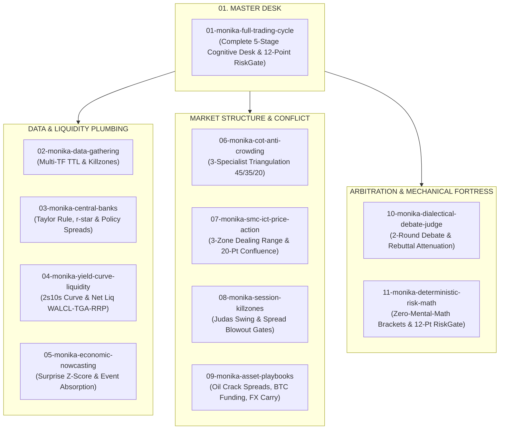

# Monika Institutional Skill Suite for AI Agents

> **Version**: 1.0.0 | **Author**: Monika Algorithmic Trading Desk | **Target Agents**: Claude Code, Google Antigravity, OpenAI Codex, Cursor, AutoGPT

[](https://python.org)
[-success.svg)]()
[]()
[]()

The **Monika Institutional Skill Suite** repackages the rigorous institutional trading intelligence of Monika—a full-stack algorithmic trading system—into **11 modular, self-contained skills** that any AI coding agent can discover, execute, and reason with.

---

> [!WARNING]
> **Mandatory Harness vs. Skill Architectural Disclaimer**
> *Monika is a full-stack algorithmic trading harness that in its production deployment integrates real-time MetaTrader 5 IPC pipes, 463 native Rust/NumPy quantitative factors, TimesFM 3.0 zero-shot neural forecasting, PostgreSQL ledger audits, and an MQL5 Expert Advisor with an automated dead-man's watchdog. Running Monika as a standalone AI agent skill faithfully replicates its cognitive architecture, prompt discipline, 2-round dialectical debate, and deterministic mathematical risk fortress, but will yield different execution behavior compared to the full autonomous live application.*

---

## 1. Quickstart: 60-Second Installation

The suite includes an automated zero-dependency installer (`install.py`) compatible with Windows, macOS, and Linux.

### Option A: Install for Claude Code (`~/.claude/skills/`)
```bash
# Install all 11 packages
python install.py --target claude --all

# Or install only the Master Full Trading Cycle
python install.py --target claude --package 01
```

### Option B: Install for Google Antigravity / Gemini CLI
```bash
# Auto-detects ~/.gemini/antigravity-cli/skills/
python install.py --target antigravity --all
```

### Option C: Install into Current Project Workspace (`.claude/skills/`)
```bash
python install.py --target project --path ./my-trading-project --all
```

### Option D: Manual Installation
Copy the desired package folder(s) directly into your agent's skill directory:
- **Claude Code**: `~/.claude/skills/<package-name>/`
- **Antigravity**: `~/.gemini/antigravity-cli/skills/<package-name>/`

---

## 2. The 11-Package Institutional Taxonomy

The suite offers a master orchestrator (Package 01) alongside 10 domain-specific specialist skills. Each skill includes an authoritative `SKILL.md` directive, zero-dependency Python calculation engines, and report templates.



### Package Catalog Summary

| # | Package Name | Focus & Domain | Standalone Engine |
|---|--------------|----------------|-------------------|
| **01** | `01-monika-full-trading-cycle` | **Master Institutional Desk**: Complete 5-stage workflow connecting telemetry $\to$ macro $\to$ SMC $\to$ debate $\to$ RiskGate. | `monika_quant_engine.py` (Master) |
| **02** | `02-monika-data-gathering` | **Telemetry & Timing**: Multi-timeframe TTL freshness verification, Rollover Blackout (`21:55-22:15 UTC`), session killzones. | `telemetry_validator.py` |
| **03** | `03-monika-central-banks-monetary-policy` | **Monetary Policy**: Central Bank reaction functions (Fed, ECB, BoE, BoJ, RBA), Taylor Rule gaps, r-star, and FX policy differentials. | `cb_differential_calc.py` |
| **04** | `04-monika-yield-curve-liquidity-plumbing` | **Macro Plumbing**: 2s10s yield curve regimes (Bull/Bear Steepener), TIPS breakeven inflation, and systemic banking net liquidity. | `macro_liquidity_calc.py` |
| **05** | `05-monika-economic-nowcasting-event-absorption` | **Event Absorption**: Pre-event pricing (FedWatch & COT), surprise z-scores, and high-impact volatility absorption boundaries. | `event_nowcast_calc.py` |
| **06** | `06-monika-cot-positioning-anti-crowding` | **Anti-Crowding & Positioning**: 3-specialist council (Tech 45%, Macro 35%, Contrarian Sent 20%) & 5 institutional synergy states. | `cot_synergy_calc.py` |
| **07** | `07-monika-smc-ict-price-action` | **SMC & Price Action**: 20-bar spatial dealing range position ($pos$), Fair Value Gaps (FVG), order blocks, and 20-point confluence scorecard. | `smc_confluence_calc.py` |
| **08** | `08-monika-session-killzones-microstructure` | **Session Microstructure**: Tokyo, London Open (Judas Swing), London-NY Overlap (+1 bonus), spread spike and order book skew. | `session_microstructure_calc.py` |
| **09** | `09-monika-commodities-crypto-carry-playbooks` | **Specialized Asset Playbooks**: Brent-WTI spread ($Z$-score), 3:2:1 crack spread, BTC funding rate & perpetual OI, and 4-factor FX carry scores. | `asset_special_calc.py` |
| **10** | `10-monika-dialectical-debate-judge` | **Dialectical Debate & Bayesian Judge**: 2-Round Bull vs Bear debate, Rebuttal Attenuation (-3.0 penalty for weak defenses), and anti-fence-sitting. | `debate_judge_calc.py` |
| **11** | `11-monika-deterministic-risk-math` | **Mechanical Risk Fortress**: Zero-arithmetic bracket generation, `Decimal` `ROUND_FLOOR` lot sizing, and 12-point `RiskGate` pre-execution audit. | `monika_quant_engine.py` (Risk) |

---

## 3. How to Use with AI Agents

Once installed, your AI agent automatically recognizes the skills. Simply prompt the agent using natural language:

### Example 1: Full Institutional Desk Analysis
```text
Analyze EURUSD multi-timeframe structure, macro policy differentials, and retail sentiment using the Monika Full Trading Cycle skill. Conduct a 2-round dialectical debate and audit the trade ticket through the 12-point RiskGate.
```

### Example 2: Specialized SMC & Dealing Range Evaluation
```text
Evaluate XAUUSD price action using the Monika SMC/ICT skill. Current price is 2650.00, 20-bar low is 2605.00, high is 2655.00, ATR is 25.00. Check dealing range position and anti-chasing limits.
```

### Example 3: Deterministic Risk & Lot Sizing
```text
Calculate position size and execution brackets for a BUY on GBPUSD with $25,000 equity, 1.0% risk, entry at 1.2950, and stop loss at 1.2900 using the Monika Deterministic Risk Math engine.
```

---

## 4. Institutional Standards & Mechanical Invariants

Unlike typical trading prompts that rely on hallucinated mental math or subjective opinions, Monika skills enforce **3 Non-Negotiable Core Invariants**:

1. **AI Proposes, Mechanical Fortress Disposes**:
   - The LLM reasons, debates, and proposes structured trade hypotheses.
   - The LLM **NEVER** calculates lot sizes or bracket prices via internal mental arithmetic.
   - All numbers must be produced by the included Python CLI engines using `decimal.Decimal` with strict `ROUND_FLOOR` rounding (rounding down never increases risk).
2. **Fail Closed, Never Fail Open**:
   - If market data, spread, equity, or economic event timestamps are missing, stale, or contradictory, execution is **strictly rejected (`HOLD`/`REJECT`)**.
3. **12-Point RiskGate Pre-Execution Audit**:
   Every order candidate is evaluated against 12 hard deterministic gates:
   1. Finite strictly positive inputs.
   2. Directional bracket ordering (`SL < Entry < TP` for Buy; `TP < Entry < SL` for Sell).
   3. Noise floor stop distance ($1.25\times\text{ATR}$ FX, $1.35\times\text{ATR}$ High-Vol).
   4. Maximum stop loss cap ($3.0\times\text{ATR}$ and $\le 1.0\times\text{ADR}$).
   5. Minimum Risk-to-Reward ratio $\ge 1.50$.
   6. Dealing range spatial position & anti-chasing ($pos \le 0.85$ for Buy; $pos \ge 0.15$ for Sell).
   7. Daily drawdown circuit breaker ($\le 3.0\%$).
   8. Spread expansion ratio ($\le 2.0\times$ typical spread).
   9. Rollover blackout window exclusion (`21:55-22:15 UTC`).
   10. Tier-1 high-impact news event window exclusion ($\le 15$ mins).
   11. Systemic financial crisis veto (`VIX > 30` or `HY OAS > 450 bps`).
   12. Data freshness (TTL) and broker volume step quantization.

---

## 5. Technical Specifications

- **Python Version**: Python 3.10, 3.11, 3.12, 3.13, 3.14+
- **External Dependencies**: **Zero (0)**. Pure Python Standard Library (`math`, `decimal`, `datetime`, `json`, `argparse`, `pathlib`).
- **Platform Support**: Windows (PowerShell / Command Prompt), macOS (Zsh / Bash), Linux (Bash).

---

## 6. Packaging & Distribution

To create release distribution archives (`.zip`) for marketplaces or external sharing:
```bash
python package_dist.py
```
This generates:
- `dist/monika-skills-suite-v1.0.0-full.zip` (complete 11-package bundle)
- `dist/<package-name>-v1.0.0.zip` (11 individual modular zips)
- `dist/SHA256SUMS.txt` (SHA-256 cryptographic integrity hashes)

---

## 7. License & Credits

Developed by the **Monika Algorithmic Trading Team**. Built for professional algorithmic traders, quantitative analysts, and AI engineer agents.
Licensed under the Apache-2.0 License.
