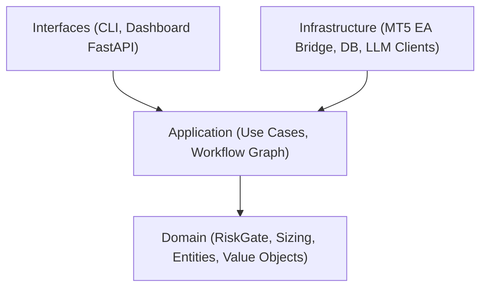

# Monika Elephant — Repository Architectural Context

This skill equips the **Elephant** session (and relevant subagents) with deep institutional knowledge of the **Monika** algorithmic trading system, ensuring that any proposed design specification aligns with established safety, risk, and architectural invariants.

---

## 1. System Mission & Core Philosophy

Monika is a quantitative algorithmic trading platform interfacing with live and simulated financial markets.
* **Core Rule**: **AI proposes, the Mechanical Fortress disposes.** LLMs hypothesize setups and generate structured trade plans, but LLMs **never** execute trades or access broker sockets directly.
* **Deterministic Risk Gate**: Every trade proposal must pass the deterministic `RiskGate` ([`src/monika/domain/risk/risk_gate.py`](file:///D:/Monika/src/monika/domain/risk/risk_gate.py)) before touching an execution adapter.
* **Fail-Closed Principle**: In risk, sizing, and order pathways, any missing, stale, negative, or invalid data **must reject or hold the trade**—never fail open.

---

## 2. Architectural Blueprint

The codebase strictly adheres to **Clean Architecture** (enforced by `.importlinter`):

### Layer Responsibilities:
1. **Domain (`src/monika/domain/`)**:
   - Pure business logic, zero external dependencies or framework imports.
   - Core modules: `risk/risk_gate.py`, `risk/position_sizing.py`, `market/`, `execution/`.
   - Financial precision: All monetary values must use `Decimal(str(x))`. Volume must be rounded down to symbol step constraints.
2. **Application (`src/monika/application/`)**:
   - Orchestrates use cases, state workflows, trade lifecycle, and event publishing.
   - Houses the multi-agent graph coordinator and execution dispatchers.
3. **Infrastructure (`src/monika/infrastructure/`)**:
   - Concrete implementations: MetaTrader 5 EA Bridge socket protocol (`ea_bridge/`), PostgreSQL database repositories (`database/`), Telegram alerting (`notifications/`), and LLM provider adapters.
4. **Interfaces (`src/monika/interfaces/`)**:
   - Operator CLI (`src/monika/interfaces/cli/`) and FastAPI web dashboard (`src/monika/interfaces/dashboard/`).

---

## 3. Critical Invariants for Design Specifications

When drafting a new specification (`docs/designs/<feature>.md`) via EGM:
1. **Paper Trading Safety**: Ensure new features default to paper trading (`paper_trading.enabled = true`). Live trade activation requires explicit operator confirmation.
2. **Precision & Rounding**: Reject float arithmetic for money. Enforce `Decimal` and down-rounding for lot sizes.
3. **Time Awareness**: All datetime instances must be timezone-aware UTC (`datetime.now(UTC)`). Naive datetimes are forbidden.
4. **Concurrency Hygiene**: Coroutines in `async def` must not make blocking calls (`time.sleep` or synchronous socket I/O). Always set explicit timeouts on network/broker calls.
5. **No Look-Ahead in Backtests**: Analytics and indicators at bar $t$ must only use information available at the close of $t$.
6. **Authoritative Spec Alignment**: Verify alignment with [`PRD.md`](file:///D:/Monika/PRD.md) and [`AGENTS.md`](file:///D:/Monika/AGENTS.md). Any change altering a system contract must be explicitly documented in both the design doc and `PRD.md`.

---

## 4. Codebase Navigation Cheatsheet

* System Specification: [`PRD.md`](file:///D:/Monika/PRD.md)
* Agent Directives & Quality Gates: [`AGENTS.md`](file:///D:/Monika/AGENTS.md)
* Full Python AST Index: [`INDEX.md`](file:///D:/Monika/INDEX.md)
* File Catalog: [`STRUCTURE.md`](file:///D:/Monika/STRUCTURE.md)
* Design Documents Index: [`docs/designs/SITEMAP.md`](file:///D:/Monika/docs/designs/SITEMAP.md)
